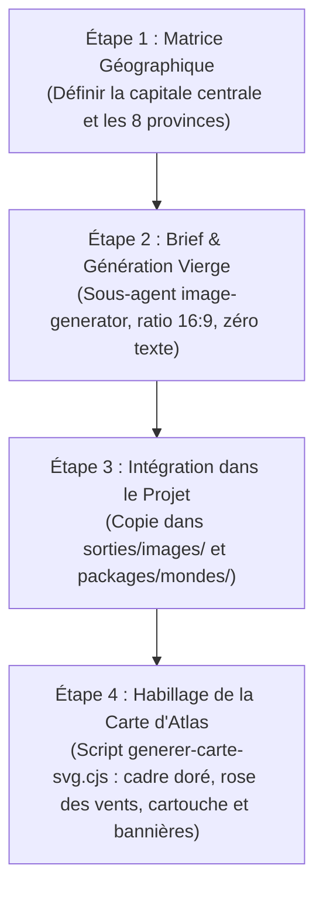

# Créer la Carte du Monde Continentale (Grand Atlas RPG)

Une carte du monde de grand RPG ne doit jamais être confondue avec une carte tactique ou une maquette locale de château. Pour un monde modulaire conçu pour accueillir **8 grandes régions et 60 à 75 sous-régions**, la carte doit être une **véritable Carte d'Atlas Continental (Macro-Échelle)** comme les cartes officielles de **Tamriel** (*The Elder Scrolls*), de **Faerûn** (*D&D / Baldur's Gate*) ou de **Thedas** (*Dragon Age*).

Ce skill formalise le processus complet en **4 étapes standardisées** pour garantir que tous les futurs mondes du projet partagent exactement la même identité visuelle, la même échelle et les mêmes gabarits techniques.

---

## 1. Les Deux Versions Obligatoires de la Carte

Pour chaque monde, le skill produit systématiquement **deux déclinaisons** :

| Version | Fichier cible | Rôle & Spécificités |
| :--- | :--- | :--- |
| **1. Carte Vierge Moteur** | `carte-monde-<id>.jpg` (ou `.png` / `.webp`) | **100 % épurée de texte** : aucun label, aucune lettre, aucune bordure ni interface. C'est l'illustration de fond sur laquelle le moteur de jeu (`CarteMonde.tsx`) superpose le brouillard de guerre dynamique et les marqueurs interactifs cliquables (`position: { x, y }`). |
| **2. Carte d'Atlas Légendée** | `carte-atlas-legendee.<jpg/svg>` | **Version officielle de prestige / encyclopédie** : bordure ornementale d'atlas en laiton et or ciselé, rose des vents dans l'océan, grand cartouche royal du titre en haut, bannière de la capitale au centre et bannières des 8 provinces. |

---

## 2. Le Canon Stylistique Obligatoire (Le Prompt de Référence)

Chaque génération de carte continentale doit impérativement respecter la structure suivante :

```text
Dark fantasy digital painting, grand fantasy world atlas cartography, macro continental scale (inspired by Tamriel, Faerûn and Thedas official world maps).
Full continental bird's-eye high-altitude view showing the ENTIRE landmass surrounded by expansive deep ocean with realistic waves, foam and rocky coastlines.
Rich painterly rendering with visible terrain topography: shaded mountain ranges, sprawling dense forest masses, navigable river networks flowing into central lakes and ocean deltas.
Atmospheric dramatic lighting under an overcast storm sky with soft sunrays breaking through clouds, muted earthy palette with rich contrasting regional biomes (polar ice sheet, dark volcanic basalt, golden plains, limestone chalk canyons, emerald rainforest, shimmering mercury/silver waters).
STRICTLY NO modern UI, NO text, NO letters, NO labels, NO borders, NO giant characters in foreground.
```

### La Palette de Couleurs Standard
- **Océan & Côtes** : Bleu ardoise profond, bleu nuit, écume blanche, turquoise des hauts-fonds.
- **Terre & Reliefs** : Gris pierre, ocre terreux, vert mousse et émeraude profond, blanc calcaire, ivoire fossile.
- **Biomes Extrêmes** : Blanc de givre et violet boréal (Nord glacé), noir basalte et rouge lave incandescent (Volcans), or impérial et jaune blé (Plaines).
- **Ornements (Atlas)** : Dégradé or royal (`#fff2be` vers `#b88b14` et `#705203`), laiton patiné, fond noir obsidienne.

---

## 3. Les 4 Étape du Processus de Création



### Étape 1 : Définir la Matrice Géographique du Continent
Avant toute génération, formaliser la topographie dans un document de travail (la Bible du Monde) :
1. **La Capitale Impériale (Position `{ x: 50, y: 50 }`)** :
   - Placée obligatoirement au **cœur géographique du continent**, au carrefour des fleuves majeurs et près d'un grand lac intérieur.
   - Son repère visuel unique (ex: les arches colossales d'ivoire de Sol-Invictus, une citadelle circulaire fortifiée à triple enceinte).
2. **Les 8 Provinces Périphériques** :
   - Délimiter clairement chaque région par des barrières naturelles (chaînes de montagnes infranchissables, golfes profonds, grands fleuves ou déserts).
   - Assigner un biome contrasté à chaque point cardinal (Nord glacé, Sud-Est volcanique, Est sylvestre, Sud crayeux/désertique, etc.).

### Étape 2 : Générer l'Illustration Vierge (Grand Atlas)
Invoquer le sous-agent `image-generator` avec le gabarit de prompt :
- **Rôle** : `Grand RPG World Cartographer`
- **Format** : Paysage (`16:9` ou `3:2`).
- **Contrainte absolue** : Zéro texte, zéro lettre, zéro personnage géant, pleine masse continentale entourée d'eau.

### Étape 3 : Sauvegarde et Déploiement dans le Moteur
Dès la fin de la génération, copier et indexer l'image :
1. `crpg-llm/sorties/images/mondes/<id>/carte-atlas-continentale.jpg` (et `.png`)
2. `crpg-llm/sorties/images/mondes/<id>/carte-monde-<id>.json` (fiche de métadonnées)
3. `crpg-llm/packages/mondes/<id>/images/carte-monde-<id>.jpg` (pour le chargement dans `CarteMonde.tsx`)

### Étape 4 : Générer la Version Légendée avec Cadre & Bannières
Exécuter le générateur vectoriel d'atlas (`generer-carte-svg.cjs`) ou composer la version ornée :
- **Cadre extérieur** : Double filet or ciselé avec coins découpés et médaillons dorés.
- **Rose des vents** : Positionnée dans un coin d'océan dégagé (généralement en bas à gauche), à 8 ou 16 pointes, aux couleurs or et ivoire.
- **Grand Cartouche de Titre (Haut Centre)** : Pavillon royal avec le nom du Monde en lettres majuscules d'or (`font-family: Georgia, 'Cinzel', serif`), sous-titré par le thème.
- **Bannière de la Capitale** : Marqueur lumineux doré central `{ x: 50%, y: 47% }` avec cartouche noir et or.
- **8 Bannières Régionales** : Cartouches discrets semi-transparents placés au centre de chaque province avec bordure colorée rappelant le biome (bleu ciel pour le gel, rouge pour le feu, vert pour la forêt, blanc pour la craie, etc.).

---

## 4. Checklist de Validation Qualité

Avant de valider la carte d'un nouveau monde, vérifier les critères suivants :

- [ ] **Échelle Macro respectée** : L'image montre le continent entier entouré d'océan, et non un zoom local sur une ville ou une colline.
- [ ] **Espace pour 60+ sous-régions** : Les 8 provinces sont assez vastes pour qu'on y imagine aisément des dizaines de vallées, villages, grottes et donjons.
- [ ] **Position de la Capitale** : La capitale est bien visible au centre, au nœud du réseau hydrographique et des routes impériales.
- [ ] **Absence de texte sur la version moteur** : L'image brute est 100 % vierge de tout caractère typographique.
- [ ] **Cohérence de la version légendée** : L'orthographe française de chaque région est irréprochable et positionnée sur son biome respectif.
- [ ] **Formats générés** : La carte est disponible en haute résolution aux formats `.jpg`, `.png`, `.svg` et prête pour les composants React du jeu.
