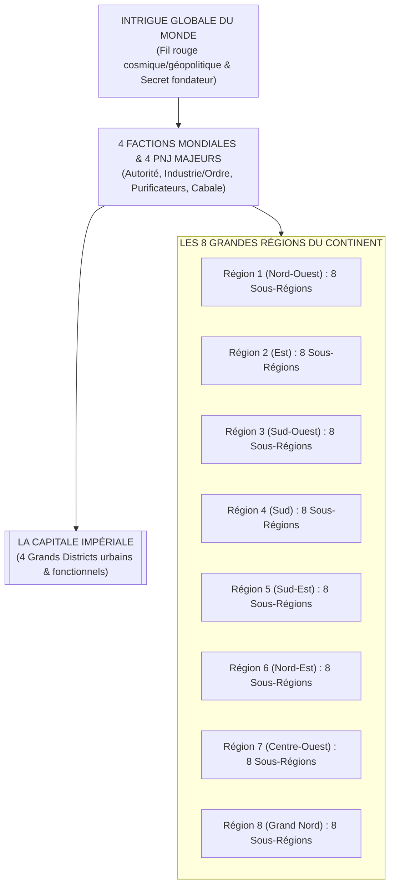

# Créer la Grande Bible d'un Monde Modulaire (Grand Monde D&D 5e)

Ce skill formalise la méthodologie complète pour bâtir l'architecture d'un **monde-continent modulaire** capable d'accueillir entre **60 et 75 modules d'aventures indépendants**, interconnectés par une intrigue globale forte, sans écrire de code de règles, directement sous forme d'une **Grande Bible de Monde** (`packages/mondes/<id>/BIBLE.md`) et de son descripteur racine (`monde.json`).

---

## 1. La Structure Standardisée d'un Grand Monde

Chaque monde créé avec ce skill doit impérativement respecter ce canevas architectural :

---

## 2. Les 5 Sections Obligatoires de la Bible (`BIBLE.md`)

### Section 1 : Genèse, Cosmologie & Singularité du Monde
- **L'Événement Fondateur** (ex: la Nuit des Sept Lances, la Grande Décrue, le Silence du Trône).
- **La Ressource / Matière Singulière** (ex: l'Ichor divin, le Miasme d'Éther, les Sceaux draconiques) : son rôle économique, son pouvoir magique et son prix biologique/moral (la malédiction ou mutation qu'elle engendre).
- **Le Panthéon ou les Forces Primordiales** associées à chacune des 8 régions.

### Section 2 : L'Intrigue Globale & les Factions Mondiales
- **Le Fil Rouge Mondial** : La crise cosmique ou politique imminente (ex: Le Réveil des Carcasses, l'Extinction des Phares).
- **Les 4 Factions Mondiales** :
  1. *L'Autorité Régnante* (Empire, Régence, Sénat) ;
  2. *La Puissance Économique / Savante* (Consortium, Guildes, Mages) ;
  3. *L'Ordre Fanatique / Purificateur* (Inquisition, Pénitents, Druides de rupture) ;
  4. *La Cabale Occulte Conspiratrice* (L'ennemi dans l'ombre préparant l'apocalypse).
- **Les 4 PNJ Majeurs du Monde** : Profil narratif, alignement moral et objectifs profonds.

### Section 3 : La Capitale Impériale (4 Grands Districts)
La capitale doit être le miroir du monde et compter **4 districts distincts** :
- **District 1 (Haute-Ville / Pouvoir)** : Siège du gouvernement, sénat, basiliques impériales.
- **District 2 (Quartier Arcanique / Industriel)** : Fonderies, guildes d'artifice, académies.
- **District 3 (Ville-Basse / Bas-fonds)** : Pègre, arènes, marché noir, puits de la ressource.
- **District 4 (Port fluvial ou maritime / Diplomatie)** : Docks, ambassades des 8 régions, zone de quarantaine.
*Chaque district a ses lieux clés, son intrigue locale propre et son bestiaire spécifique.*

### Section 4 : Les 8 Grandes Régions & leurs 64 Sous-Régions
Chaque Région comprend :
- Son entité tutélaire / origine mythologique ;
- Son **intrigue régionale autonome** (qui peut être résolue indépendamment de la trame mondiale) ;
- Ses **2 PNJ majeurs régionaux** ;
- Ses **8 Sous-Régions détaillées** avec pour chacune :
  1. *Lieux clés* : 1 village/bourg principal, 1 grotte/gouffre, 1 temple/sanctuaire, 1 lieu mythique ou ruine remarquable.
  2. *Histoire / Conflit local* : Un pitch d'aventure immédiat de 3 à 5 phrases (sans dérouler les quêtes pas-à-pas).
  3. *Bestiaire mobilisé* : Liste précise des créatures du **SRD D&D 5e** (`packages/donnees/srd/monstres/`).

### Section 5 : Matrice des Connexions & Bestiaire Exhaustif
- Diagramme mermaid des connexions terrestres et fluviales entre les régions et la capitale.
- Tableau récapitulatif des 68 modules (4 districts + 64 sous-régions) et des boss régionaux.
- Répartition par paliers de puissance : FP 0–2 (Sbires), FP 3–8 (Élite), FP 9–30 (Boss régionaux & Mythiques).

---

## 3. Checklist de Cohérence & Validation

- [ ] La Bible est enregistrée dans `packages/mondes/<id>/BIBLE.md`.
- [ ] Le descripteur `packages/mondes/<id>/monde.json` est rédigé et conforme au schéma Zod `Monde`.
- [ ] Les 8 régions possèdent exactement 8 sous-régions chacune (soit 64 sous-régions au total).
- [ ] Aucun monstre inventé : tous les monstres cités existent dans `packages/donnees/srd/monstres/`.
- [ ] Chaque région propose une intrigue forte connectable à l'atlas visuel via le skill `creer-atlas-visuel`.
