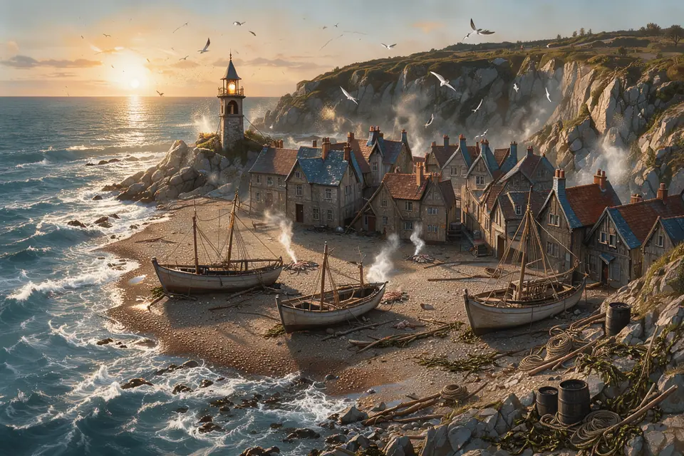
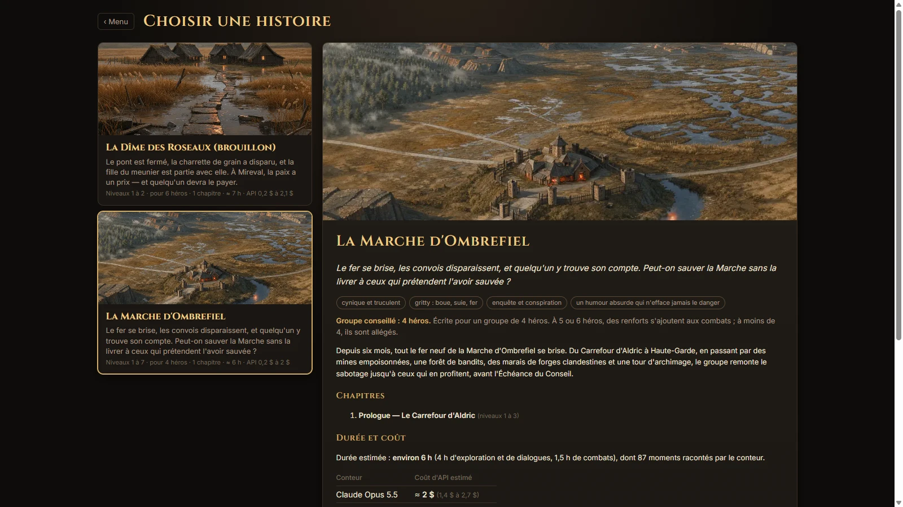
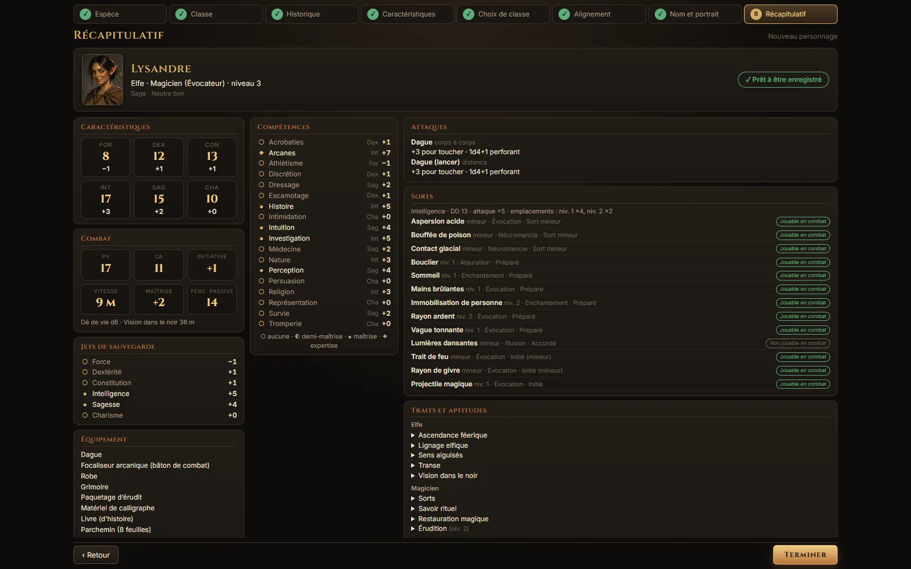
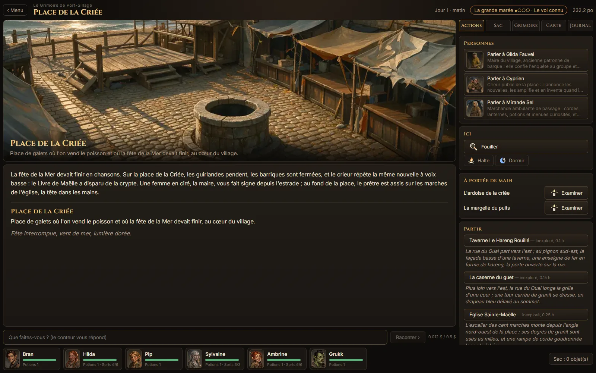
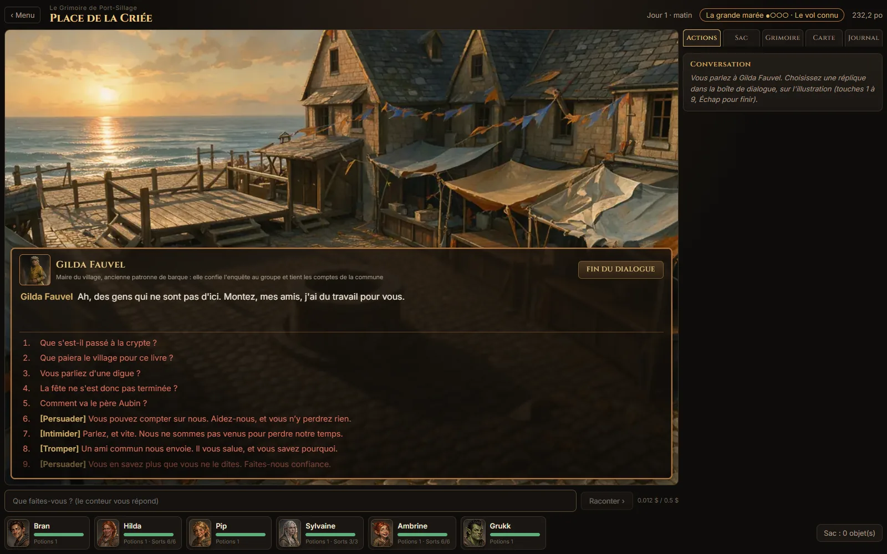
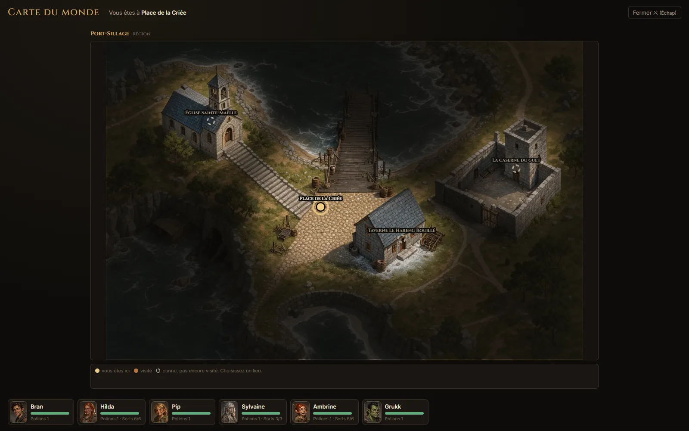
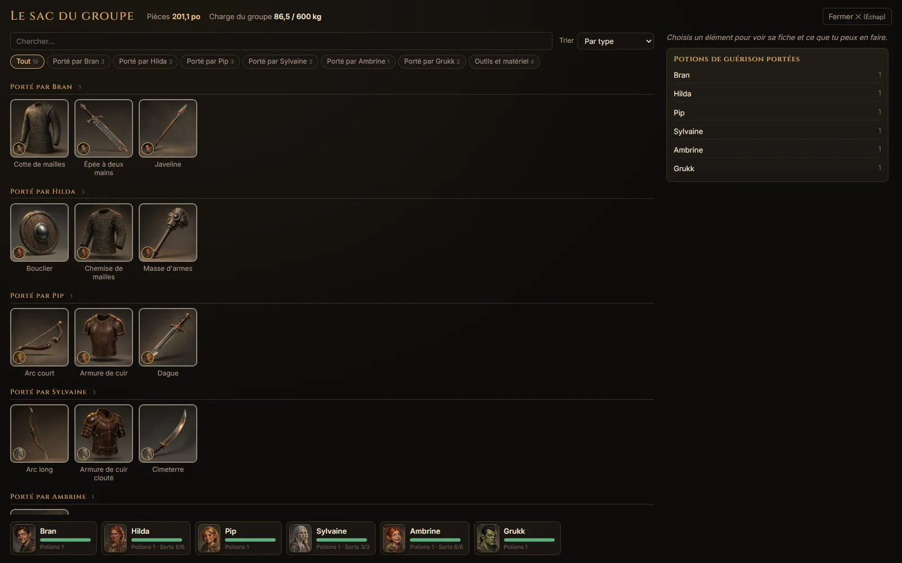
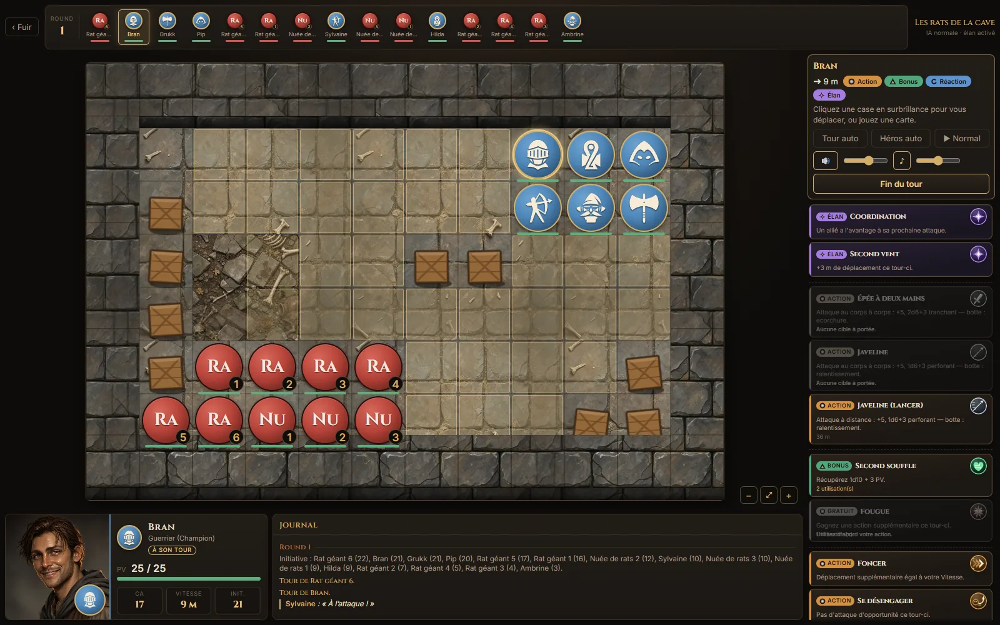
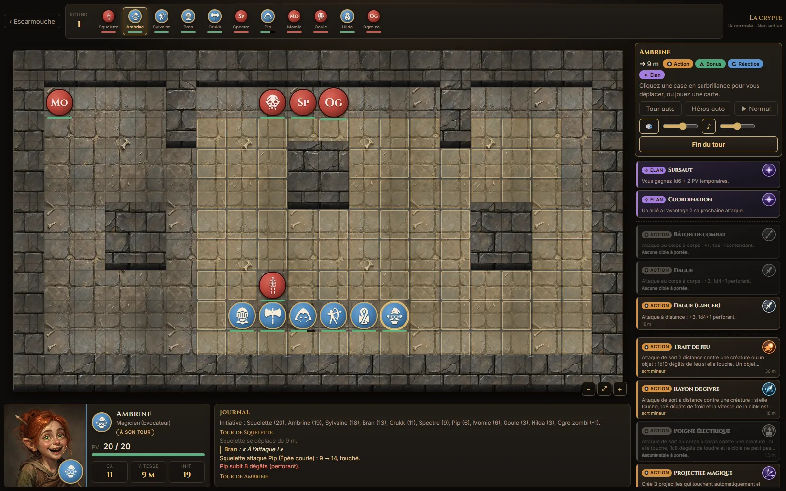

<p align="center">
  
</p>

<h1 align="center">La Table du Conteur</h1>

<p align="center">
  <em>Un livre dont vous êtes le héros, avec toute la mécanique de Donjons &amp; Dragons.</em>
</p>

<p align="center">
  
  
  
  
  
</p>

La Table du Conteur est un jeu de rôle narratif illustré, en français, sur les règles du SRD 5.2.1 (Donjons & Dragons 5e, règles libres). On lit la scène, on voit le lieu, puis on choisit : parler, fouiller, négocier, fuir ou combattre. De 1 à 6 héros créés par le joueur, des histoires complètes, un combat de cartes tactique sur grille et un « conteur » animé par une IA.

**Le principe : le conteur propose, le jeu décide.** Les règles, les dés, les combats, les trésors et les conséquences sont du code déterministe et testé ; l'IA raconte et joue les personnages, mais ne modifie jamais l'état du jeu.

> Jeu indépendant, fondé sur le SRD 5.2.1 de Wizards of the Coast. Ce n'est pas un produit officiel de Donjons & Dragons.
>
> Créé de bout en bout par Claude (Anthropic), sous la direction de son auteur.

**Sommaire** : [Le jeu en images](#le-jeu-en-images) · [Ce que le jeu permet](#ce-que-le-jeu-permet) · [Les histoires](#les-histoires) · [Démarrer](#démarrer) · [Le dépôt](#le-dépôt) · [Crédits](#crédits) · [Licence](#licence)

## Le jeu en images

<table>
  <tr>
    <td width="50%"><br><sub><b>Choisir une histoire</b> : durée estimée et coût d'API affichés avant de commencer.</sub></td>
    <td width="50%"><br><sub><b>Créer son héros</b> : 8 écrans, 12 classes jusqu'au niveau 20, 339 sorts, une fiche validée par le jeu.</sub></td>
  </tr>
  <tr>
    <td><br><sub><b>Explorer</b> : lieux illustrés, personnages à qui parler, fouille, sorties expliquées, jauge qui rend le temps précieux.</sub></td>
    <td><br><sub><b>Parler, convaincre, mentir</b> : réponses cliquables et approches avec jet de compétence.</sub></td>
  </tr>
  <tr>
    <td><br><sub><b>Carte du monde</b> avec brouillard : les lieux se dévoilent au fil des pas.</sub></td>
    <td><br><sub><b>Inventaire du groupe</b> : objets illustrés, rangés par héros, recherche, tri et filtres.</sub></td>
  </tr>
  <tr>
    <td><br><sub><b>Combat de cartes</b> sur grille : initiative, action, action bonus, réaction.</sub></td>
    <td><br><sub><b>Sorts et aptitudes</b> jouables en combat, contre des monstres qui réfléchissent.</sub></td>
  </tr>
</table>

## Ce que le jeu permet

- **Créer son groupe** : de 1 à 6 héros parmi 9 espèces, 12 classes (niveau 1 à 20), 4 historiques, 17 dons, 54 portraits ; groupe conseillé, export et import ; les combats des histoires s'adaptent au nombre de héros.
- **Vivre des histoires complètes** : film d'ouverture avec voix, scènes narrées, quêtes, énigmes, pièges, dilemmes aux coûts annoncés, plusieurs fins dont aucune n'est entièrement heureuse.
- **Explorer** : fouiller, ouvrir, crocheter, désamorcer, examiner un détail du décor, faire une halte, dormir ; carte du monde, journal, inventaire, grimoire, boutiques.
- **Parler** : dialogues par sujets, confiance des personnages, secrets qui se gagnent par un jet, un prix ou une preuve, compagnons de voyage.
- **Combattre** : règles de la 5e (attaques d'opportunité, avantage, concentration, états…), cartes qui sont de vraies options de jeu, « deck d'élan », terrains et couvert, monstres qui simulent leurs coups, ont du moral et ne trichent jamais.
- **Entendre et voir** : images peintes pour chaque lieu, personnage, objet et monstre (329 monstres du SRD illustrés), voix du conteur, musiques et bruitages.
- **Jouer sans payer** : le « mode livre » fonctionne sans clé d'API ; le conteur IA (saisie libre, vraies conversations) utilise la clé du joueur.

## Les histoires

| Histoire | Niveaux | Durée | En deux mots |
| --- | --- | --- | --- |
| **Le Val des Cendres** | 1 à 5 | environ 30 h | Un village de réfugiés autour d'une Lanterne qui faiblit sous la neige |
| **La Citadelle des Marées** | 1 à 4 | environ 16 h | Un monastère de cartographes et une marée qui s'éloigne trop |
| **Le Grimoire de Port-Sillage** | 1 à 3 | environ 6 h | Le grimoire d'une sainte a disparu de la crypte pendant la fête de la Mer (histoire facile pour 4 héros) |

Le format des mondes est décrit dans [`docs/MONDES.md`](docs/MONDES.md).

## Démarrer

Prérequis : Node.js 22 ou plus, [pnpm](https://pnpm.io).

```bash
pnpm install
pnpm test          # moteur, données du SRD et mondes
pnpm typecheck
pnpm jeu           # le jeu sur http://localhost:5173
pnpm monde valider # valide les mondes (références, quêtes, énigmes)
```

Le jeu fonctionne sans clé d'API en « mode livre » : textes des auteurs et boutons proposés. Le conteur IA utilise la clé OpenRouter du joueur (voir `.env.example` : copiez-le en `.env`, qui est ignoré par git). Ne publiez jamais une clé.

## Le dépôt

| Dossier | Contenu |
| --- | --- |
| `packages/regles` | Moteur de règles en TypeScript pur : fiches de personnage, création, combat de cartes et IA des monstres, exploration, dialogues, quêtes, énigmes |
| `packages/donnees` | Données du SRD 5.2.1 en français (12 classes jusqu'au niveau 20, 9 espèces, 339 sorts, 329 monstres, 502 objets) et charte visuelle |
| `packages/mondes` | Les histoires jouables, un dossier de données par monde (lieux, personnages, rencontres, énigmes, quêtes, fins, images, voix) |
| `apps/jeu` | Le jeu : client web (Vite + React) |
| `apps/atelier` | Atelier d'auteur : vérification des mondes (santé, graphes, parcours) |
| `apps/bureau` | Coquille de bureau (Tauri) |
| `outils` | Scripts en ligne de commande : validation des mondes, simulation d'équilibre, images, voix, sons, musique |
| `site` | Page de présentation du jeu (statique, prête à déployer) |
| `docs` | Conception : vision, combat, création, format des mondes, architecture |

## Crédits

Cette œuvre inclut du matériel issu du System Reference Document 5.2.1 (« SRD 5.2.1 ») de Wizards of the Coast LLC, disponible à l'adresse https://www.dndbeyond.com/srd. Le SRD 5.2.1 est régi par la Licence Creative Commons Attribution 4.0 International, disponible à l'adresse https://creativecommons.org/licenses/by/4.0/legalcode.

Autres crédits : pictogrammes de [game-icons.net](https://game-icons.net) (CC BY 3.0, voir `apps/jeu/src/icones/CREDITS.md`), deux bruitages de Kenney (CC0, voir `apps/jeu/src/sons/CREDITS.md`).

## Licence

- **Code source** : licence MIT (fichier `LICENSE`), Copyright (c) 2026 Sébastien Hanoteaux.
- **Contenus du jeu** (histoires, images, voix, musiques, bruitages, textes du site) : tous droits réservés, sauf les éléments sous licence libre listés dans `LICENSE-CONTENU.md` (SRD 5.2.1 sous CC BY 4.0, pictogrammes sous CC BY 3.0, deux bruitages sous CC0). Ils ne peuvent pas être réutilisés sans l'accord de l'auteur.
