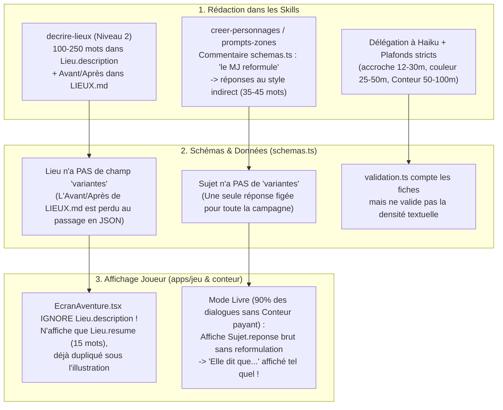

# Audit & Plan d'Amélioration : Moteur de Création d'Histoire & Pipeline Narratif

> **Contexte & Rôle** : Concepteur de scénarios, Narrative Designer Senior & Architecte Moteur JDR / D&D 5e.  
> **Cible** : Pipeline de génération multi-agents (`.claude/skills/`), schémas et validation (`packages/regles/src/monde/`), moteur du conteur (`packages/regles/src/conteur/`), et interface de jeu (`apps/jeu/src/aventure/`).  
> **Objectifs** :
> 1. Débloquer la profondeur littéraire, sensorielle et dramatique (descriptions de lieux immersives, dialogues incarnés à la première personne, réactivité « Avant / Après ») pour captiver le joueur dans un RPG textuel.
> 2. Verrouiller la cohérence absolue avec la quête principale (zéro fuite de secrets, mémoire longue des faits majeurs pour le Conteur, robustesse des déclencheurs de quêtes face aux parcours libres).

---

## Sommaire

1. [Diagnostic : Pourquoi le joueur manque de texte et de profondeur](#partie-1--diagnostic--pourquoi-le-joueur-manque-de-texte-et-de-profondeur)
2. [Diagnostic : Les failles de cohérence de l'histoire principale](#partie-2--diagnostic--les-failles-de-cohérence-de-lhistoire-principale)
3. [Plan d'Amélioration en 4 Chantiers](#partie-3--plan-damélioration-en-4-chantiers)
   - [Chantier 1 : Lieux vivants, récit d'arrivée riche & évolution Avant/Après](#chantier-1--lieux-vivants-récit-darrivée-riche--évolution-avant--après)
   - [Chantier 2 : Dialogues incarnés, multi-tours et évolutifs](#chantier-2--dialogues-incarnés-multi-tours-et-évolutifs)
   - [Chantier 3 : Verrouillage de la cohérence de l'intrigue (Moteur & Revue)](#chantier-3--verrouillage-de-la-cohérence-de-lintrigue-moteur--revue)
   - [Chantier 4 : Refonte des Skills de Création d'Histoires](#chantier-4--refonte-des-skills-de-création-dhistoires)
4. [Matrice des Fichiers et Actions Concrètes](#partie-4--matrice-des-fichiers-et-actions-concrètes)

---

## Partie 1 — Diagnostic : Pourquoi le joueur manque de texte et de profondeur

L'analyse croisée des compétences de génération (`.claude/skills/`), des types TypeScript (`packages/regles/src/monde/schemas.ts`) et de l'interface graphique (`apps/jeu/src/aventure/EcranAventure.tsx`) met en évidence **4 freins structurels** :



### 1.1. Le chaînon manquant des Lieux : `Lieu.description` est rédigé mais jamais affiché au joueur
- **Dans les skills de création** : Le skill [`decrire-lieux/SKILL.md`](file:///c:/Users/sebas/Documents/GitHub/D&D/crpg-llm/.claude/skills/decrire-lieux/SKILL.md) et son guide [`brief-agent-lieu.md`](file:///c:/Users/sebas/Documents/GitHub/D&D/crpg-llm/.claude/skills/decrire-lieux/references/brief-agent-lieu.md) demandent explicitement aux agents de rédiger une description évocatrice de **100 à 250 mots** dans `Lieu.description` (vue par les PJ, zéro secret du MJ), ainsi qu'un `Lieu.resume` condensé de **12 à 18 mots**.
- **Dans l'interface de jeu** : Dans [`EcranAventure.tsx`](file:///c:/Users/sebas/Documents/GitHub/D&D/crpg-llm/apps/jeu/src/aventure/EcranAventure.tsx#L402-L405) et la fonction [`construireBlocs`](file:///c:/Users/sebas/Documents/GitHub/D&D/crpg-llm/apps/jeu/src/aventure/EcranAventure.tsx#L645-L656), lors de l'arrivée dans une salle (`arrivee` ou `deplacement`), **le jeu n'affiche jamais `Lieu.description`** ! Il n'affiche que `l.resume` (15 mots), qui est en plus déjà dupliqué juste au-dessus comme légende sous l'image générée ([ligne 527](file:///c:/Users/sebas/Documents/GitHub/D&D/crpg-llm/apps/jeu/src/aventure/EcranAventure.tsx#L527)).
- **L'explication historique** : Dans [`docs/M4-CONTEUR.md`](file:///c:/Users/sebas/Documents/GitHub/D&D/crpg-llm/docs/M4-CONTEUR.md#L98-L102), il était prévu un sous-chantier **`M4b' — Textes du joueur`** car à l'origine, les premières campagnes contenaient des notes de secrets de MJ dans `Lieu.description`. Même si les skills modernes ont isolé les secrets dans l'Atlas (`Secret du MJ`), le branchement `M4b'` dans l'interface React n'a jamais été finalisé.
- **L'oubli de l'Avant / Après** : L'Atlas `LIEUX.md` demande de concevoir l'évolution du lieu avant et après la résolution de la crise. Mais le schéma TypeScript [`Lieu`](file:///c:/Users/sebas/Documents/GitHub/D&D/crpg-llm/packages/regles/src/monde/schemas.ts#L168-L196) ne comporte **aucun champ `variantes`** conditionné (contrairement à `Examen` ou `Salutations`). Les lieux restent donc textuellement statiques.

### 1.2. Des répliques de PNJ sèches, figées et piégées dans le style indirect
- **Le commentaire trompeur dans `schemas.ts`** :
  ```typescript
  // packages/regles/src/monde/schemas.ts (ligne 299)
  reponse: string; // Ce que le PNJ dit ou fait savoir (le MJ le reformule dans la voix du PNJ)
  ```
- **L'effet en jeu** : Le jeu fonctionne principalement en « Mode Livre » (choix de sujets prédéfinis sans appel API Conteur). [`EcranAventure.tsx`](file:///c:/Users/sebas/Documents/GitHub/D&D/crpg-llm/apps/jeu/src/aventure/EcranAventure.tsx#L658) injecte directement `e.reponse` à côté du nom de l'interlocuteur. Résultat : dans de nombreuses zones (comme `citadelle-des-marees`, voir [`z1-citadelle.json`](file:///c:/Users/sebas/Documents/GitHub/D&D/crpg-llm/packages/regles/tests/fixtures/mondes/citadelle-des-marees/pnj/z1-citadelle.json#L71-L115)), les agents écrivent des résumés froids à la 3e personne :
  > *« Ysmène Hautecôte : Elle dit que la mer s'est retirée depuis trois jours et que le port est bloqué. Elle demande au groupe de monter au donjon. »* (34 mots).
- **Absence de variantes de dialogue** : `Sujet` n'a pas de champ `variantes`. Un PNJ interrogé sur le même sujet au chapitre 1 et au chapitre 3 répète exactement la même réplique mot pour mot, détruisant l'impression de monde vivant.

### 1.3. Contraintes de concision disproportionnées & sous-traitance à Haiku
- Les documents de référence ([`guide-style-textes-courts.md`](file:///c:/Users/sebas/Documents/GitHub/D&D/crpg-llm/.claude/skills/creer-monde/references/guide-style-textes-courts.md), [`prompts-zones.md`](file:///c:/Users/sebas/Documents/GitHub/D&D/crpg-llm/.claude/skills/creer-monde/references/prompts-zones.md)) imposent des limites très serrées : `accroche` (12–30 mots), `passage` (12–30 mots), `couleur` (25–50 mots), `rencontre.intro` (2–4 phrases), Conteur en jeu (50–100 mots).
- La génération du JSON final est massivement confiée à des sous-agents Haiku, dont la prose tend vers le résumé factuel.
- Parallèlement, [`validerMonde`](file:///c:/Users/sebas/Documents/GitHub/D&D/crpg-llm/packages/regles/src/monde/validation.ts) contrôle le nombre d'éléments mais ne pose aucun avertissement sur une réplique au style indirect ou un texte de 10 mots.

---

## Partie 2 — Diagnostic : Les failles de cohérence de l'histoire principale

Même si le moteur dispose d'outils solides (`BIBLE.md §7`, `canon.json`, `parcours.ts`), **4 failles majeures** nuisent à la continuité de la trame narrative :

### 2.1. L'amnésie de la quête principale dans le Conteur (`contexte.ts`)
- Dans [`ficheDeTour`](file:///c:/Users/sebas/Documents/GitHub/D&D/crpg-llm/packages/regles/src/conteur/contexte.ts#L209-L216) :
  ```typescript
  for (const id of faits.slice(0, 12)) {
    const f = dm.faits.get(id);
    if (f) lignes.push(`- ${f.nom} : ${f.description}`);
  }
  ```
- **Conséquence** : `faits` prend les 12 derniers faits découverts sans filtrer sur l'`importance: 3`. Dès que le joueur examine 12 éléments secondaires de décor (`importance: 1`), les révélations fondatrices de la quête principale disparaissent de la fenêtre de contexte du Conteur LLM.

### 2.2. Les angles morts de détection des fuites de secrets (`revue.ts`)
- [`champsLibres(dm)`](file:///c:/Users/sebas/Documents/GitHub/D&D/crpg-llm/packages/regles/src/monde/revue.ts#L23-L59) recherche les mots tabous (`fuitesSecrets`) et les noms inventés (`nomsInconnus`), mais omet plusieurs champs majeurs :
  - `Lieu.description` et `Lieu.visuel` (si un secret fuite dans `visuel`, le modèle de génération d'image affiche le secret au joueur !) ;
  - `Pnj.salutations.amical`, `Pnj.salutations.hostile`, et les variantes inconditionnelles ;
  - `Pnj.sujets[].question` et `Pnj.sujets[].reponse` (quand le sujet est ouvert sans condition de secret) ;
  - `Rencontre.intro` et `Evenement.narration`.

### 2.3. Les goulots d'étranglement de quête à déclencheur unique
- Si un objet ou un fait clé de la quête principale est conditionné à une seule action spécifique (par exemple crocheter un coffre mais sans poser le drapeau de quête, ou parler à un PNJ avant d'avoir combattu son garde), le parcours se brise. L'intrigue doit s'appuyer sur des **invariants d'état** (la possession de l'objet ou la neutralisation de l'obstacle, quel qu'en soit le mode).

### 2.4. Quêtes secondaires isolées de l'intrigue centrale
- Les quêtes de factions ou contrats annexes (`z7-`) risquent d'être rédigés comme des activités génériques sans résonance avec le thème de la campagne, sans impacter la jauge globale de tension ou de péril (`jauge`).

---

## Partie 3 — Plan d'Amélioration en 4 Chantiers

---

### Chantier 1 : Lieux vivants, récit d'arrivée riche & évolution Avant / Après

1. **Restaurer le récit d'arrivée complet dans `EcranAventure.tsx`** :
   - À la première entrée dans un lieu (ou lors d'une transition majeure), afficher **`Lieu.description` complète (100–250 mots)** en typographie soignée et aérée.
   - Réserver `Lieu.resume` (12–18 mots) comme légende sous l'image et comme rappel discret lors des allers-retours ultérieurs, avec une commande ou un bouton *« Examiner à nouveau les lieux »*.
2. **Ajout de l'évolution dynamique (`descriptionsVariables`)** :
   - Ajouter dans [`schemas.ts`](file:///c:/Users/sebas/Documents/GitHub/D&D/crpg-llm/packages/regles/src/monde/schemas.ts#L168-L196) :
     ```typescript
     descriptionsVariables?: {
       condition: Condition;
       description: string;
       resume?: string;
       ambiance?: string;
     }[];
     ```
   - Adapter [`monde/exploration.ts`](file:///c:/Users/sebas/Documents/GitHub/D&D/crpg-llm/packages/regles/src/monde/exploration.ts) pour évaluer la variante active selon l'état du monde (permettant de matérialiser concrètement l'Avant/Après de `LIEUX.md`).

---

### Chantier 2 : Dialogues incarnés, multi-tours et évolutifs

1. **Suppression définitive du style indirect** :
   - Mettre à jour [`schemas.ts`](file:///c:/Users/sebas/Documents/GitHub/D&D/crpg-llm/packages/regles/src/monde/schemas.ts#L296-L305) et tous les prompts d'agents : `Sujet.reponse` doit être **strictement rédigé au discours direct**, incarné par des didascalies gestuelles (60 à 120 mots).
2. **Variantes conditionnelles de sujets (`Sujet.variantes`)** :
   - Ajouter dans [`schemas.ts`](file:///c:/Users/sebas/Documents/GitHub/D&D/crpg-llm/packages/regles/src/monde/schemas.ts#L296-L305) :
     ```typescript
     variantes?: {
       condition: Condition;
       reponse: string;
       effets?: Effet[];
     }[];
     ```
   - Le PNJ adapte sa réponse au même sujet selon les chapitres de la quête principale ou son attitude envers les PJ.
3. **Arbres d'échanges approfondis** :
   - Promouvoir l'enchaînement de sous-sujets conditionnés (`condition: { fait: "sujet-precedent-aborde" }`) pour créer des discussions à tiroirs (questionnement, objection, révélation).

---

### Chantier 3 : Verrouillage de la cohérence de l'intrigue (Moteur & Revue)

1. **Mémoire prioritaire des faits majeurs dans le Conteur** :
   - Modifier [`contexte.ts`](file:///c:/Users/sebas/Documents/GitHub/D&D/crpg-llm/packages/regles/src/conteur/contexte.ts) :
     - Toujours inclure **100 % des faits connus d'`importance: 3`** (piliers de l'intrigue principale).
     - Injecter l'état actuel de la quête principale (`titre`, `étape en cours`).
     - Compléter avec les 8 à 10 faits récents de couleur locale (`importance: 1` ou `2`).
2. **Couverture exhaustive de la revue de secrets (`revue.ts`)** :
   - Intégrer dans `champsLibres` la vérification des mots tabous pour : `Lieu.description`, `Lieu.visuel`, `Pnj.sujets[].reponse`, `Pnj.salutations.*`, `Rencontre.intro`.
3. **Garde-fous dans `validation.ts`** :
   - Alerter si un `Sujet.reponse` contient des tournures de narration indirecte (*« Il dit que »*, *« Elle explique que »*, *« Il demande au groupe »*) ou fait moins de 35 mots.
   - Alerter si un `Lieu.description` fait moins de 70 mots.
   - Exiger une règle d'invariant sur les objets de quête (vérifier que l'obtention d'un objet clé déclenche toujours son fait de progression associé).

---

### Chantier 4 : Refonte des Skills de Création d'Histoires

1. **Règle du « Prisme Thématique » (`creer-intrigue` & `creer-monde`)** :
   - Toute quête secondaire doit être ancrée dans le conflit central (impact direct sur une faction, répercussion sur la jauge de tension, ou éclairage d'un pan de l'antagoniste).
2. **Règle des Trois Pistes (Three Clue Rule)** :
   - Chaque jalon critique de la quête principale doit pouvoir être franchi par au moins deux à trois approches alternatives documentées dans la bible.
3. **Rehaussement des gabarits textuels** :
   - Cible de dialogue : 60 à 120 mots au discours direct.
   - Cible de description de lieu : 100 à 250 mots sensoriels.
   - Conteur en jeu : budget étendu à 80–150 mots pour les moments d'exploration et de révélation.
   - Mobilisation de modèles à forte capacité littéraire (Sonnet) pour les descriptions d'ambiance et les répliques majeures.

---

## Partie 4 — Matrice des Fichiers et Actions Concrètes

| Composant | Fichier source | Action à réaliser |
| :--- | :--- | :--- |
| **Schémas de données** | [`packages/regles/src/monde/schemas.ts`](file:///c:/Users/sebas/Documents/GitHub/D&D/crpg-llm/packages/regles/src/monde/schemas.ts) | • Ajouter `Lieu.descriptionsVariables`<br>• Ajouter `Sujet.variantes`<br>• Réécrire la documentation de `Sujet.reponse` (discours direct obligatoire) |
| **Règles d'exploration** | [`packages/regles/src/monde/exploration.ts`](file:///c:/Users/sebas/Documents/GitHub/D&D/crpg-llm/packages/regles/src/monde/exploration.ts) | • Sélectionner la description active du lieu selon `descriptionsVariables` |
| **Règles de dialogue** | [`packages/regles/src/monde/dialogue.ts`](file:///c:/Users/sebas/Documents/GitHub/D&D/crpg-llm/packages/regles/src/monde/dialogue.ts) | • Sélectionner la variante active d'un sujet selon ses conditions |
| **Interface de jeu** | [`apps/jeu/src/aventure/EcranAventure.tsx`](file:///c:/Users/sebas/Documents/GitHub/D&D/crpg-llm/apps/jeu/src/aventure/EcranAventure.tsx) | • Remplacer le `resume` par `Lieu.description` à l'arrivée<br>• Éviter la duplication texte/légende<br>• Ajouter un rappel d'examen complet |
| **Contexte du Conteur** | [`packages/regles/src/conteur/contexte.ts`](file:///c:/Users/sebas/Documents/GitHub/D&D/crpg-llm/packages/regles/src/conteur/contexte.ts) | • Prioriser tous les faits d'`importance: 3`<br>• Injecter l'étape active de la quête principale<br>• Ajuster le calibrage de mots (80–150 mots) |
| **Contrôle & Sécurité** | [`packages/regles/src/monde/revue.ts`](file:///c:/Users/sebas/Documents/GitHub/D&D/crpg-llm/packages/regles/src/monde/revue.ts) | • Scanner les secrets dans `description`, `visuel`, `sujets`, `salutations`, `rencontres` |
| **Validateur** | [`packages/regles/src/monde/validation.ts`](file:///c:/Users/sebas/Documents/GitHub/D&D/crpg-llm/packages/regles/src/monde/validation.ts) | • Avertissement sur le style indirect (`"Il dit que"`)<br>• Vérification des longueurs minimales de texte |
| **Skills de création** | [`.claude/skills/creer-monde/`](file:///c:/Users/sebas/Documents/GitHub/D&D/crpg-llm/.claude/skills/creer-monde/SKILL.md)<br>[`.claude/skills/decrire-lieux/`](file:///c:/Users/sebas/Documents/GitHub/D&D/crpg-llm/.claude/skills/decrire-lieux/SKILL.md)<br>[`.claude/skills/creer-personnages/`](file:///c:/Users/sebas/Documents/GitHub/D&D/crpg-llm/.claude/skills/creer-personnages/SKILL.md)<br>[`.claude/skills/creer-intrigue/`](file:///c:/Users/sebas/Documents/GitHub/D&D/crpg-llm/.claude/skills/creer-intrigue/SKILL.md) | • Intégrer les nouvelles directives de style direct incarné<br>• Règle du Prisme Thématique et des Trois Pistes<br>• Prise en charge de l'Avant/Après dans le JSON |
