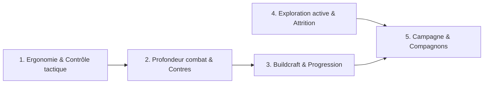

# Plan d'évolution — Vers la jouabilité d'un grand CRPG (type Baldur's Gate / Pillars of Eternity)

## Goal Description

Le moteur actuel de **La Table du Conteur** (`crpg-llm`) dispose déjà d'une base technique très solide : un moteur de combat tactique déterministe sur grille, une IA à doctrines avec simulation sans triche, 42 sorts, des zones persistantes, des objets embarqués/à charges, un système de quêtes/énigmes/dilemmes et un conteur LLM strictement encadré par le code.

Pour atteindre le niveau de jouabilité, de profondeur tactique et d'agence d'un grand CRPG classique (*Baldur's Gate 1 & 2*, *Pillars of Eternity 1 & 2*), il ne s'agit pas de remplacer le tour par tour par du temps réel avec pause (le combat par cartes sur grille est l'identité du jeu), mais de combler **5 écarts majeurs de gameplay** identifiés dans le code et les audits (`AUDIT-REGLES-SRD.md`, `PRD-SAGA.md`, `COMBAT.md`) :

1. **Maîtrise tactique & Ergonomie d'escouade** (réactions contrôlées par le joueur, upcasting des sorts, comportements/scripts d'IA configurables par héros, pré-positionnement).
2. **Profondeur des combats & « Duel de contres »** (contres magiques/dissipation, actions `Se cacher` et `Préparer`, aptitudes de classe manquantes dont Ensorceleur/Druide, actions/réactions/souffles des monstres et boss légendaires).
3. **Buildcraft & Progression significative** (multiclassage, dons généraux à la montée de niveau, choix de bottes/styles, harmonisation complète).
4. **Boucle d'exploration active & Tension d'attrition** (fouille et pièges en deux étages, gestion manuelle des dés de vie au repos court, épuisement/lumière, mode de difficulté avec enjeu de défaite).
5. **Réactivité du groupe & Continuité de campagne** (carnet de campagne inter-épisodes, réactions/approbation des compagnons).

---

## User Review Required

> [!IMPORTANT]
> **Levée ciblée du gel du combat (`PRD-SAGA.md` — règle P3)**
> La règle P3 de `PRD-SAGA.md` gèle `packages/regles/src/combat/` pour les fiches F1 à F5 afin de préserver l'empreinte exacte de `pnpm simuler 10 rapide`.
> Les chantiers 1, 2 et 3 ci-dessous modifient directement le moteur de combat. Comme pour les correctifs M4/M5 du 18/11/2026, il faudra soit :
> - exécuter d'abord les chantiers hors combat (Chantier 4 / F1-F4 de `PRD-SAGA.md`), puis lever P3 pour le combat ;
> - soit isoler chaque nouvelle mécanique derrière des opt-ins / nouvelles cartes afin de garantir la non-régression des simulations de référence.

> [!WARNING]
> **Choix de design sur la défaite et la tension**
> Actuellement (`CLAUDE.md`, `AUDIT-REGLES-SRD.md` §5), la défaite en histoire relève tous les héros à 1 PV pour la moitié de l'or et 8 h. Cela supprime une grande partie de la tension d'attrition propre à *BG1* / *PoE*.
> Il est proposé d'introduire un **mode de difficulté ou d'attrition optionnel** (ex. niveaux d'Épuisement / blessure durable à la défaite, ou mode « Sans filet ») plutôt que de casser la règle actuelle par défaut.

---

## Open Questions

> [!IMPORTANT]
> Merci de trancher ces points avant de lancer l'implémentation :
> 1. **Ordre de priorité** : Souhaitez-vous commencer par l'**Exploration active & Attrition** (aligné avec F1–F4 de `PRD-SAGA.md`, sans toucher au combat) ou attaquer d'abord la **Profondeur tactique du combat** (réactions, upcasting, sorts de contre, IA configurable) ?
> 2. **Réactions en combat** : Pour `Bouclier`, `Attaque d'opportunité` et un futur `Contresort`, préférez-vous une **fenêtre de confirmation interactive** (« Voulez-vous lancer Bouclier ? ») ou un **règle par héros configurable** (« Toujours / Si PV < 50 % / Jamais ») afin de ne pas hacher le rythme du tour ?
> 3. **Scripts d'IA des alliés (`Héros auto`)** : Souhaitez-vous un éditeur de priorités simple par héros (inspiré de *Pillars of Eternity 2*, ex. « Économiser les sorts », « Soigner sous 50 % », « Garder ses distances ») pour fluidifier les combats mineurs ?
> 4. **Enjeu de la défaite** : Souhaitez-vous ajouter un malus mécanique à la défaite/mise à 0 PV (ex. +1 niveau d'Épuisement) en option de partie ?

---

## Proposed Changes

### Chantier 1 — Ergonomie & Contrôle tactique en combat (style *PoE2* / *BG2*)

L'objectif est de redonner au joueur le contrôle fin sur ses ressources et son rythme de jeu, sans alourdir les combats mineurs.

#### [MODIFY] [moteur.ts](file:///C:/Users/sebas/Documents/GitHub/D&D/crpg-llm/packages/regles/src/combat/moteur.ts)
#### [MODIFY] [cartes.ts](file:///C:/Users/sebas/Documents/GitHub/D&D/crpg-llm/packages/regles/src/combat/cartes.ts)
- **Choix du niveau d'emplacement (*Upcasting*)** : permettre à `jouerCarte` (et à l'interface de main de cartes) de passer un `niveauEmplacement` optionnel au lieu de forcer systématiquement l'emplacement le plus bas disponible.
- **Réactions pilotées par le joueur** : remplacer le déclenchement purement automatique (`Bouclier`, `Attaque d'opportunité`, futur `Contresort`) par un état d'attente de réaction (`ReactionEnAttente` dans `EtatCombat`) ou une politique par combattant (`toujours` | `demander` | `jamais`).
- **Pré-positionnement de début de combat** : ajouter une phase optionnelle `placement` avant le round 1 (ou une formation définie sur le groupe) permettant de placer les combattants de première ligne et les lanceurs de sorts sur les cases de départ alliées.

#### [MODIFY] [ia.ts](file:///C:/Users/sebas/Documents/GitHub/D&D/crpg-llm/packages/regles/src/combat/ia.ts)
- **Profils de comportement configurables pour `Héros auto`** : exposer des profils/doctrines sélectionnables par héros (ex. *Économe* : cantrips et attaques uniquement ; *Soutien* : priorité aux soins et bénédictions ; *Contrôle* : zones et entraves ; *Agressif* : ressources maximales).

---

### Chantier 2 — Profondeur du combat, Contre-jeu & Boss (style *BG2*)

L'objectif est d'introduire le « duel de contres », la furtivité tactique et des combats de boss mémorables.

#### [MODIFY] [sorts.ts](file:///C:/Users/sebas/Documents/GitHub/D&D/crpg-llm/packages/regles/src/combat/sorts.ts)
- **Sorts de contre-jeu et contrôle** : ajouter la résolution de `Contresort` (réaction), `Dissipation de la magie` (retire les modificateurs et zones persistantes adverses), ainsi que des sorts de contrôle spatial (murs, zones d'entrave).
- **États manquants** (`AUDIT-REGLES-SRD.md` §7.3) : implémenter `Pétrifié`, `Assourdi` et `Épuisement` (niveaux 1 à 6) avec leurs effets complets sur les jets et la vitesse.

#### [MODIFY] [cartes.ts](file:///C:/Users/sebas/Documents/GitHub/D&D/crpg-llm/packages/regles/src/combat/cartes.ts)
#### [MODIFY] [moteur.ts](file:///C:/Users/sebas/Documents/GitHub/D&D/crpg-llm/packages/regles/src/combat/moteur.ts)
- **Actions SRD manquantes** :
  - `base:se-cacher` : test de Discrétion contre Perception passive adverse, octroyant l'état `invisible`/`caché` (avantage à la prochaine attaque, indispensable pour le Roublard).
  - `base:preparer` : réserver son action pour déclencher une attaque ou un sort en réaction à une condition simple (ex. entrée d'un ennemi à portée).
- **Aptitudes de classes manquantes** (`AUDIT-REGLES-SRD.md` §7.1) :
  - **Ensorceleur** : Points de sorcellerie, *Sorcellerie innée* et *Métamagie* (Accéléré, Jumeau, Intensifié).
  - **Druide** : *Forme sauvage* (substitution temporaire de profil/PV).
  - **Clerc / Paladin** : *Conduit divin* en combat.

#### [MODIFY] [etat.ts](file:///C:/Users/sebas/Documents/GitHub/D&D/crpg-llm/packages/regles/src/combat/etat.ts)
#### [MODIFY] [grille.ts](file:///C:/Users/sebas/Documents/GitHub/D&D/crpg-llm/packages/regles/src/combat/grille.ts)
- **Monstres et Boss de haut calibre** (`PRD-SAGA.md` F6, `AUDIT-REGLES-SRD.md` §7.2 & §7.6) :
  - Résolution des actions de zone des monstres (souffles, cônes, sphères) et des actions de monstre actuellement sans effet.
  - Support des **Actions légendaires**, **Résistances légendaires** et **Régénération**.
  - Support des **grandes créatures multi-cases** (G = 2×2, TG = 3×3) sur la grille et dans la ligne de vue.

---

### Chantier 3 — Buildcraft & Progression significative

L'objectif est de donner au joueur une vraie liberté de personnalisation sur la durée d'une campagne.

#### [MODIFY] [fiche.ts](file:///C:/Users/sebas/Documents/GitHub/D&D/crpg-llm/packages/regles/src/fiche.ts)
#### [MODIFY] [progression.ts](file:///C:/Users/sebas/Documents/GitHub/D&D/crpg-llm/packages/regles/src/creation/progression.ts)
#### [MODIFY] [EcranNiveau.tsx](file:///C:/Users/sebas/Documents/GitHub/D&D/crpg-llm/apps/jeu/src/aventure/EcranNiveau.tsx)
- **Multiclassage** : permettre d'ajouter une nouvelle classe lors d'une montée de niveau (avec vérification des prérequis de caractéristiques et calcul combiné des emplacements de sorts).
- **Dons généraux à la montée de niveau** : permettre de choisir un don général à la place de l'amélioration de caractéristiques (niveaux 4, 8, 12, 16, 19).
- **Choix tactiques complets** : ajout du choix de style de combat, du remplacement de sort préparé et de la gestion des bottes d'arme.
- **Propriétés d'armes complètes** : prise en compte de `Polyvalente` (dégâts à deux mains) et de la botte `Coup double`.

---

### Chantier 4 — Exploration active, Butin & Attrition (aligné avec `PRD-SAGA.md` F1 & F4)

L'objectif est de transformer l'exploration hors combat en véritable boucle de risque/récompense.

#### [MODIFY] [exploration.ts](file:///C:/Users/sebas/Documents/GitHub/D&D/crpg-llm/packages/regles/src/modules/exploration.ts)
#### [MODIFY] [EcranAventure.tsx](file:///C:/Users/sebas/Documents/GitHub/D&D/crpg-llm/apps/jeu/src/aventure/EcranAventure.tsx)
- **Verbes en deux étages (`PRD-SAGA.md` F1)** : dissocier `fouiller` (la pièce) et `chercherPiege` (sur un contenant/porte précis, jet de Perception/Investigation contre DD caché, limité à une tentative par héros et par cible).
- **Butin indexé sur la difficulté (`PRD-SAGA.md` F4)** : calculer la difficulté d'un contenant (`max(DD verrou, DD piège, FP gardien)`) pour orienter le tirage dans `TableButin` tout en respectant le plafond de niveau du groupe.

#### [MODIFY] [EcranSommeil.tsx](file:///C:/Users/sebas/Documents/GitHub/D&D/crpg-llm/apps/jeu/src/aventure/EcranSommeil.tsx)
- **Repos court tactique** : laisser le joueur choisir combien de **Dés de vie** dépenser par héros lors d'un repos court (au lieu de tout dépenser automatiquement) et faire avancer l'horloge du monde d'une heure.
- **Épuisement et Lumière** : intégrer l'impact de la lumière/vision dans l'exploration (désavantage en obscurité sans vision dans le noir ni source lumineuse) et l'Épuisement lors de marches forcées ou de défaites (si option activée).

---

### Chantier 5 — Réactivité des compagnons & Continuité de campagne (`PRD-SAGA.md` F5)

#### [MODIFY] [types.ts](file:///C:/Users/sebas/Documents/GitHub/D&D/crpg-llm/packages/regles/src/noyau/types.ts)
#### [MODIFY] [migrations.ts](file:///C:/Users/sebas/Documents/GitHub/D&D/crpg-llm/packages/regles/src/noyau/migrations.ts)
- **Carnet de campagne (`VERSION_PARTIE` 5)** : exporter l'équipe (niveaux, PX, or, objets uniques) et les drapeaux narratifs clés d'un épisode à l'autre pour déclencher des échos et retours de PNJ.

#### [MODIFY] [interjections.ts](file:///C:/Users/sebas/Documents/GitHub/D&D/crpg-llm/packages/regles/src/modules/interjections.ts)
- **Dynamique d'approbation des compagnons** : associer aux choix de dilemmes et d'actions marquantes un impact sur l'attitude des compagnons recrutés, débloquant des dialogues dédiés, des bonus de synergie ou des départs en cas de rupture morale.

---

### Chantier 6 — Textes, Présentations de lieux & Dialogues vivants (style *BG1/2* & *PoE*)

L'objectif est de passer de textes descriptifs sobres mais uniformes à une écriture incarnée, réactive et caractérisée, sans régresser sur la séparation entre narration et moteur.

#### [MODIFY] [dialogue.ts](file:///C:/Users/sebas/Documents/GitHub/D&D/crpg-llm/packages/regles/src/modules/dialogue.ts)
#### [MODIFY] [BoiteDialogue.tsx](file:///C:/Users/sebas/Documents/GitHub/D&D/crpg-llm/apps/jeu/src/aventure/BoiteDialogue.tsx)
- **Répliques typées du joueur (ton / posture)** : enrichir les sujets et propositions de dialogue avec des intentions/postures optionnelles (ex. *Pragmatique*, *Cynique / Ironique*, *Autoritaire*, *Empathique*) qui influent sur l'attitude du PNJ et déclenchent des réactions ciblées.
- **Tests de compétences intégrés au fil du dialogue** : permettre de greffer sur un sujet un test contextuel (Perception d'un tic, Intuition d'un mensonge, Savoir/Arcanes) révélant une réplique alternative ou un secret sans passer par une action générique séparée.
- **Interjections en scène** : afficher les prises de parole des compagnons directement dans le flux de la boîte de dialogue (et pas seulement en encart passif) lorsque le PNJ aborde un sujet sensible.

#### [MODIFY] [SKILL.md (decrire-lieux)](file:///C:/Users/sebas/Documents/GitHub/D&D/crpg-llm/.claude/skills/decrire-lieux/SKILL.md)
#### [MODIFY] [SKILL.md (creer-personnages)](file:///C:/Users/sebas/Documents/GitHub/D&D/crpg-llm/.claude/skills/creer-personnages/SKILL.md)
- **Présentations de lieux incarnées (80–110 mots)** : lever l'interdiction stricte d'évoquer des micro-événements ou des silhouettes dans les textes d'arrivée ; imposer un détail concret/sensoriel, une touche d'ironie ou de tension par la retenue, et une ouverture sur l'action (ce qui cloche, ce qui attire l'œil).
- **Variantes temporelles / d'état sur les lieux clés** : encourager l'usage de variantes conditionnelles sur les arrivées (jour/nuit, avant/après résolution d'une quête locale).
- **Généralisation des registres de parole** : systématiser pour chaque PNJ important les trois tons d'attitude (`hostile`, `neutre`, `amical`), des marqueurs linguistiques distincts (tutoiement/vouvoiement, longueur de phrase, tics de langage) et le sous-texte (ce que le PNJ veut cacher, vendre ou obtenir).

#### Exemples de référence (écriture cible)

1. **Présentation de lieu (80–110 mots, détail concret + micro-scène + accroche) :**
   * *Avant (figé)* : « Une grande salle basse de plafond aux poutres noircies par la suie. Un feu crépite dans l'âtre de pierre et éclaire une dizaine de tables en chêne massif. L'air sent le ragoût, la bière tiède et la laine mouillée. »
   * *Après (vivant)* : « L'odeur de chou bouilli et de bottes humides vous frappe avant même que la porte ne se referme. Deux miliciens jouent aux dés près du poêle, sans quitter du regard un vieux chien qui ronge un os sous leur banc — manifestement le seul client de la salle à avoir payé d'avance. Au fond, un panneau de bois cloué à la hâte condamne l'escalier de l'étage, et l'aubergiste essuie trois fois le même verre en surveillant l'entrée. Quelqu'un, ici, attend de mauvaises nouvelles. »

2. **Discussion (3 tons d'attitude + postures joueur + test intégré + interjection) :**
   * *PNJ Neutre* : « Trois chariots partis mardi, pas un essieu revenu. Si tu veux mon avis, ils ont pris par la ravine au lieu du chemin haut pour gagner deux heures. Des idiots pressés. »
   * *PNJ Hostile* : « Tu poses trop de questions pour quelqu'un qui a encore les bottes propres. Trois chariots perdus dans la ravine, voilà ce que ça donne quand on envoie des amateurs. Fiche le camp, j'ai du fer au feu. »
   * *PNJ Amical* : « Écoute… officiellement, ils ont pris la ravine par bêtise. Mais j'ai ferré leurs bêtes la veille : le chef d'escorte payait en pièces d'argent neuves et regardait sans cesse vers les collines. Il fuyait quelqu'un avant même de partir. »
   * *Réponses typées du joueur* : `[Pragmatique]` « Combien valait la cargaison ? » / `[Cynique]` « Des amateurs avec des pièces neuves, ça court les rues par ici ? » / `[Autoritaire — Intimidation DD 13]` « Arrête de marteler ton enclume et dis-moi qui les a payés. » / `[Perception DD 12]` *(brûlure fraîche au poignet en forme de sceau)* → « C'est toi qui as scellé leurs caisses, non ? »
   * *Interjection de compagnon* : **Varnac :** « Laisse tomber son enclume, chef. Un forgeron qui ne jure pas quand son fer refroidit, c'est qu'il écoute trop ce qu'on lui demande. »

---

## Verification Plan

### Automated Tests
Après chaque lot implémenté (dans `crpg-llm/`), exécuter la batterie complète de validation :
- `pnpm typecheck` — vérification stricte TypeScript sur tout le monorepo.
- `pnpm test` — exécution des tests unitaires et d'intégration (actuellement 2 633 tests verts).
- `pnpm monde valider` et `pnpm monde verifier <monde>` — validation des schémas et preuve des fins par le parcours automatique.
- `pnpm simuler 10 rapide` — vérification de l'équilibre du combat et de l'absence de régression sur les graines de référence (1000 à 1009).

### Manual Verification
1. **En combat (`pnpm jeu`)** : tester une rencontre en lançant un sort avec *upcasting*, en déclenchant/refusant une réaction (`Bouclier` / `Contresort`), en utilisant `Se cacher` avec un Roublard, et en vérifiant les profils d'IA sur les combats mineurs.
2. **En exploration (`pnpm jeu`)** : tester la séquence complète *Fouiller la pièce → Chercher un piège sur un coffre → Désamorcer → Crocheter → Piller* puis un repos court avec dépense sélective de dés de vie.
3. **À la montée de niveau** : vérifier le choix d'un don général ou d'une classe de multiclassage dans `EcranNiveau`.
