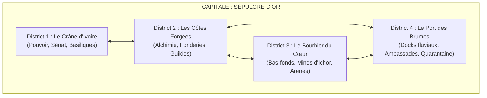
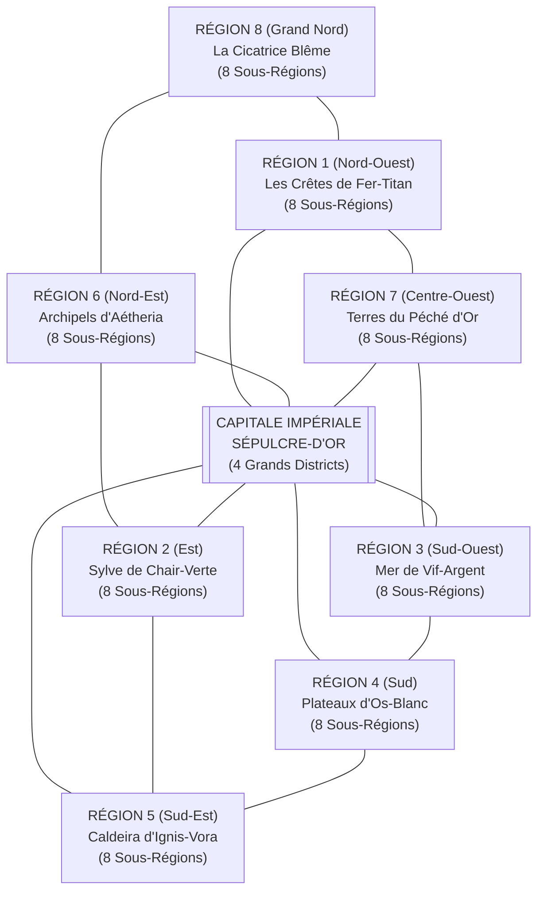

# GRANDE BIBLE DU MONDE 1 : L'ÉCHIQUIER D'OMBRESANG

> **Genre & Tonalité** : *High Fantasy Crépusculaire, Géopolitique Impériale, Alchimie Sacrilège & Reliques des Dieux Déchus*  
> **Système** : D&D 5e (SRD 5.2.1 — Bestiaire officiel intégré)  
> **Architecture du Monde** :
> - **1 Capitale Impériale** divisée en **4 Grands Districts** (*Sépulcre-d'Or*)
> - **8 Grandes Régions** (formant chacune un biome né de la dépouille d'une divinité ou du cataclysme céleste)
> - **64 Sous-Régions** (8 sous-régions par Région), chacune conçue comme **une histoire complète** avec ses villages, grottes, temples, lieux mythiques, conflits locaux et bestiaire.

---

## 1. GENÈSE, COSMOLOGIE & L'ICHOR DIVIN

### 1.1. La Nuit des Sept Lances (An 0 du Calendrier Cendré)
Il y a trois cent douze ans, le panthéon céleste s'est déchiré lors d'une guerre fratricide dont les mortels n'ont jamais connu la véritable cause. Pendant sept nuits d'apocalypse appelées la **Nuit des Sept Lances**, le firmament s'est embrasé. Les dieux se sont transpercés, démembrés et précipités les uns les autres sur le continent mortel d'**Ombresang**.

Leurs corps titanesques — longs de plusieurs dizaines de lieues — ont remodelé la géographie du monde en s'écrasant :
1. **Sol-Invictus**, le Dieu-Roi Solaire, s'est abattu au centre du continent ; sa cage thoracique pétrifiée abrite aujourd'hui la capitale impériale, *Sépulcre-d'Or*.
2. **Vael-Khor**, le Titan de Fer et de Guerre, s'est brisé au nord-ouest, formant une chaîne de montagnes métalliques hérissée d'épées cyclopéennes.
3. **Sylphéa**, la Déesse des Moissons et de la Vie, a pourri dans les vallées de l'est, donnant naissance à une jungle bioluminescente, carnivore et mutante.
4. **Néréia**, l'Oracle des Eaux et des Miroirs, s'est liquéfiée au sud-ouest en une mer intérieure de mercure vif et de brumes hallucinatoires.
5. **Mor-Vath**, le Juge des Morts, s'est enfoncé dans les plateaux crayeux du sud, transformant la région en une immense nécropole d'ossements calcifiés.
6. **Ignis-Vora**, la Forge-Mère, agonise encore sous la caldeira du sud-est, ses artères de lave alimentant des rivières de feu.
7. **Aétheria**, la Tisseuse des Vents, s'est fragmentée en archipels de roche flottante et de falaises foudroyées au nord-est.
8. Quant au huitième territoire, **La Cicatrice Blême** (l'extrême nord glacé), c'est le cratère d'impact de *La Lance Sans Nom*, l'arme inconnue qui a déclenché le massacre céleste.

### 1.2. L'Ichor : Le Sang des Dieux
Des carcasses pétrifiées suinte encore un fluide épais, tantôt doré, tantôt noirâtre ou irisé : **l'Ichor**.
- **Miracle économique et arcanique** : Raffiné par les guildes impériales, l'Ichor chauffe les cités, anime des golems, prolonge la vie des nobles et permet aux mages de lancer des sortilèges d'une puissance inouïe.
- **Malédiction biologique (La Stigmatisation)** : Quiconque extrait, respire ou consomme l'Ichor trop longtemps subit la *Transmutation*. La faune devient chimérique (basilics, manticores, hydres), le sang coagule en vases vivantes (poudings noirs, gelées ocres), et les mortels sombrent dans la folie messianique ou se transforment en monstruosités.

---

## 2. L'INTRIGUE GLOBALE DU MONDE : LE RÉVEIL DES CARCASSES

### 2.1. Le Fil Rouge Mondial
Depuis trois siècles, le **Saint-Empire d'Ombresang** exploite industriellement les dépouilles divines en affirmant que les dieux sont définitivement morts. **C'est un mensonge.**
Un Dieu ne meurt jamais tout à fait : il rêve dans la pierre, amnésique et torturé.

Depuis six mois, **le Cœur Pétrifié de Sol-Invictus**, enfoui à trois cents mètres sous la capitale *Sépulcre-d'Or*, a recommencé à battre — un coup sourd toutes les heures qui fait trembler les fondations de la ville. En résonance, dans les 8 Régions, les carcasses des autres dieux manifestent des signes de réveil cauchemardesque :
- Leurs anciens serviteurs célestes (`deva`, `planetar`, `solar`), rendus fous par trois siècles d'abandon et de douleur, émergent des sanctuaires pour punir les mortels « vampires » qui boivent le sang de leurs maîtres.
- Une organisation secrète tentaculaire, **Le Concile des Cendres Blanches**, sabote les sceaux de confinement régionaux. Son but n'est pas de ressusciter les anciens dieux, mais de **fusionner leurs carcasses réveillées** grâce au réseau d'aqueducs d'Ichor pour faire naître une divinité unique, artificielle et tyrannique, incarnée par leur mystérieux chef : **L'Apôtre Voilé**.

### 2.2. Les 4 Grandes Factions Mondiales
1. **Le Trône d'Ivoire & La Légion Solaire (L'Autorité Impériale)** : Basée à *Sépulcre-d'Or*, dirigée par l'Impératrice-Régente **Cassia Valérian**. Elle cherche à maintenir l'unité de l'Empire par le fer, la censure et les taxes d'Ichor, tout en étouffant la nouvelle du réveil du Cœur.
2. **Le Consortium des Veines d'Or (Les Guildes d'Alchimistes et d'Extracteurs)** : Dirigé par le Haut-Artificier **Malthus Vane**. Ils considèrent les dieux comme une simple ressource minière et créent des armées de golems et d'homoncules pour réprimer les révoltes ouvrières et protéger leurs forages.
3. **L'Ordre des Pénitents du Silence (Les Purificateurs)** : Fanatiques religieux menés par l'Inquisiteur-Prieur **Sévérin l'Aveugle**. Pour eux, boire ou forer l'Ichor est le péché ultime qui provoque la colère des carcasses divines. Ils brûlent les raffineries et massacrent les alchimistes.
4. **Le Concile des Cendres Blanches (Les Conspirateurs de l'Apothéose)** : Cabale occulte infiltrée dans toutes les couches de la société, alliée à des Diables (`rakshasa`, `diantrefosse`) et des Liches. Ils provoquent des crises régionales pour forcer les dépouilles divines à sécréter un *Ichor Noir* de panique, indispensable à leur rituel final.

### 2.3. Les Figures Majeures du Monde (PNJ Globaux)
- **Impératrice-Régente Cassia Valérian** *(Humaine, Noble/Vétéran)* : Femme d'État froide et pragmatique de 50 ans, qui maintient son fils mourant en vie grâce à des transfusions quotidiennes d'Ichor pur.
- **L'Apôtre Voilé / Malakor l'Écorché** *(Archimage / Liche)* : Ancien Premier Astrologue impérial qui a découvert ce qui a réellement lancé la *Lance Sans Nom* il y a 300 ans. Il orchestre le Concile des Cendres Blanches.
- **Séraphiel aux Ailes Brisées** *(Planetar déchu)* : L'ancien porte-étendard du Dieu-Roi Sol-Invictus. Ses ailes sont faites de bronze fondu et de plumes calcinées. Il cherche à détruire Sépulcre-d'Or pour abréger les souffrances de son maître.
- **Haut-Artificier Malthus Vane** *(Humain, Mage)* : Génie industriel sans scrupules dont la moitié du corps a été remplacée par des prothèses d'or animées à l'Ichor.

---

## 3. LA CAPITALE IMPÉRIALE : SÉPULCRE-D'OR (4 GRANDS DISTRICTS)

Construite à l'intérieur et autour de la cage thoracique colossale du Dieu-Roi **Sol-Invictus**, *Sépulcre-d'Or* (aussi appelée *Haute-Couronne*) compte près de 200 000 âmes. Douze côtes d'ivoire fossilisé, hautes comme des cathédrales, forment une voûte titanesque au-dessus de la métropole.

### District 1 : Le Crâne d'Ivoire (La Haute-Ville)
* **Description & Atmosphère** : Bâti dans le crâne géant incliné du dieu et sur la colline sacrée qui le surplombe. Les palais de marbre blanc sont reliés par des ponts d'or filigrané. À travers les orbites vides du crâne divin, on domine toute la vallée.
* **Lieux Clés** :
  * *Le Palais des Deux Orbites* (siège de l'Impératrice-Régente) ;
  * *L'Hémicycle de la Machoire* (le Sénat impérial où siègent les représentants des 8 Régions) ;
  * *La Basilique du Soleil Éteint* (grand temple officiel gardé par des `armure-animee` et des `chevalier`) ;
  * *La Nécropole des Empereurs* (cryptes scellées sous la nuque du dieu).
* **Intrigue & Problème du District** : Trois sénateurs opposés au Consortium viennent d'être assassinés dans des pièces verrouillées de l'intérieur. Des `doppelganger` et un `rakshasa` à la solde du Concile des Cendres Blanches ont pris la place de hauts dignitaires pour voter la loi martiale, tandis que dans la Nécropole des Empereurs, les anciens monarques embaumés à l'Ichor se réveillent en `momie-auguste`.
* **Monstres présents** : `doppelganger`, `rakshasa`, `assassin`, `espion`, `chevalier`, `garde-anime`, `armure-animee`, `epee-volante`, `momie`, `momie-auguste`, `fantome`, `gargouille`.

### District 2 : Les Côtes Forgées (Le Quartier Industriel & Arcanique)
* **Description & Atmosphère** : Suspendu directement aux douze côtes monumentales du Dieu-Roi par des chaînes d'acier géantes. Des fonderies, des laboratoires d'alchimie, des bibliothèques suspendues et des aqueducs de verre où coule l'Ichor incandescent. Une pluie fine de suie dorée tombe en permanence.
* **Lieux Clés** :
  * *La Grande Raffinerie Vane* (cœur industriel du Consortium) ;
  * *L'Université de l'Artifice* (tour académique des mages et créateurs de golems) ;
  * *Le Pont des Soupirs d'Airain* (grand marché d'équipements, d'armes runiques et de fioles) ;
  * *L'Atelier des Chair-Cousues* (laboratoire secret où l'on fabrique des `golem-de-chair`).
* **Intrigue & Problème du District** : Une série de « surpressions » dans les tuyaux d'Ichor a rendu fous furieux les automates du quartier. En réalité, un groupe d'ouvriers stigmatisés et les Pénitents du Silence préparent le dynamitage de la Septième Côte pour faire s'effondrer la Raffinerie Vane sur le Bourbier, tandis que les expériences du Haut-Artificier ont donné naissance à un `golem-de-fer` devenu conscient.
* **Monstres présents** : `golem-de-chair`, `golem-d-argile`, `golem-de-pierre`, `golem-de-fer`, `homoncule`, `mage`, `archimage`, `mimique`, `tapis-etrangleur`, `mephite-vaporeux`, `mephite-magmatique`, `fanatique-de-secte`.

### District 3 : Le Bourbier du Cœur (La Ville-Basse & le Puits)
* **Description & Atmosphère** : Au niveau du sol, exactement sous la cage thoracique, là où les résidus toxiques des fonderies ruissellent. Un labyrinthe de ruelles boueuses, de taudis sur pilotis, de fumerolles chaudes et de tripots éclairés à la lanterne verte. Au centre s'ouvre *La Fosse Cardiaque*, le puits béant qui descend vers le Cœur Pétrifié.
* **Lieux Clés** :
  * *La Fosse Cardiaque* (le grand puits minier gardé par la Légion) ;
  * *L'Arène des Stigmatisés* (amphithéâtre souterrain où combattent gladiateurs et monstres mutants) ;
  * *La Cour des Miracles Sanglants* (repaire de la guilde des voleurs et des rats-garous) ;
  * *L'Égout des Coagulations* (réseau souterrain d'évacuation de l'Ichor).
* **Intrigue & Problème du District** : Chaque battement du Cœur Pétrifié fait remonter des profondeurs des vases de sang divin (`pouding-noir`, `babelien`) qui dévorent les habitants des taudis la nuit. Le roi de la pègre locale (un maître `rat-garou`) retient prisonnier l'ingénieur en chef qui détient les plans des sceaux du Cœur.
* **Monstres présents** : `pouding-noir`, `gelee-ocre`, `cube-gelatineux`, `vase-grise`, `otyugh`, `babelien`, `rat-garou`, `rat-geant`, `nuee-de-rats`, `gladiateur`, `chef-de-bande`, `bandit`, `gros-bras`, `goule`, `ombre`.

### District 4 : Le Port des Brumes (Les Docks Fluviaux & la Quarantaine)
* **Description & Atmosphère** : Bordant le fleuve *Styx-Doré* qui traverse la capitale, ce district brumeux regroupe d'immenses entrepôts fortifiés, les palais exotiques des ambassadeurs des 8 Régions, des chantiers navals et l'*Île des Pestiférés* où sont parqués les malades atteints par la mutation de l'Ichor.
* **Lieux Clés** :
  * *Les Quais des Galères-Citadelles* (port militaire et marchand) ;
  * *L'Allée des HuitBannières* (quartier diplomatique où s'espionnent les émissaires des provinces) ;
  * *L'Île-Lazaret de Sainte-Lacrima* (hôpital-prison fortifié au milieu du fleuve) ;
  * *La Halle aux Reliques Grises* (entrepôt douanier des artefacts extraits des dieux).
* **Intrigue & Problème du District** : Un navire-amiral venu de la Mer de Vif-Argent a accosté sans équipage vivant, sa cale remplie de cocons cristallins et de `vampirien`. L'Île-Lazaret est tombée aux mains des malades mutés qui menacent d'empoisonner l'eau potable de toute la capitale si le blocus militaire n'est pas levé.
* **Monstres présents** : `vampire`, `vampirien`, `espion`, `assassin`, `capitaine-pirate`, `pirate`, `capitaine-de-la-garde`, `garde`, `goule`, `bleme`, `spectre`, `ame-en-peine`, `succube`, `incube`, `diablotin`.

---

## 4. LES 8 GRANDES RÉGIONS & LEURS 64 SOUS-RÉGIONS

---

### RÉGION 1 : LES CRÊTES DE FER-TITAN (Nord-Ouest)
* **La Dépouille Divine** : Le corps brisé de **Vael-Khor**, le Dieu de la Guerre et de la Forge, dont l'armure colossale et les membres d'acier météorique forment une chaîne de montagnes acérées.
* **Intrigue Régionale — *La Croisade des Sans-Âme*** : Le Seigneur-Maréchal **Draven Kael**, gouverneur militaire de la région, a découvert la *Forge Crânienne* de Vael-Khor. Pour mater les clans rebelles et préparer un coup d'État contre la Capitale, il transfère l'âme de ses soldats mourants dans des enveloppes de métal (`armure-animee`, `golem-de-fer`). Mais l'esprit belliqueux du Dieu de la Guerre contamine ces légions mécaniques, qui commencent à massacrer garnisons et villages sans distinction.
* **PNJ Majeurs de la Région** :
  * **Seigneur-Maréchal Draven Kael** *(Chevalier / Champion)* : Vétéran inflexible convaincu que seul un Empire de métal peut survivre au réveil des dieux.
  * **Mère-Enclume Bruna** *(Prêtresse naine rebelle)* : Gardienne des anciens serments des mineurs qui cherche à éteindre la Forge Crânienne.

#### Les 8 Sous-Régions des Crêtes de Fer-Titan :
1. **SR 1.1 — La Vallée des Mille Épées (⭐ POINT DE DÉPART DE LA CAMPAGNE — Niveau 1)**
   * *Lieux* : **Village de Lame-Rousse** (point de départ exact `"lame-rousse"`, village de forgerons), **Le Bastion du Pont-Viaduc**, **La Forêt d'Acier** (champ de bataille antique où des épées géantes sont plantées dans le roc), **La Grotte des Rouilles** (repaire d'`oxydeur`), **Le Temple du Glaive Brisé**.
   * *Histoire locale* : Les armes forgées à Lame-Rousse s'animent la nuit (`epee-volante`) et attaquent leurs propriétaires ; une meute d'`oxydeur` attirée par le minerai divin menace de dévorer les structures métalliques du pont-viaduc qui relie le village au reste du monde.
   * *Monstres* : `epee-volante`, `armure-animee`, `oxydeur`, `bandit`, `eclaireur`, `loup-sanguinaire`.
2. **SR 1.2 — Le Gantelet d'Airain**
   * *Lieux* : **Bourg-Minier de Phalange** (construit dans les doigts géants du gantelet divin), **Les Mines de Moelle-Fer**, **Le Sanctuaire du Poing Fermé**, **L'Abîme des Marteaux**.
   * *Histoire locale* : Les mineurs ont percé une artère du gantelet divin d'où s'échappent des mineurs (`veteran`) et `sentinelle-azer` asservis par un `diable-des-chaines` qui fait tourner une fonderie clandestine d'armes maudites.
   * *Monstres* : `sentinelle-azer`, `diable-des-chaines`, `diable-barbu`, `gargouille`, `garde-anime`, `gros-bras`.
3. **SR 1.3 — Le Col des Géants Écorchés**
   * *Lieux* : **Fort-Verrou** (citadelle impériale), **Village montagnard de Givre-Fer**, **La Caverne des Crânes de Pierre**, **L'Autel des Tonnerres** (lieu mythique au sommet du col).
   * *Histoire locale* : Une tribu de `geant-du-feu` et de `geant-des-pierres` tente de récupérer le marteau brisé de Vael-Khor et assiège Fort-Verrou, tandis que le commandant du fort vend secrètement les vivres des villageois aux contrebandiers.
   * *Monstres* : `geant-du-feu`, `geant-des-pierres`, `ogre`, `ettin`, `griffon`, `veteran`, `capitaine-de-la-garde`.
4. **SR 1.4 — La Cuirasse Fendue**
   * *Lieux* : **Cité-Caserne d'Égide** (bâtie sous le plastron fendu du dieu), **Les Galeries de Scories**, **Le Monastère des Lames Silencieuses**, **Le Gouffre des Enclumes**.
   * *Histoire locale* : Le Seigneur-Maréchal Kael y teste ses premiers bataillons de soldats-automates. Des familles entières de conscrits disparaissent dans les Galeries de Scories pour alimenter les cuves d'âmes des `golem-de-fer`.
   * *Monstres* : `golem-de-fer`, `golem-de-pierre`, `armure-animee`, `chevalier`, `mage`, `homoncule`, `fantome`.
5. **SR 1.5 — Les Landes de Limaille**
   * *Lieux* : **Hameau de Grise-Poudre**, **Le Désert Magnétique** (où les boussoles s'affolent et la foudre frappe sans cesse), **La Tanière de la Cuirasse** (grotte souterraine), **La Tour Paratonnerre** (ruine mythique).
   * *Histoire locale* : Les caravanes d'approvisionnement sont décimées par une `gorgone` de fer et un `behir` attiré par les tempêtes magnétiques de la Tour Paratonnerre.
   * *Monstres* : `gorgone`, `behir`, `bulette`, `mephite-poussiereux`, `elementaire-de-l-air`, `harpie`.
6. **SR 1.6 — Les Marches Hobgobelines de Fer-Sang**
   * *Lieux* : **Camp-Forteresse de Krag-Vael**, **Village occupé de Val-Martel**, **Les Grottes à Worgs**, **Le Temple du Loup d'Acier**.
   * *Histoire locale* : Une légion disciplinée de hobgobelins (`capitaine-hobgobelin`), ayant bu la rouille divine de Vael-Khor, revendique l'héritage martial du dieu mort et prépare une invasion méthodique de la vallée.
   * *Monstres* : `capitaine-hobgobelin`, `combattant-hobgobelin`, `traqueur-gobelours`, `combattant-gobelours`, `chef-gobelin`, `combattant-gobelin`, `worg`, `molosse-infernal`.
7. **SR 1.7 — Le Sanctuaire de l'Épaule Brisée**
   * *Lieux* : **Village de Pèlerinage d'Aile-de-Plomb**, **La Cathédrale Penchée**, **Les Catacombes des Porte-Boucliers**, **La Source de Mercure Rouge**.
   * *Histoire locale* : Un `deva` autrefois au service de Vael-Khor est retenu enchaîné sous la Cathédrale Penchée par des prêtres impériaux qui traient son sang céleste pour créer des élixirs d'invulnérabilité.
   * *Monstres* : `deva`, `pretre`, `acolyte`, `fanatique-de-secte`, `golem-d-argile`, `spectre`, `ame-en-peine`.
8. **SR 1.8 — Le Heaume du Titan (Cœur de la Région 1)**
   * *Lieux* : **Citadelle de la Visière** (bastion du Maréchal Kael), **La Forge Crânienne** (lieu mythique au cœur de la tête du dieu), **Les Puits d'Incandescence**, **Camp des Mineurs Forçats**.
   * *Histoire locale* : Dénouement de l'arc régional : dans le crâne de métal en fusion de Vael-Khor, le Maréchal Kael s'apprête à éveiller le *Colosse Primordial* avec l'aide d'un `diantrefosse` lié aux Cendres Blanches.
   * *Monstres* : `diantrefosse`, `diable-cornu`, `golem-de-fer`, `efrit`, `elementaire-du-feu`, `chevalier`, `archimage`.

---

### RÉGION 2 : LA SYLVE DE CHAIR-VERTE (Est)
* **La Dépouille Divine** : Le corps décomposé et fécond de **Sylphéa**, Déesse de la Vie, de la Flore et des Bêtes. Loin d'une forêt paisible, c'est une jungle titanesque, carnivore et bioluminescente où la vie pousse trop vite, fusionnant plantes, bêtes et ossements.
* **Intrigue Régionale — *La Moisson Dévoreuse*** : L'Archidruidesse **Ysolde des Spores** et un couvent de `guenaude-verte` et `guenaude-nocturne` ont éveillé le *Matriarcat Racinaire* de Sylphéa. La forêt avance d'une lieue par semaine, engloutissant les villes frontalières sous des racines géantes et transformant les habitants en hôtes végétaux ou en chimères, tandis que les expéditions du Consortium brûlent la lisière au naphte d'Ichor.
* **PNJ Majeurs de la Région** :
  * **Archidruidesse Ysolde des Spores** *(Druide corrompue)* : Elle entend les pleurs de Sylphéa et veut rendre tout le continent à l'état sauvage primordial.
  * **Commandant-Veneur Cassian Ronce** *(Éclaireur / Rôdeur)* : Chef des Garde-Lisières qui tente de sauver les villages forestiers pris entre le feu impérial et la jungle dévorante.

#### Les 8 Sous-Régions de la Sylve de Chair-Verte :
1. **SR 2.1 — La Lisière des Bûchers**
   * *Lieux* : **Bourg-Fortifié de Coupe-Ronce**, **Les Scieries Calcinées**, **La Grotte des Sèves Noires**, **L'Arbre-Pendu** (lieu mythique).
   * *Histoire locale* : Les bûcherons de Coupe-Ronce sont attaqués chaque nuit par les arbres mêmes qu'ils ont abattus (`arbre-eveille`, `sylvanien`). Une dryade blessée révèle que le contremaître de la scierie a volé le *Cœur-Graine* d'un bosquet sacré.
   * *Monstres* : `sylvanien`, `arbre-eveille`, `arbuste-eveille`, `dryade`, `esprit-follet`, `satyre`, `sanglier-geant`.
2. **SR 2.2 — Le Val des Cocons Soyeux**
   * *Lieux* : **Village suspendu de Tisse-Branche**, **Les Cavernes de Soie Blanche**, **Le Temple de la Mère-Tisseuse**, **Le Pont de Toile**.
   * *Histoire locale* : Le village récoltait autrefois la soie géante pacifiquement, mais une colonie de `drider` et d'`araignee-de-phase` mutées par la sève d'Ichor a pris le contrôle du temple souterrain et entoile les voyageurs.
   * *Monstres* : `drider`, `araignee-de-phase`, `araignee-geante`, `araignee-loup-geante`, `ettercap`, `nuee-d-insectes`.
3. **SR 2.3 — Les Marais de Bile-Fleur**
   * *Lieux* : **Village sur pilotis de Tourbe-Douce**, **Le Cercle des Chaudrons** (repaire du couvent de guenaudes), **La Grotte aux Fongus**, **L'Idole Engloutie**.
   * *Histoire locale* : Une épidémie de sommeil frappe Tourbe-Douce : les habitants rêvent qu'ils sont des fleurs et marchent la nuit jusque dans les marais pour se noyer. Trois guenaudes (`guenaude-verte`, `guenaude-nocturne`) distillent leurs rêves dans l'Idole Engloutie.
   * *Monstres* : `guenaude-verte`, `guenaude-nocturne`, `tertre-errant`, `thallophyte-violette`, `criard`, `crapaud-geant`, `crocodile-geant`, `feu-follet`.
4. **SR 2.4 — La Canopée des Chimères**
   * *Lieux* : **Poste d'observation de Haute-Cime**, **Le Nid Céleste** (branches géantes fossilisées à 100 m du sol), **La Grotte Aérienne des Harpies**, **L'Autel des Plumes d'Or**.
   * *Histoire locale* : Dans les branches hautes fossilisées du bras de Sylphéa, le pollen divin fusionne les créatures ailées en `chimere`, `manticore` et `griffon` qui disputent le ciel aux dirigeables du Consortium.
   * *Monstres* : `chimere`, `manticore`, `griffon`, `hippogriffe`, `harpie`, `aigle-geant`, `guepe-geante`.
5. **SR 2.5 — La Vallée des Écailles Tonnantes**
   * *Lieux* : **Campement indigène de Croc-Vert**, **Le Cratère Chaud** (microclimat préhistorique), **Les Grottes d'Ambre**, **Le Monolithe du Premier Sang** (lieu mythique).
   * *Histoire locale* : Au creux du ventre tiède de la déesse, une faune préhistorique géante (`tyrannosaure`, `triceratops`, `allosaure`) prospère. Des braconniers impériaux ont capturé les petits d'un couple de tyrannosaures, déclenchant une ruée dévastatrice vers les villages.
   * *Monstres* : `tyrannosaure`, `triceratops`, `allosaure`, `ankylosaure`, `pteranodon`, `serpent-constricteur-geant`, `serpent-venimeux-geant`.
6. **SR 2.6 — Le Bosquet de la Licorne Sanglante**
   * *Lieux* : **Village elfique de Clair-Voile**, **La Clairière de Cristal**, **La Grotte des Racines Pleureuses**, **La Fontaine de Sève Pure**.
   * *Histoire locale* : La `licorne` tutélaire qui purifiait l'eau de toute la sous-région a été infectée par une flèche d'Ichor Noir tirée par le Concile des Cendres Blanches. Sa corne corrompue transforme les bêtes de la forêt en `loup-garou`, `ours-garou` et `hibours` enragés.
   * *Monstres* : `licorne`, `loup-garou`, `ours-garou`, `sanglier-garou`, `hibours`, `chien-esquiveur`, `grand-cervide`.
7. **SR 2.7 — Les Ruines d'Émeraude-Morte**
   * *Lieux* : **Camp des Archéologues**, **La Cité Engloutie sous les Lianes**, **Le Temple du Serpent Ailé**, **Les Cryptes Végétales**.
   * *Histoire locale* : Un `dragon-vert-adulte` manipulateur a élu domicile dans le Temple du Serpent Ailé, se faisant passer pour la voix réincarnée de la déesse Sylphéa afin de manipuler les druides locaux contre la Capitale.
   * *Monstres* : `dragon-vert-adulte`, `jeune-dragon-vert`, `dragonnet-vert`, `couatl`, `naga-gardien`, `druide`, `arbuste-eveille`.
8. **SR 2.8 — Le Ventre des Mille Racines (Cœur de la Région 2)**
   * *Lieux* : **Le Sanctuaire du Bourgeon Rouge** (cœur battant de Sylphéa), **Le Village Symbiotique de Sève-Chair**, **L'Abîme des Spores**, **Le Trône d'Écorce**.
   * *Histoire locale* : Au centre de la carcasse divine, l'Archidruidesse Ysolde nourrit un `babelien` végétal et une `hydre` régénérante avec les corps des prisonniers pour faire éclore un Avatar de Sylphéa.
   * *Monstres* : `hydre`, `babelien`, `tertre-errant`, `sylvanien`, `druide`, `guenaude-nocturne`, `ankheg`, `ver-pourpre`.

---

### RÉGION 3 : LA MER DE VIF-ARGENT & LES CÔTES MIROIRS (Sud-Ouest)
* **La Dépouille Divine** : Le corps liquéfié de **Néréia**, Déesse des Océans, de la Lune et des Illusions. Une mer intérieure lourde, argentée et réfléchissante comme un miroir liquide, bordée de falaises de verre blanc et d'archipels où la réalité et les reflets se confondent.
* **Intrigue Régionale — *Le Schisme des Reflets*** : Les vapeurs de la Mer de Vif-Argent donnent des visions prophétiques mais créent aussi des *Doubles de Mercure* (`doppelganger`, illusions tangibles). Le Prince-Marchand **Valério d'Argent** a conclu un pacte avec un `aboleth` millénaire niché dans la fosse crânienne de Néréia : petit à petit, les notables et habitants des ports côtiers sont remplacés par leurs reflets obéissants, préparant la sécession de toute la flotte du Sud-Ouest.
* **PNJ Majeurs de la Région** :
  * **Prince-Amiral Valério d'Argent** *(Noble / Mage)* : Gouverneur flamboyant de la Côte Miroir — ou peut-être déjà son propre reflet inversé.
  * **L'Oracle Aveugle Calypso** *(Prêtresse aux yeux bandés)* : La seule voyante capable de distinguer un humain de son reflet de mercure sans regarder.

#### Les 8 Sous-Régions de la Mer de Vif-Argent :
1. **SR 3.1 — Port-Miroir & La Baie des Galères d'Argent**
   * *Lieux* : **Cité portuaire de Port-Miroir**, **Le Phare aux Cent Lentilles**, **Les Grottes de Marée-Basse**, **Le Temple de la Lune Noyée**.
   * *Histoire locale* : Des habitants de Port-Miroir affirment avoir croisé leur propre double dans les rues avant d'être attaqués chez eux. Les égouts du port abritent une ruche de `doppelganger` et de contrebandiers de vif-argent.
   * *Monstres* : `doppelganger`, `espion`, `assassin`, `capitaine-pirate`, `pirate`, `mimique`, `rat-geant`.
2. **SR 3.2 — L'Archipel des Sirènes de Verre**
   * *Lieux* : **Village de pêcheurs d'Écume-Blanche**, **Les Récifs Chantants** (aiguilles de verre volcanique), **La Caverne des Échos**, **L'Épave du Titan-Doré** (lieu mythique).
   * *Histoire locale* : Le chant des récifs attire les navires d'Ichor sur les brisants. Une reine `harpie` et un clan de `merrow` récupèrent les cargaisons d'or divin pour les offrir à une `dragon-tortue` capricieuse.
   * *Monstres* : `harpie`, `merrow`, `combattant-sahuagin`, `tirailleur-thalasseen`, `dragon-tortue`, `crabe-geant`.
3. **SR 3.3 — Les Salines d'Illusion**
   * *Lieux* : **Bourg de Sel-Miroir**, **Le Désert des Glaces Sèches** (étendue aveuglante de sel et de mercure cristallisé), **Les Mines de Cristal**, **Le Sanctuaire des Mirages**.
   * *Histoire locale* : Dans l'étendue aveuglante des salines, les mirages deviennent réels et mortels. Un `rakshasa` retenu prisonnier dans le Sanctuaire des Mirages manipule les caravaniers en matérialisant leurs pires cauchemars ou leurs proches disparus.
   * *Monstres* : `rakshasa`, `lamie`, `traqueur-invisible`, `mephite-vaporeux`, `ombre`, `bandit`, `chef-de-bande`.
4. **SR 3.4 — La Falaise des Statues d'Argent**
   * *Lieux* : **Village deTailleurs de Pierre de Haute-Vasque**, **Le Jardin des Pétrifiés** (lieu mythique), **La Grotte aux Miroirs Brisés**, **Le Palais Suspendu de Dame Séléné**.
   * *Histoire locale* : Quiconque regarde la mer depuis la falaise par nuit de pleine lune est transformé en statue d'argent pur. Trois sœurs `meduse` et leurs `basilic` règnent sur le Palais Suspendu et vendent ces « statues » comme œuvres d'art à la Capitale.
   * *Monstres* : `meduse`, `basilic`, `cockatrice`, `gargouille`, `golem-de-pierre`, `serpent-venimeux-geant`.
5. **SR 3.5 — La Lagune des Nefs Perdues**
   * *Lieux* : **Village flottant de Radeau-Franc** (bâti sur des coques de navires liés), **Le Cimetière des Galions**, **La Grotte Sous-Marine du Corail Noir**, **La Chapelle des Naufragés**.
   * *Histoire locale* : Les marins noyés dans le vif-argent ne pourrissent pas : ils reviennent sous la forme de morts-vivants argentés menés par le `fantome` d'un amiral trahi qui bloque le détroit commercial.
   * *Monstres* : `fantome`, `ame-en-peine`, `spectre`, `goule`, `bleme`, `squelette`, `zombi`, `pieuvre-geante`, `requin-chasseur`.
6. **SR 3.6 — L'Île de l'Oracle Écorché**
   * *Lieux* : **Monastère de Clair-Voyance**, **Hameau des Pèlerins**, **La Grotte des Fumées Lunaires**, **L'Œil de Néréia** (lac circulaire parfait qui montre le passé).
   * *Histoire locale* : L'Œil de Néréia est le seul endroit où l'on peut voir une image de la *Nuit des Sept Lances*. Le Concile des Cendres Blanches a envoyé un commando de fanatiques et un `naga-corrupteur` pour aveugler le lac sacré.
   * *Monstres* : `naga-corrupteur`, `naga-gardien`, `sphinx-erudit`, `mage`, `fanatique-de-secte`, `sectateur`, `elementaire-de-l-eau`.
7. **SR 3.7 — Les Marécages de Mercure Dormant**
   * *Lieux* : **Village d'alchimistes d'Alambic-Gris**, **Les Bassins de Décantation**, **La Tanière de l'Hydre d'Argent**, **Les Ruines du Pont-Aqueduc**.
   * *Histoire locale* : Les rejets alchimiques des bassins ont fait muter la faune amphibie. Une `hydre` aux écailles de mercure liquide et des `vase-grise` géantes coupent la route impériale.
   * *Monstres* : `hydre`, `vase-grise`, `cube-gelatineux`, `gelee-ocre`, `guenaude-marine`, `grenouille-geante`, `crocodile-geant`.
8. **SR 3.8 — La Fosse des Abysses Lunaires (Cœur de la Région 3)**
   * *Lieux* : **Citadelle Insulaire d'Argent-Pur**, **Le Gouffre de la Couronne Engloutie** (tête submergée de Néréia), **Le Temple Abyssal**, **La Salle du Miroir-Monde**.
   * *Histoire locale* : Au fond du gouffre liquide, l'`aboleth` ancestral et un `kraken` juvénile tissent l'illusion collective qui asservit la flotte régionale.
   * *Monstres* : `aboleth`, `kraken`, `chtuul`, `elementaire-de-l-eau`, `merrow`, `archimage`, `doppelganger`.

---

### RÉGION 4 : LES PLATEAUX D'OS-BLANC (Sud)
* **La Dépouille Divine** : Le squelette titanesque et les terres crayeuses de **Mor-Vath**, le Dieu des Morts, du Jugement et de la Mémoire. Des plateaux arides de craie blanche, des canyons creusés dans des vertèbres géantes et des cités-nécropoles où les vivants cohabitent légalement avec les morts-vivants sous contrat.
* **Intrigue Régionale — *La Grève des Morts et l'Édit d'Éternité*** : Depuis trois siècles, les *Archontes Nécromants* des Plateaux d'Os-Blanc louent à l'Empire une main-d'œuvre docile de squelettes et de zombies pour les travaux agricoles et miniers. Mais à mesure que la carcasse de Mor-Vath frémit, **les morts retrouvent la mémoire de leur vie passée** ! Des milliers de travailleurs squelettes cessent d'obéir, réclament justice à leurs descendants vivants ou se rassemblent derrière le **Roi-Momie Ankhar**, tandis qu'un vampire de haute lignée tente de renverser le Conseil des Archontes.
* **PNJ Majeurs de la Région** :
  * **Haut-Archonte Vespera Mortis** *(Mage Nécromancienne)* : Juriste austère qui gère le « Bail des Défunts » et refuse de voir s'effondrer l'économie mortuaire de la province.
  * **Ankhar le Souvenant** *(Momie Auguste)* : Ancien grand prêtre de Mor-Vath éveillé avec tous ses souvenirs, qui exige la libération des âmes enchaînées.

#### Les 8 Sous-Régions des Plateaux d'Os-Blanc :
1. **SR 4.1 — Les Champs de Craie & La Cité de Bail-les-Morts**
   * *Lieux* : **Ville de Bail-les-Morts**, **Les Fermes Silencieuses** (cultivées par des squelettes sous contrat), **La Grotte de l'Ossuaire Commun**, **Le Tribunal des Testaments**.
   * *Histoire locale* : Les ouvriers `squelette` et `zombi` des Fermes Silencieuses ont posé leurs outils et encerclent pacifiquement les maisons des propriétaires vivants en brandissant les contrats falsifiés de leur mort. La milice veut les détruire ; les familles reconnaissent leurs ancêtres.
   * *Monstres* : `squelette`, `zombi`, `minotaure-squelette`, `destrier-squelette`, `ogre-zombi`, `garde`, `pretre`.
2. **SR 4.2 — Le Canyon des Trente Vertèbres**
   * *Lieux* : **Village troglodyte d'Épine-Blanche** (creusé dans les vertèbres du dieu), **La Route de la Moelle**, **La Caverne des Goules Affamées**, **L'Arche du Jugement** (lieu mythique).
   * *Histoire locale* : Une meute de `goule` et de `bleme` menée par un `necronte` pille les convois funéraires qui traversent le canyon et dévore la moelle fossilisée du dieu pour acquérir des pouvoirs nécrotiques.
   * *Monstres* : `necronte`, `goule`, `bleme`, `ombre`, `vautour-geant`, `hyene-geante`, `combattant-gnoll`.
3. **SR 4.3 — Le Comté Nocturne de Sombre-Vigne**
   * *Lieux* : **Bourg viticole de Sang-Terre**, **Le Château deVermeil** (fief de l'aristocratie vampirique), **Les Caves d'Affinage**, **La Chapelle Profanée**.
   * *Histoire locale* : Les nobles vampires du Château de Vermeil protégeaient jadis le bourg contre un impôt du sang mesuré, mais le Comte est tombé sous l'influence des Cendres Blanches et transforme toute la population en `vampirien` pour lever une armée.
   * *Monstres* : `vampire`, `vampirien`, `familier-de-vampire`, `chauve-souris-geante`, `nuee-de-chauves-souris`, `loup-sanguinaire`, `chevalier`.
4. **SR 4.4 — La Pyramide des Balances Rompues**
   * *Lieux* : **Oasis de Sable-Gris**, **La Grande Ziggourat de Mor-Vath** (temple mythique), **Le Labyrinthe des Sarcophages**, **Les Puits d'Embaumement**.
   * *Histoire locale* : Le Roi-Momie Ankhar a ouvert la Grande Ziggourat. Quiconque entre dans la sous-région voit ses mensonges passés se matérialiser sous forme d'`ombre` ou de `spectre` qui l'attaquent tant qu'il n'a pas confessé ses fautes sur la Balance du temple.
   * *Monstres* : `momie-auguste`, `momie`, `sphinx-merveilleux`, `spectre`, `ombre`, `golem-d-argile`, `nuee-d-insectes`, `scorpion-geant`.
5. **SR 4.5 — La Lande des Cavaliers Sans Tête**
   * *Lieux* : **Village fortifié de Halte-Cri**, **Le Champ de Bataille des Cent Bannières**, **Le Tumulus du Roi-Chevalier**, **La Grotte des Corbeaux**.
   * *Histoire locale* : Chaque nuit, un escadron spectral d'`ame-en-peine` montées sur des `destrier-squelette` et des `chien-du-trepas` charge à travers la lande, revivant la dernière bataille de la guerre civile d'il y a cent ans.
   * *Monstres* : `ame-en-peine`, `fantome`, `destrier-squelette`, `chien-du-trepas`, `nuee-de-corbeaux`, `nuee-de-senestres`, `feu-follet`.
6. **SR 4.6 — L'Université Grise de Nécrosophie**
   * *Lieux* : **Cité académique de Crâne-Savant**, **L'Amphithéâtre d'Anatomie Divine**, **Les Catacombes d'Expérimentation**, **La Tour de l'Horloge d'Os**.
   * *Histoire locale* : Le doyen de l'Université tente secrètement de devenir une `liche` en utilisant l'Ichor moelleux de Mor-Vath. Son rituel raté a plongé la moitié du campus dans une boucle temporelle nécrotique peuplée d'`horriflamme` et de `golem-de-chair`.
   * *Monstres* : `liche`, `archimage`, `mage`, `horriflamme`, `golem-de-chair`, `homoncule`, `gargouille`, `mimique`.
7. **SR 4.7 — Les Mines de Phalanges & Le Gouffre aux Vers**
   * *Lieux* : **Camp minier de Craie-Profonde**, **Les Galeries du Fémur Géant**, **Le Nid du Ver Sépulcral**, **L'Oratoire des Mineurs Ensevelis**.
   * *Histoire locale* : Les excavations de poussière d'os divin (utilisée pour le mortier impérial) ont réveillé un `ver-pourpre` nécrotique et des `ankheg` qui font s'effondrer les galeries sous les villages.
   * *Monstres* : `ver-pourpre`, `ankheg`, `bulette`, `grick`, `mante-obscure`, `squelette`, `otyugh`.
8. **SR 4.8 — Le Trône du Jugement Dernier (Cœur de la Région 4)**
   * *Lieux* : **La Cage Thoracique de Mor-Vath**, **La Cour Suprême des Âmes** (lieu mythique), **La Citadelle des Archontes**, **Le Puits des Larmes Noires**.
   * *Histoire locale* : L'affrontement final entre l'armée des morts éveillés d'Ankhar, les Archontes Nécromants et un `dragon-noir-venerable` nécrotique niché dans le crâne du Dieu des Morts.
   * *Monstres* : `dragon-noir-venerable`, `dragon-noir-adulte`, `liche`, `momie-auguste`, `necronte`, `ame-en-peine`, `golem-de-pierre`.

---

### RÉGION 5 : LA CALDEIRA D'IGNIS-VORA & LES TERRES DE BRAISE (Sud-Est)
* **La Dépouille Divine** : Le corps incandescent d'**Ignis-Vora**, la Forge-Mère et Déesse des Volcans, dont le ventre éventré forme une mer de basalte noir parcourue d'artères de lave dorée (le *Sang-Flamme*).
* **Intrigue Régionale — *Le Pacte des Seigneurs de Braise*** : La province fournit tout le charbon divin et le Sang-Flamme de l'Empire. Mais le Sultan-Éfrit **Malik al-Khar** (éveillé des entrailles de la déesse) et un conclave de `dragon-rouge-adulte` exigent la restitution des sept *Cœurs de Rubis* volés par le Consortium. Pendant ce temps, l'Ordre des Pénitents du Silence y mène une guérilla fanatique pour provoquer une éruption cataclysmique qui « purifierait » tout le continent par le feu.
* **PNJ Majeurs de la Région** :
  * **Gouverneure-Ingénieure Héloïse Ardente** *(Mage / Artificière)* : Dirige les Écluses de Lave ; pragmatique et épuisée, elle tente d'éviter à la fois l'éruption et la révolte ouvrière.
  * **Grand-Prieur Sévérin l'Aveugle** *(Prêtre fanatique)* : Chef spirituel des Pénitents du Silence, retranché dans un monastère troglodyte au bord du cratère.

#### Les 8 Sous-Régions de la Caldeira d'Ignis-Vora :
1. **SR 5.1 — Les Écluses de Basalte & Bourg-Fournaise**
   * *Lieux* : **Ville industrielle de Bourg-Fournaise**, **Le Grand Barrage de Lave**, **Les Grottes de Soufre**, **Le Temple de la Flamme Domptée**.
   * *Histoire locale* : Des saboteurs des Pénitents du Silence ont endommagé les vannes du Grand Barrage de Lave. Si les écluses cèdent, Bourg-Fournaise sera engloutie en trois jours, tandis que des `magmatique` et des `salamandre` sortent déjà des conduites fissurées.
   * *Monstres* : `salamandre`, `magmatique`, `mephite-magmatique`, `mephite-vaporeux`, `elementaire-du-feu`, `fanatique-de-secte`, `garde`.
2. **SR 5.2 — Le Désert de Verre Noir (LeVal des Cendres Impérial)**
   * *Lieux* : **Village caravane de Halte-Vitre**, **La Plaine d'Obsidienne Tranchante**, **La Caverne des Scorpions d'Airain**, **L'Obélisque Vitrifié** (lieu mythique).
   * *Histoire locale* : Là où le souffle mourant d'Ignis-Vora a vitrifié le sable, des pillards montés et une colonie de `scorpion-geant` et de `bulette` cuirassées d'obsidienne attaquent les convois de rubis divins.
   * *Monstres* : `scorpion-geant`, `bulette`, `dragonnet-rouge`, `bandit`, `chef-de-bande`, `berserker`, `vautour-geant`.
3. **SR 5.3 — La Citadelle d'Airain du Sultan Éfrit**
   * *Lieux* : **Oasis Thermale de Fumée-d'Or**, **Le Palais des Mille Braseros** (bastion d'airain surgi de la lave), **Les Mines de Gemmes de Feu**, **Le Bazar des Génies**.
   * *Histoire locale* : Cette sous-région n'est pas en guerre ouverte : l'`efrit` Malik al-Khar y tient un marché franc où humains, `salamandre` et marchands d'Ichor négocient. Mais un voleur a dérobé la *Lampe de Scellement* de la fille du Sultan, menaçant de déclencher des représailles immédiates sur les villages humains voisins.
   * *Monstres* : `efrit`, `salamandre`, `sentinelle-azer`, `elementaire-du-feu`, `xorn` (mangeurs de gemmes), `assassin`, `espion`, `golem-de-fer`.
4. **SR 5.4 — Les Geysers de Sang-Chaud**
   * *Lieux* : **Village de Bains-des-Stigmates**, **La Vallée des Cent Geysers**, **La Grotte des Vapeurs Hallucinogènes**, **Le Sanctuaire de la Guérison Brûlante**.
   * *Histoire locale* : Les malades viennent de tout l'Empire se baigner dans les sources chaudes d'Ignis-Vora pour guérir leurs blessures. Mais la source profonde a été contaminée par un `glabrezu` qui offre des guérisons miraculeuses en échange de pactes démoniaques secrets.
   * *Monstres* : `glabrezu`, `hezrou`, `dretch`, `quasit`, `molosse-infernal`, `sectateur`, `pretre`.
5. **SR 5.5 — Le Nid des Dragons de Cendre**
   * *Lieux* : **Village fortifié d'Écaille-Rousse**, **Les Aiguilles Fumantes** (pitons volcaniques), **La Grotte au Trésor Fondu**, **L'Autel du Pacte Draconique**.
   * *Histoire locale* : Trois jeunes dragons rouges (`jeune-dragon-rouge`) se disputent le territoire de leur mère endormie (`dragon-rouge-adulte`), exigeant chacun un tribut contradictoire du village d'Écaille-Rousse servi par des clans de `combattant-kobold`.
   * *Monstres* : `dragon-rouge-adulte`, `jeune-dragon-rouge`, `dragonnet-rouge`, `demi-dragon`, `combattant-kobold`, `vouivre`, `chimere`.
6. **SR 5.6 — Les Forges Enfouies des Géants du Feu**
   * *Lieux* : **Avant-poste nain de Martel-Profond**, **La Grande Fonderie Cyclopéenne**, **Le Tunnel des Rivières Rouges**, **Le Temple du Marteau Tombé**.
   * *Histoire locale* : Le Roi-Forgeron des `geant-du-feu` reconstruit en secret l'épée brisée d'Ignis-Vora en réduisant en esclavage les mineurs nains et les `xorn` de la montagne.
   * *Monstres* : `geant-du-feu`, `molosse-infernal`, `sentinelle-azer`, `golem-de-pierre`, `xorn`, `ogre`, `troll`.
7. **SR 5.7 — Le Monastère des Pénitents Aveugles**
   * *Lieux* : **Hameau de Cendre-Grise**, **La Forteresse Troglodyte du Silence**, **La Grotte des Flagellants**, **Le Pont de Corde sur l'Abîme**.
   * *Histoire locale* : Quartier général de l'Inquisiteur Sévérin. Les Pénitents ont capturé un `planetar` de feu blessé et comptent le jeter vivant dans la cheminée volcanique principale pour provoquer l'hiver volcanique sur tout l'Empire.
   * *Monstres* : `planetar`, `pretre`, `fanatique-de-secte`, `acolyte`, `chevalier`, `veteran`, `diable-barbele`, `erinye`.
8. **SR 5.8 — La Fournaise du Cœur-Mère (Cœur de la Région 5)**
   * *Lieux* : **Le Cratère Central d'Ignis-Vora**, **L'Île d'Obsidienne Flottante** (sur le lac de lave), **Le Temple du Premier Feu**, **Les Conduits Impériaux**.
   * *Histoire locale* : Au centre du lac de magma, un `dragon-rouge-venerable` et un `balor` éveillé du sang bouillonnant de la déesse luttent pour le contrôle du Cœur-Mère.
   * *Monstres* : `dragon-rouge-venerable`, `balor`, `efrit`, `elementaire-du-feu`, `salamandre`, `horriflamme`.

---

### RÉGION 6 : LES ARCHIPELS CÉLESTES D'AÉTHERIA (Nord-Est)
* **La Dépouille Divine** : Le corps dispersé d'**Aétheria**, Déesse des Vents, de la Foudre et des Étoiles. En mourant, son souffle a arraché des montagnes entières à la gravité : la région est composée de hauts plateaux balayés par les tempêtes au-dessus desquels flottent des dizaines d'îles rocheuses reliées par des ponts de chaînes géantes et des courants d'air ascendants.
* **Intrigue Régionale — *La Chute des Îles Flottantes*** : La gravité revient lentement à mesure que le souffle divin d'Aétheria s'épuise — ou plutôt parce que le **Conclave des Astrologues d'Azur** siphonent l'Ichor gazeux (*l'Éther-Souffle*) pour maintenir leurs propres palais célestes en altitude. Deux îles habitées se sont déjà écrasées sur les vallées en contrebas. Les clans de chevaucheurs de griffons et les `djinn` se rebellent contre les tours de siphonage.
* **PNJ Majeurs de la Région** :
  * **Archimage Céleste Orion Vael** *(Archimage)* : Dirigeant hautain du Conclave d'Azur, prêt à laisser tomber les îles paysannes pour sauver sa cité flottante.
  * **Capitaine Lyra Vent-d'Orage** *(Chevalier sur Griffon)* : Cheffe des Corsaires du Ciel qui évacue les villages condamnés et sabote les siphons.

#### Les 8 Sous-Régions des Archipels Célestes d'Aétheria :
1. **SR 6.1 — Les Ponts de Chaînes & Bourg-Suspendu**
   * *Lieux* : **Ville de Bourg-Suspendu** (accrochée entre deux îles flottantes), **La Grande Chaîne d'Ancrage**, **La Grotte des Courants d'Air**, **Le Phare des Nuages**.
   * *Histoire locale* : Des `gargouille` et des saboteurs scient les maillons géants de la Grande Chaîne d'Ancrage. Si la chaîne rompt, l'île entière dérivera vers les tempêtes de foudre mortelles de l'est.
   * *Monstres* : `gargouille`, `harpie`, `griffon`, `hippogriffe`, `mephite-poussiereux`, `bandit`, `eclaireur`.
2. **SR 6.2 — La Vallée des Épaves Célestes (Au Sol)**
   * *Lieux* : **Village de Cratère-Neuf** (au sol, sous les îles), **Le Champ des Îles Tombées**, **Les Cavernes d'Impact**, **Le Temple Écrasé**.
   * *Histoire locale* : Au sol, les survivants fouillent les décombres d'une île sacrée tombée le mois dernier. Mais le choc a libéré des `elementaire-de-l-air` furieux, des `golem-de-pierre` détraqués et une meute de `bulette` attirées par le séisme.
   * *Monstres* : `elementaire-de-l-air`, `golem-de-pierre`, `bulette`, `ankheg`, `manticore`, `ogre`, `chef-de-bande`.
3. **SR 6.3 — L'Île-Sanctuaire des Pégases d'Argent**
   * *Lieux* : **Hameau pastoral d'Alizé**, **Les Prairies Flottantes**, **La Grotte des Plumes Blanches**, **L'Autel du Zéphyr** (lieu mythique).
   * *Histoire locale* : Dernier refuge des `pegase` et des `aigle-geant`, l'île est envahie par des chasseurs de trophées impériaux et un `jeune-dragon-bleu` qui électrocute les troupeaux aériens.
   * *Monstres* : `pegase`, `aigle-geant`, `jeune-dragon-bleu`, `dragonnet-bleu`, `veteran`, `eclaireur`, `griffon`.
4. **SR 6.4 — La Cour des Djinns et des Nuages**
   * *Lieux* : **Palais de Vapeur Sculptée**, **Village aérien de Souffle-Clair**, **La Caverne des Orages Enbouteillés**, **L'Observatoire du Vent**.
   * *Histoire locale* : Un noble `djinn` et un clan de `geant-des-nuages` réclament le tribut ancien promis par le Premier Empereur. Face au refus du Conclave d'Azur, ils ont enveloppé trois sous-régions dans un cyclone permanent.
   * *Monstres* : `djinn`, `geant-des-nuages`, `elementaire-de-l-air`, `traqueur-invisible`, `mephite-vaporeux`, `mage`.
5. **SR 6.5 — Les Aiguilles Foudroyées**
   * *Lieux* : **Poste de collecte de Foudre-Vive**, **La Forêt de Paratonnerres**, **L'Antre du Behir Céleste**, **Le Monolithe d'Ambre Électrique**.
   * *Histoire locale* : Les collecteurs d'énergie arcanique ont attiré un `dragon-bleu-adulte` et une couvée de `behir` qui se nourrissent des éclairs concentrés par les tours du Consortium.
   * *Monstres* : `dragon-bleu-adulte`, `behir`, `elementaire-de-l-air`, `garde-anime`, `armure-animee`, `homoncule`.
6. **SR 6.6 — Le Roc du Nid Titanesque**
   * *Lieux* : **Campement des Fauconniers**, **Le Pic de l'Oiseau-Tonnerre** (lieu mythique), **Les Grottes à Guano d'Or**, **L'Épave de la Galère Volante**.
   * *Histoire locale* : Un `rukh` (oiseau roc colossal né des plumes d'Aétheria) enlève des troupeaux entiers et des navires volants pour nourrir son unique œuf, que le Concile des Cendres Blanches cherche à corrompre.
   * *Monstres* : `rukh`, `vouivre`, `chimere`, `harpie`, `faucon-de-sang`, `aigle-geant`, `pteranodon`.
7. **SR 6.7 — La Bibliothèque des Étoiles Mortes**
   * *Lieux* : **Île-Monastère d'Astrolabe**, **La Tour Inversée** (qui pend sous l'île rocheuse !), **Les Archives du Vide**, **Le Planétarium Divin**.
   * *Histoire locale* : Dans la Tour Inversée qui pend au-dessus du vide, un `sphinx-valeureux` et un `sphinx-erudit` gardent les tablettes stellaires qui révèlent l'origine de la *Lance Sans Nom*. Des `assassin` et un `nalfeshnie` tentent de forcer le sanctuaire.
   * *Monstres* : `sphinx-valeureux`, `sphinx-erudit`, `nalfeshnie`, `vrock`, `assassin`, `archimage`, `epee-volante`, `tapis-etrangleur`.
8. **SR 6.8 — Le Poumon des Tempêtes (Cœur de la Région 6)**
   * *Lieux* : **La Citadelle d'Azur** (capitale régionale flottante), **L'Œil du Cyclone Éternel** (lieu mythique où flotte le cœur d'Aétheria), **Les Grands Siphons d'Éther**, **Le Sanctuaire des Souffles Primordiaux**.
   * *Histoire locale* : Le cœur du cyclone est défendu par un `geant-des-tempetes` prophétique et un `dragon-d-argent-adulte` face aux machines de siphonage de l'Archimage Orion Vael.
   * *Monstres* : `geant-des-tempetes`, `dragon-d-argent-adulte`, `dragon-bleu-venerable`, `djinn`, `archimage`, `golem-de-fer`.

---

### RÉGION 7 : LES TERRES FRACTURÉES DU PÉCHÉ D'OR (Centre-Ouest)
* **La Dépouille Divine** : Ici est tombée la main droite coupée de **Sol-Invictus** tenant encore le fragment de la *Balance des Serments*, ainsi que le sang mêlé des sept dieux. C'est le grenier à blé dévasté de l'Empire, une terre de collines dorées balafrées par des failles abyssales d'où montent les légions des Enfers venues réclamer les âmes parjures.
* **Intrigue Régionale — *La Foire aux Âmes et la Guerre des Barons Parjures*** : Pour survivre aux sécheresses et aux guerres féodales, les Sept Barons de la province ont signé il y a cent ans un pacte fiscal et militaire avec une Archidiablesse (`erinye` / `diantrefosse`). Aujourd'hui, le bail séculaire expire : des huissiers infernaux (`diable-osseux`, `diable-cornu`) émergent des failles avec des contrats de sang pour saisir les terres, les châteaux et les âmes de tous les habitants.
* **PNJ Majeurs de la Région** :
  * **Légat Infernal Malphas de la Huitième Clause** *(Diable Cornu / Rakshasa)* : Diplomate d'une politesse glaciale qui exécute légalement la saisie de la province.
  * **Dame Jeanne de Clair-Sillon** *(Chevalier Paladin)* : La seule baronne ayant refusé de signer le pacte, qui défend son bourg fortifié où s'entassent tous les réfugiés.

#### Les 8 Sous-Régions des Terres Fracturées du Péché d'Or :
1. **SR 7.1 — Les Moissons Cendrées & Bourg-Franc**
   * *Lieux* : **Bourg fortifié de Clair-Sillon**, **Les Moulins Brûlés**, **La Grotte des Réfractaires**, **La Chapelle du Serment Tenu**.
   * *Histoire locale* : Clair-Sillon est assiégé par les collecteurs de dîme infernale (`diable-barbu`, `molosse-infernal`) et des compagnies de mercenaires humains payés par les barons voisins pour livrer les réfugiés à leur place.
   * *Monstres* : `diable-barbu`, `lemure`, `diablotin`, `molosse-infernal`, `veteran`, `bandit`, `chef-de-bande`, `chevalier`.
2. **SR 7.2 — La Faille des Chaînes Chantantes**
   * *Lieux* : **Village minier de Gouffre-Fer**, **Le Pont du Parjure**, **Les Cavernes de Torture Légale**, **L'Obélisque des Contrats** (lieu mythique).
   * *Histoire locale* : Au fond de la faille géologique, l'`Obélisque des Contrats` grave dans le basalte chaque mensonge prononcé dans la région. Un `diable-des-chaines` y retient les âmes des villageois dans des cages suspendues.
   * *Monstres* : `diable-des-chaines`, `diable-barbele`, `diable-osseux`, `ombre`, `spectre`, `sectateur`, `fanatique-de-secte`.
3. **SR 7.3 — Le Carnaval de Velours Rouge**
   * *Lieux* : **Ville thermale et décadente de Plaisance-d'Or**, **La Grande Foire Nocturne**, **Les Catacombes des Soupirs**, **Le Théâtre des Masques**.
   * *Histoire locale* : Pour oublier l'échéance du pacte, les nobles de Plaisance-d'Or vivent dans une fête perpétuelle orchestrée par un cabaret de `succube`, d'`incube` et un `rakshasa` qui rachètent les années de vie des joueurs ruinés au casino.
   * *Monstres* : `rakshasa`, `succube`, `incube`, `doppelganger`, `assassin`, `espion`, `noble`, `gargouille`.
4. **SR 7.4 — Le Labyrinthe de Ronces-Cornes**
   * *Lieux* : **Hameau abandonné de Val-Bouc**, **La Haie Titanesque d'Épines Noires**, **L'Antre du Minotaure**, **Le Temple Profané de la Moisson**.
   * *Histoire locale* : Le Baron de Val-Bouc a tenté de tromper les Diables en invoquant un démon abyssal pour les combattre : sa baronnie s'est transformée en un labyrinthe sauvage où chassent des `minotaure-de-baphomet`, des `combattant-gnoll` et un `glabrezu`.
   * *Monstres* : `minotaure-de-baphomet`, `combattant-gnoll`, `glabrezu`, `hezrou`, `vrock`, `dretch`, `quasit`, `hyene-geante`.
5. **SR 7.5 — Les Collines aux Cent Gibets**
   * *Lieux* : **Village de Carrefour-des-Pendus**, **La Route de la Justice Impériale**, **La Grotte des Brigands**, **L'Arbre des Juges** (lieu mythique).
   * *Histoire locale* : Le grand juge de la province pend coupables et innocents pour remplir le quota d'âmes exigé par les Enfers. Les pendus reviennent en `ame-en-peine` et `necronte` qui hantent les routes.
   * *Monstres* : `necronte`, `ame-en-peine`, `fantome`, `goule`, `nuee-de-corbeaux`, `capitaine-de-la-garde`, `chef-gros-bras`, `gros-bras`.
6. **SR 7.6 — Le Sanctuaire du Doigt Solaire**
   * *Lieux* : **Monastère fortifié de Phalange-d'Or**, **Le Doigt de Pierre** (index dressé de Sol-Invictus), **La Crypte des Reliques**, **La Source d'Or Liquide**.
   * *Histoire locale* : Seul lieu saint encore pur de la région, gardé par un `couatl` et un `naga-gardien`. Une armée menée par une `erinye` et un `marilith` (rivaux infernaux et abyssaux) converge vers le monastère pour souiller la Source d'Or Liquide.
   * *Monstres* : `erinye`, `marilith`, `couatl`, `naga-gardien`, `deva`, `pretre`, `chevalier`.
7. **SR 7.7 — Les Terriers de la Famine**
   * *Lieux* : **Village affamé de Mie-Sèche**, **Les Silos Souterrains**, **Les Galeries des Nuées**, **Le Moulin Hanté**.
   * *Histoire locale* : Alors que les champs sont brûlés par le soufre infernal, le meunier enrichi de Mie-Sèche cache d'immenses réserves de blé dans les Silos Souterrains sous la garde d'un culte de `rat-garou`, d'`otyugh` et de vases.
   * *Monstres* : `rat-garou`, `rat-geant`, `nuee-de-rats`, `otyugh`, `gelee-ocre`, `pouding-noir`, `mimique`.
8. **SR 7.8 — La Citadelle du Bail Sanglant (Cœur de la Région 7)**
   * *Lieux* : **Château-Tribunal de Haute-Clause**, **La Porte d'Airain vers les Neuf Enfers** (lieu mythique), **La Salle du Grand Parchemin**, **Les Oubliettes du Huitième Sceau**.
   * *Histoire locale* : Le Légat Malphas et un `diantrefosse` président l'audience finale où les Sept Barons doivent livrer la province — à moins que l'on ne trouve la faille juridique ou martiale inscrite sur le fragment de la *Balance des Serments*.
   * *Monstres* : `diantrefosse`, `diable-cornu`, `diable-osseux`, `erinye`, `rakshasa`, `archimage`, `golem-de-fer`.

---

### RÉGION 8 : LA CICATRICE BLÊME & LE CRATÈRE DE L'ÉTOILE MORTE (Grand Nord Glacé)
* **La Dépouille Divine** : Ici ne repose aucun dieu connu, mais le cratère d'impact gelé de **La Lance Sans Nom** — le projectile cosmique venu d'au-delà des étoiles qui a frappé le ciel et déclenché la folie meurtrière de la *Nuit des Sept Lances*. Une toundra polaire parcourue d'aurores boréales violettes, de glaciers translucides où sont figées des créatures antédiluviennes, et d'un réseau souterrain aberrant.
* **Intrigue Régionale — *L'Appel de la Lance et le Dégel de la Bête*** : C'est ici que le **Concile des Cendres Blanches** a établi sa base secrète ultime. La chaleur des forages d'Ichor fait fondre le glacier central : sous la glace, la *Lance Sans Nom* (qui est en réalité le dard cristallin d'une entité cosmique extérieure) et la **Tarasque** endormie depuis l'aube du monde commencent à dégeler. Les clans barbares du Nord et les géants du givre fuient vers le sud devant l'avancée des aberrations.
* **PNJ Majeurs de la Région** :
  * **L'Apôtre Voilé (Malakor l'Écorché)** *(Liche / Archimage)* : Le maître du Concile des Cendres Blanches, qui dirige l'excavation de la Lance Sans Nom.
  * **Jarl Astrid Brise-Glace** *(Berserker / Reine des Clans du Nord)* : Cheffe de guerre farouche qui tente d'unir les tribus humaines et les géants du givre contre le réveil du Cratère.

#### Les 8 Sous-Régions de la Cicatrice Blême :
1. **SR 8.1 — Le Mur des Glaces Hurlantes & Fort-Boréal**
   * *Lieux* : **Forteresse frontalière de Fort-Boréal**, **Village trappeur de Fourrure-Grise**, **La Grotte de l'Ours Blanc**, **La Passe des Vents Coupants**.
   * *Histoire locale* : Des centaines de réfugiés nordiques et de bêtes arctiques (`mammouth`, `loup-arctique`) se pressent devant les portes fermées de Fort-Boréal, poursuivis par une horde de morts-vivants gelés et un `diable-gele`.
   * *Monstres* : `diable-gele`, `loup-arctique`, `ours-polaire`, `mammouth`, `tigre-a-dents-de-sabre`, `zombi`, `squelette`, `berserker`.
2. **SR 8.2 — La Mer de Banquise & Le Cimetière des Brise-Glaces**
   * *Lieux* : **Port baleinier de Harpon-Gelé**, **Les Navires Pris dans les Glaces**, **La Caverne Sous-Glaciaire**, **Le Sanctuaire de l'Orque Blanc**.
   * *Histoire locale* : Les navires de ravitaillement de l'expédition impériale sont bloqués dans la banquise et attaqués par le dessous par des `remorhaz` et un `dragon-blanc-adulte` qui exige les cargaisons d'Ichor chaud pour son nid.
   * *Monstres* : `dragon-blanc-adulte`, `jeune-dragon-blanc`, `dragonnet-blanc`, `remorhaz`, `epaulard`, `ours-polaire`, `mephite-gele`.
3. **SR 8.3 — Le Fjord des Géants du Givre**
   * *Lieux* : **Citadelle de Glace de Jotun-Krag**, **Village barbare de Sang-Chaud**, **La Grotte des Stalactites Géantes**, **La Pierre des Sagas** (lieu mythique).
   * *Histoire locale* : Le Roi des `geant-du-givre` a été empoisonné par des émissaires des Cendres Blanches qui accusent les clans humains du Jarl Astrid. Une guerre totale entre géants et barbares menace d'éclater si la supercherie n'est pas prouvée.
   * *Monstres* : `geant-du-givre`, `ogre`, `troll`, `ettin`, `loup-arctique`, `berserker`, `oni` (assassin déguisé).
4. **SR 8.4 — Le Glacier des Monstres Figés**
   * *Lieux* : **Camp scientifique du Consortium**, **La Galerie de Glace Translucide** (où l'on voit des monstres pris dans la glace), **Les Puits de Vapeur**, **L'Autel Préhistorique**.
   * *Histoire locale* : Le Consortium utilise des canons à vapeur d'Ichor pour découper le glacier, libérant par accident des créatures figées depuis des millénaires : `ver-pourpre`, `chimere`, `hydre` et `babelien` dégèlent dans les galeries.
   * *Monstres* : `ver-pourpre`, `babelien`, `chimere`, `hydre`, `remorhaz`, `golem-de-chair`, `mage`.
5. **SR 8.5 — Les Cavernes Aberrantes de Sous-Cratère**
   * *Lieux* : **Avant-poste souterrain de Lampe-Basse**, **Les Tunnels de Chair Violette**, **Le Lac Souterrain Sans Étoile**, **Le Pilier Télépathique**.
   * *Histoire locale* : Sous le glacier, la roche a été mutée par les radiations de la Lance Sans Nom. Les explorateurs entendent des murmures dans leur tête et affrontent une écologie souterraine cauchemardesque menée par un `aboleth` stellaire et des `chtuul`.
   * *Monstres* : `aboleth`, `chtuul`, `grick`, `enlaceur`, `manteleur`, `mante-obscure`, `pouding-noir`, `cube-gelatineux`, `thallophyte-violette`.
6. **SR 8.6 — La Nécropole des Anges Gelés**
   * *Lieux* : **Sanctuaire de Plume-Givre**, **Le Champ des Statues Célestes**, **La Crypte du Premier Chœur**, **Le Miroir d'Aurore** (lieu mythique).
   * *Histoire locale* : C'est ici que les premiers messagers célestes venus inspecter la Lance Sans Nom ont été foudroyés il y a 312 ans. Un `solar` aveugle et blessé, dernier témoin de la vérité sur la Nuit des Sept Lances, y est traqué par les Liches du Concile.
   * *Monstres* : `solar`, `planetar`, `deva`, `liche`, `archimage`, `necronte`, `spectre`, `ame-en-peine`.
7. **SR 8.7 — La Cage du Titan Endormi**
   * *Lieux* : **Poste de garde des Sceaux**, **La Caverne de la Carapace**, **Les Chaînes de Diamant Noir**, **Le Temple des Veilleurs du Nord**.
   * *Histoire locale* : Une caverne aussi grande qu'une ville où dort la `tarasque`, enchaînée par les anciens dieux. Les fanatiques du Concile des Cendres Blanches injectent de l'Ichor bouillant dans ses veines pour provoquer son réveil et la lancer sur la Capitale.
   * *Monstres* : `tarasque` (endormie ou éveillée lors du climax), `dragon-blanc-venerable`, `golem-de-fer`, `golem-de-pierre`, `fanatique-de-secte`, `assassin`.
8. **SR 8.8 — L'Écharde de l'Étoile Morte (Cœur de la Région 8 & Climax Mondial)**
   * *Lieux* : **Le Cratère Central de la Lance Sans Nom**, **La Cathédrale des Cendres Blanches**, **Le Confluent des Huit Aqueducs d'Ichor**, **L'Autel de la Seconde Apothéose**.
   * *Histoire locale* : Dénouement ultime de l'intrigue globale du monde : l'Apôtre Voilé converge les flux d'Ichor des 8 Régions vers la pointe de la Lance Sans Nom pour fusionner l'essence des dieux morts et devenir le Dieu Unique d'Ombresang.
   * *Monstres* : `liche` (L'Apôtre Voilé), `balor`, `diantrefosse`, `solar` (corrompu), `dragon-rouge-venerable`, `archimage`, `golem-de-fer`.

---

## 5. CARTOGRAPHIE GLOBALE & CONNEXIONS DU MONDE

---

## 6. TABLEAU RÉCAPITULATIF DE L'ARCHITECTURE D'OMBRESANG

| Entité Géographique | Dieu Déchu / Origine | Nombre de Zones (Modules) | Intrigue Majeure | Boss Régional / Final |
| :--- | :--- | :---: | :--- | :--- |
| **Capitale : Sépulcre-d'Or** | *Sol-Invictus* (Dieu-Roi Solaire) | **4 Districts** | Le réveil du Cœur Pétrifié & la conspiration au Sénat | `rakshasa`, `momie-auguste`, `golem-de-fer`, `vampire` |
| **Région 1 : Crêtes de Fer-Titan** | *Vael-Khor* (Dieu de la Guerre) | **8 Sous-Régions** | La Croisade des Sans-Âme (armée d'automates habités) | Seigneur-Maréchal Kael & `diantrefosse` / `golem-de-fer` |
| **Région 2 : Sylve de Chair-Verte** | *Sylphéa* (Déesse de la Vie) | **8 Sous-Régions** | La Moisson Dévoreuse (expansion mutante de la jungle) | Archidruidesse Ysolde, `hydre`, `babelien` & `dragon-vert-adulte` |
| **Région 3 : Mer de Vif-Argent** | *Néréia* (Déesse des Eaux & Reflets) | **8 Sous-Régions** | Le Schisme des Reflets (remplacement par des doubles) | `aboleth`, `kraken` & `doppelganger` |
| **Région 4 : Plateaux d'Os-Blanc** | *Mor-Vath* (Dieu des Morts) | **8 Sous-Régions** | La Grève des Morts qui retrouvent la mémoire | Roi-Momie Ankhar (`momie-auguste`), `liche` & `dragon-noir-venerable` |
| **Région 5 : Caldeira d'Ignis-Vora** | *Ignis-Vora* (Déesse de la Forge) | **8 Sous-Régions** | Le Pacte des Seigneurs de Braise & l'hiver volcanique | Sultan `efrit`, `planetar`, `balor` & `dragon-rouge-venerable` |
| **Région 6 : Archipels d'Aétheria** | *Aétheria* (Déesse des Vents) | **8 Sous-Régions** | La Chute des Îles Flottantes (siphonage de l'Éther) | Archimage Orion, `geant-des-tempetes`, `rukh` & `dragon-bleu-venerable` |
| **Région 7 : Terres du Péché d'Or** | Main de *Sol-Invictus* & *Balance* | **8 Sous-Régions** | L'expiration du Bail Infernale des Sept Barons | Légat Malphas (`diable-cornu`), `erinye`, `marilith` & `diantrefosse` |
| **Région 8 : La Cicatrice Blême** | Cratère de *La Lance Sans Nom* | **8 Sous-Régions** | Le dégel de la Lance Cosmique, de la Tarasque & l'Apothéose | L'Apôtre Voilé (`liche`), `solar` déchu & `tarasque` |
| **TOTAL DU MONDE 1** | **Panthéon d'Ombresang** | **68 Modules d'Aventures** *(4 Districts + 64 Sous-Régions)* | **Le Réveil des Carcasses** | **Plus de 130 profils du SRD D&D 5e** |
