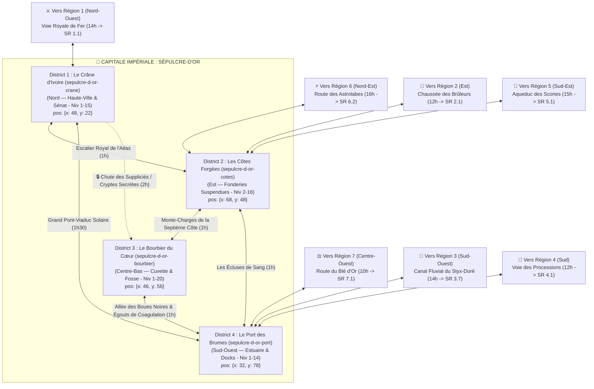

# 👑 Capitale Impériale : Sépulcre-d'Or (`sepulcre-d-or`)

> **Position sur le continent** : Carrefour central absolu d'Ombresang (`position: { x: 50, y: 48 }`)
> **Paliers de niveau** : Niveaux 1 à 20 (`niveauMin: 1`, `niveauMax: 20` — Hub évolutif de la campagne)
> **Origine divine (Bible §1.1 & §3)** : Le torse et le crâne renversé de **Sol-Invictus**, le Dieu-Roi Solaire. Une vallée-cratère ovale de 15 km de long sur 8 km de large, dominée par une cage thoracique d'ivoire fossilisé dont les douze paires d'arcs culminent à 600 mètres au-dessus du sol.

---

## 1. Hiérarchie des Boss (Monstres SRD 5.2.1)

| Échelon | Territoire | Boss / Monstre Chef (`id` SRD) | FP (CR) | Titre & Rôle Narratif |
| :--- | :--- | :--- | :---: | :--- |
| **BOSS SUPRÊME DE LA CAPITALE** | Sanctuaire Scellé (D3) | **`planetar`** *(ou **`solar`** FP 21 en phase d'Apothéose)* | **FP 16** | **Séraphiel aux Ailes Brisées** — Ancien porte-étendard céleste de Sol-Invictus, enchaîné depuis 312 ans sous le sternum de son maître ; veut purifier la ville par le feu solaire. |
| **Sous-Boss District 1** | Le Crâne d'Ivoire (`sepulcre-d-or-crane`) | **`momie-auguste`** & **`rakshasa`** | **FP 15 / 13** | **L'Empereur-Momie Aurélius Ier** (Nécropole des Empereurs) & **Le Sénateur-Masqué** (conspirateur des Cendres Blanches au Sénat). |
| **Sous-Boss District 2** | Les Côtes Forgées (`sepulcre-d-or-cotes`) | **`golem-de-fer`** *(Escorte : `golem-de-chair` FP 5)* | **FP 16** | **Le Colosse Automaton Zéro** — Prototype militaire devenu conscient au cœur de la Grande Raffinerie Vane. |
| **Sous-Boss District 3** | Le Bourbier du Cœur (`sepulcre-d-or-bourbier`) | **`pouding-noir`** *(+ **`babelien`** FP 2 & **`otyugh`** FP 5)* | **FP 4** | **Le Caillot Primordial** & **Le Roi-Gris des Égouts (`rat-garou` FP 2)** qui retient prisonnier l'ingénieur en chef des sceaux du Cœur. |
| **Sous-Boss District 4** | Le Port des Brumes (`sepulcre-d-or-port`) | **`vampire`** *(Escorte : **`vampirien`** FP 5)* | **FP 13** | **Seigneur-Amiral Noctis** — Maître du galion fantôme *L'Éclipse d'Argent* échoué contre l'Île-Lazaret. |

---

## 2. Réseau Routier Impérial, Ponts & Temps de Trajet

### 2.1. Les 7 Grandes Routes Impériales rayonnant depuis Sépulcre-d'Or
1. **Vers la Région 1 (Crêtes de Fer-Titan, Nord-Ouest)** : **Voie Royale de Fer** (part de D1/D2 $\rightarrow$ **14h de marche** jusqu'à `SR 1.1 La Vallée des Mille Épées`).
2. **Vers la Région 6 (Archipels d'Aétheria, Nord-Est)** : **Route des Astrolabes** (part de la Porte de l'Omoplate en D2 $\rightarrow$ **16h de marche** jusqu'à `SR 6.2 La Vallée des Épaves Célestes`).
3. **Vers la Région 2 (Sylve de Chair-Verte, Est)** : **Chaussée des Brûleurs** (part du Bastion Est en D2 $\rightarrow$ **12h de marche** jusqu'à `SR 2.1 La Lisière des Bûchers`).
4. **Vers la Région 5 (Caldeira d'Ignis-Vora, Sud-Est)** : **L'Aqueduc des Scories** (part de D2/D4 le long du fleuve vers le Sud-Est $\rightarrow$ **15h de marche** jusqu'à `SR 5.1 Les Écluses de Basalte & Bourg-Fournaise`).
5. **Vers la Région 4 (Plateaux d'Os-Blanc, Sud)** : **Voie des Processions** (part de D4 plein Sud $\rightarrow$ **12h de marche** jusqu'à `SR 4.1 Les Champs de Craie & Bail-les-Morts`).
6. **Vers la Région 3 (Mer de Vif-Argent, Sud-Ouest)** : **Canal Fluvial du Styx-Doré** (part des Portes Fluviales de D4 $\rightarrow$ **14h de navigation** jusqu'à `SR 3.7 Les Marécages de Mercure Dormant`).
7. **Vers la Région 7 (Terres du Péché d'Or, Centre-Ouest)** : **Route du Blé d'Or** (part de la Porte Occidentale en D1/D4 $\rightarrow$ **10h de marche** jusqu'à `SR 7.1 Les Moissons Cendrées & Bourg-Franc`).

### 2.2. Graphe de Circulation Interne (Entre les 4 Districts)



---

## 3. Charte Visuelle & Empreinte sur la Carte du Monde

### Vue Aérienne (Carte du Monde / Atlas)
- **Forme géographique** : Au centre exact du continent, douze paires de côtes géantes en ivoire blanc-doré jaillissent des deux rives du fleuve *Styx-Doré* et se rejoignent en voûte au-dessus d'une métropole de basalte noir, coiffée au Nord par le crâne colossal incliné du Dieu-Roi.
- **Palette chromatique** : Ivoire divin fossilisé (`#F4EFE6`), marbre blanc et granit noir (`#18181C`), laiton riveté et cuivre vert-de-gris (`#3E6B5C`), or d'Ichor incandescent (`#E5A93B`), velours écarlate (`#7A1C1C`).

### Vue au Sol (Exploration CRPG)
- **Atmosphère** : Ombre zébrée géante portée par les douze côtes sur la ville, contrastant avec la lueur dorée qui monte du puits du Cœur et des fonderies ; pluie fine de suie dorée ; battement sourd qui fait vibrer les pavés toutes les heures.

---

## 4. Description Détaillée des 4 Districts

---

### District 1 — Le Crâne d'Ivoire (`sepulcre-d-or-crane`)
- **Position & Frontières** : Promontoire Nord de la capitale (`position: { x: 48, y: 22 }`, `niveauMin: 1`, `niveauMax: 15` — Hub politique central rejoint depuis `SR 1.1` par la *Voie Royale de Fer*). Bâti sur le crâne renversé et les premières vertèbres cervicales de Sol-Invictus. Délimité au Sud par une falaise d'ivoire de 120 mètres surplombant le Bourbier (`D3`), à l'Est par les Côtes Forgées (`D2`) et au Sud-Ouest par le Port des Brumes (`D4`).
- **Routes & Accès** :
  - Vers `Région 1 (SR 1.1)` : **Voie Royale de Fer** (14h).
  - Vers `D2 (Les Côtes Forgées)` : **Escalier Royal de l'Atlas** (1h).
  - Vers `D4 (Le Port des Brumes)` : **Grand Pont-Viaduc Solaire** (1h30).
  - Vers `D3 (Le Bourbier du Cœur)` : **Chute des Suppliciés / Cryptes Secrètes** (2h, accès dérobé).
- **Points d'Intérêt (POI)** :
  - 🏘️ **L'Hémicycle de la Mâchoire (Quartier Sénatorial)** : Le Sénat impérial et ses villas patriciennes dont les gradins sont taillés dans les molaires d'ivoire du dieu.
  - 🏰 **Le Palais des Deux Orbites** : Résidence fortifiée de l'Impératrice-Régente Cassia Valérian, bâtie à cheval sur l'arête nasale du dieu ; deux jardins suspendus occupent les cavités oculaires.
  - 🕳️ **La Nécropole des Empereurs** : Réseau de catacombes royales scellées sous la nuque osseuse du dieu, où s'éveillent d'anciens monarques embaumés à l'Ichor.
  - ⛩️ **La Basilique du Soleil Éteint** : Cathédrale officielle où brûle une flamme d'Ichor pur gardée par des `armure-animee` (FP 1) et des `chevalier` (FP 3).
  - 🗿 **La Couronne de Vert-de-Gris** : L'arc frontal brisé du diadème solaire de Sol-Invictus, haut de cent mètres, d'où l'on domine toute la vallée centrale.
- **Boss du District** : **L'Empereur-Momie Aurélius Ier (`momie-auguste`, FP 15)** dans la Nécropole & **Le Sénateur-Masqué (`rakshasa`, FP 13)** accompagné de **`doppelganger` (FP 3)** et d'**`assassin` (FP 8)** au Sénat.

---

### District 2 — Les Côtes Forgées (`sepulcre-d-or-cotes`)
- **Position & Frontières** : Quartier industriel et arcanique vertical accroché à l'Est aux douze côtes monumentales du Dieu-Roi (`position: { x: 68, y: 48 }`, `niveauMin: 2`, `niveauMax: 16`), entre 80 et 300 mètres au-dessus du sol du Bourbier (`D3`).
- **Routes & Accès** :
  - Depuis `D1` : **Escalier Royal de l'Atlas** (1h).
  - Vers `D3` : **Monte-Charges de la Septième Côte** (1h).
  - Vers `D4` : **Les Écluses de Sang** (1h).
  - Vers `Région 6 (SR 6.2)` : **Route des Astrolabes** (16h).
  - Vers `Région 2 (SR 2.1)` : **Chaussée des Brûleurs** (12h).
  - Vers `Région 5 (SR 5.1)` : **L'Aqueduc des Scories** (15h).
- **Points d'Intérêt (POI)** :
  - 🏘️ **Le Pont des Soupirs d'Airain** : Rue-pont couverte suspendue entre deux côtes, abritant les échoppes d'armuriers, d'alchimistes et de marchands de fioles d'Ichor.
  - 🏰 **La Grande Raffinerie Vane** : Cœur industriel blindé du Consortium des Veines d'Or, grappe d'alambics géants en cuivre et verre suspendue sous la Quatrième Côte.
  - 🕳️ **L'Atelier des Chair-Cousues** : Laboratoire clandestin creusé dans la cavité spongieuse d'une côte géante où l'on greffe de l'Ichor sur des `golem-de-chair`.
  - ⛩️ **Chapelle de Sainte-Soupape** : Oratoire enfumé des maîtres-artificiers où l'on bénit les cœurs mécaniques des automates avant leur mise sous pression.
  - 🗿 **L'Université de l'Artifice (La Septième Côte)** : Tour académique monumentale sculptée directement *à l'intérieur* d'une côte d'ivoire creusée de trois cents mètres de haut.
- **Boss du District** : **Le Colosse Automaton Zéro (`golem-de-fer`, FP 16)** entouré de **`golem-de-pierre` (FP 10)**, de **`golem-de-chair` (FP 5)** et de **`mage` (FP 6)**.

---

### District 3 — Le Bourbier du Cœur (`sepulcre-d-or-bourbier`)
- **Position & Frontières** : La cuvette centrale au niveau du sol (`position: { x: 46, y: 56 }`, `niveauMin: 1`, `niveauMax: 20`), encaissée sous la voûte des douze côtes (`D2`), au pied de la falaise du Crâne (`D1`) et en amont du Port (`D4`).
- **Routes & Accès** :
  - Depuis `D1` : **Chute des Suppliciés / Cryptes Secrètes** (2h).
  - Depuis `D2` : **Monte-Charges de la Septième Côte** (1h).
  - Vers `D4` : **Allée des Boues Noires & Égouts de Coagulation** (1h).
- **Points d'Intérêt (POI)** :
  - 🏘️ **La Cour des Miracles Sanglants** : Bidonville sur pilotis construit autour de la taverne *La Veine Crevée*, fief de la guilde des voleurs et des rats-garous.
  - 🏰 **L'Arène des Stigmatisés** : Bastion-amphithéâtre souterrain éclairé au naphte où la Légion fait combattre gladiateurs et monstres mutés par l'Ichor.
  - 🕳️ **L'Égout des Coagulations** : Dédale souterrain d'évacuation des résidus d'Ichor où prolifèrent les vases de sang divin et les Otyughs.
  - ⛩️ **La Chapelle des Pénitents Cachés** : Sanctuaire clandestin de l'Ordre des Pénitents du Silence dissimulé sous un abattoir désaffecté.
  - 🗿 **La Fosse Cardiaque (Le Cœur Pétrifié)** : Gouffre minier en entonnoir de 300 mètres de profondeur au fond duquel bat le Cœur géant de Sol-Invictus et où est enchaîné Séraphiel.
- **Boss du District** : **Le Caillot Primordial (`pouding-noir`, FP 4 + `babelien` FP 2)**, **Le Roi-Gris (`rat-garou`, FP 2 + `otyugh` FP 5)** dans les Égouts, et **Séraphiel aux Ailes Brisées (`planetar`, FP 16)** au fond de la Fosse Cardiaque.

---

### District 4 — Le Port des Brumes (`sepulcre-d-or-port`)
- **Position & Frontières** : Bassin Sud-Ouest de la capitale (`position: { x: 32, y: 78 }`, `niveauMin: 1`, `niveauMax: 14`), là où le fleuve *Styx-Doré* sort de la cage thoracique entre les côtes flottantes.
- **Routes & Accès** :
  - Depuis `D1` : **Grand Pont-Viaduc Solaire** (1h30).
  - Depuis `D2` : **Les Écluses de Sang** (1h).
  - Depuis `D3` : **Allée des Boues Noires & Égouts de Coagulation** (1h).
  - Vers `Région 7 (SR 7.1)` : **Route du Blé d'Or** (10h).
  - Vers `Région 3 (SR 3.7)` : **Canal Fluvial du Styx-Doré** (14h).
  - Vers `Région 4 (SR 4.1)` : **Voie des Processions** (12h).
- **Points d'Intérêt (POI)** :
  - 🏘️ **Les Quais des Galères-Citadelles** : Docks militaires et marchands où accostent les barges cuirassées d'Ichor et où s'espionnent les émissaires des provinces.
  - 🏰 **L'Île-Lazaret de Sainte-Lacrima** : Île-forteresse de quarantaine au milieu du fleuve, entourée de chaînes de fer, où sont parqués les pestiférés mutés par l'Ichor.
  - 🕳️ **La Halle aux Reliques Grises** : Entrepôt douanier souterrain sous les docks, gardé par des `golem-de-pierre` (FP 10) et des `mimique` (FP 2).
  - ⛩️ **L'Oratoire des Passeurs du Styx** : Temple portuaire baigné de brume où les marins paient une obole d'or avant de descendre vers la Mer de Vif-Argent.
  - 🗿 **L'Allée des Huit Bannières & Les Deux Côtes Flottantes** : Avenue monumentale passant sous les deux dernières côtes d'ivoire dressées comme les piliers d'un portique géant sur le fleuve.
- **Boss du District** : **Seigneur-Amiral Noctis (`vampire`, FP 13)** entouré de ses **`vampirien` (FP 5)** dans la cale du vaisseau fantôme *L'Éclipse d'Argent*.

---

## 5. Prompt Cartographique de Référence (Capitale)

```text
Dark fantasy digital painting, top-down cartographer's city map of Sépulcre-d'Or, the Imperial Capital built inside the colossal fossilized ribcage of a fallen sun god.
Twelve gigantic curved ivory ribs arch over a sprawling dark-stone medieval metropolis split by a dark river glowing with veins of liquid gold, crossed by four fortified stone bridges.
Four distinct districts clearly visible from above:
1. North (D1): The Ivory Skull acropolis with white marble palaces and two circular plazas inside the giant eye sockets.
2. East (D2): The Forged Ribs district with brass foundries, copper domes, and iron walkways suspended directly from the giant white ribs.
3. Center (D3): The Heart-Mire slums arranged in concentric rings around a deep glowing golden pit (the Petrified Heart) at the center of the ribcage.
4. South-West (D4): The foggy river harbour with stone docks, ironclad river-galleys, and a quarantined fortress-island in the middle of the river.
Palette: aged ivory white, liquid gold, obsidian black, verdigris copper, crimson banners. No text, no labels, no UI.
```
