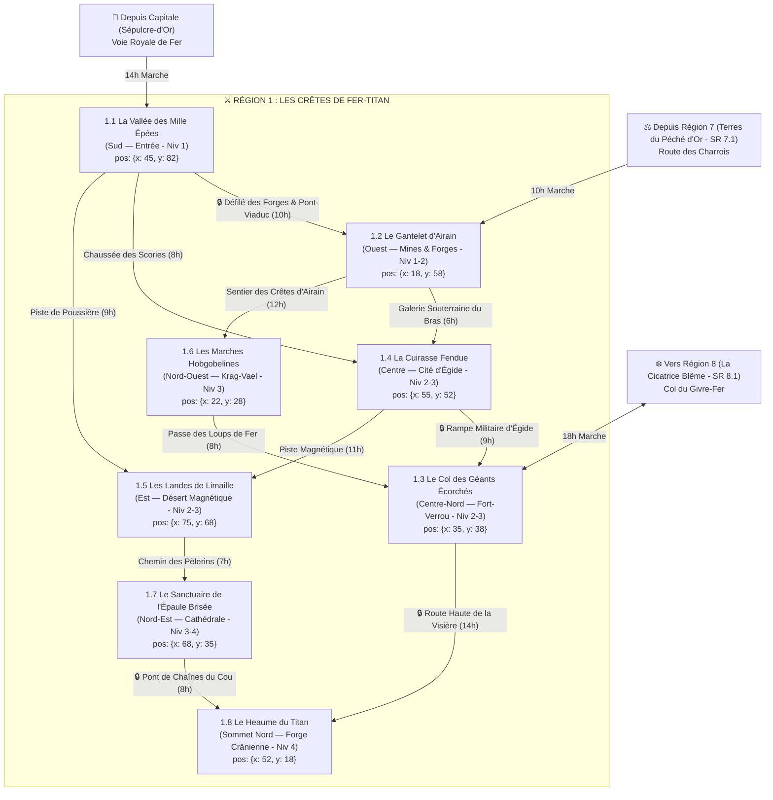

# ⚔️ Région 1 : Les Crêtes de Fer-Titan (`cretes-de-fer-titan`)

> **Position sur le continent** : Nord-Ouest d'Ombresang (`position: { x: 22, y: 26 }`)
> **Paliers de niveau** : Niveaux 1 à 4 (`niveauMin: 1`, `niveauMax: 4`)
> **Origine divine (Bible §1.1 & §4)** : Le corps en armure brisée de **Vael-Khor**, le Dieu de la Guerre et de la Forge, et ses armes cyclopéennes fichées dans la croûte terrestre. Bordée au Nord-Est par *La Cicatrice Blême* (`Région 8`), au Sud par les *Terres du Péché d'Or* (`Région 7`), et au Sud-Est par la Capitale *Sépulcre-d'Or*.

---

## 1. Hiérarchie des Boss (Monstres SRD 5.2.1)

| Échelon | Territoire | Boss / Monstre Chef (`id` SRD) | FP (CR) | Titre & Rôle Narratif |
| :--- | :--- | :--- | :---: | :--- |
| **BOSS DE RÉGION (1A)** | Le Heaume du Titan (SR 1.8) | **`golem-de-fer`** *(+ Maréchal Kael `chevalier` FP 3)* | **FP 16** | **Le Colosse Primordial de Vael-Khor** — Enveloppe mécanique géante animée dans la Forge Crânienne par le Seigneur-Maréchal Draven Kael. |
| **BOSS DE RÉGION (1B)** | Le Heaume du Titan (SR 1.8) | **`diantrefosse`** | **FP 20** | **Le Forge-Sang Ignirax** — Émissaire infernal lié au Concile des Cendres Blanches qui alimente la Forge Crânienne. |
| **Sous-Boss SR 1.1** | La Vallée des Mille Épées | **`oxydeur`** *(Alpha + `armure-animee` FP 1 & `epee-volante` FP 1/4)* | **FP 1/2** | **La Reine des Rouilles & Le Maître d'Armes Sans Corps** — Menacent d'effondrer le Pont-Viaduc de Lame-Rousse. |
| **Sous-Boss SR 1.2** | Le Gantelet d'Airain | **`diable-des-chaines`** *(Escorte : `diable-barbu` FP 3 & `sentinelle-azer` FP 2)* | **FP 8** | **Kardok le Contremaître** — Dirige la fonderie clandestine d'armes maudites au fond des Mines de Moelle-Fer. |
| **Sous-Boss SR 1.3** | Le Col des Géants Écorchés | **`geant-du-feu`** *(+ `geant-des-pierres` FP 7 & `ogre` FP 2)* | **FP 9** | **Thrym Barbe-de-Braise** — Chef de clan géant assiégeant Fort-Verrou pour récupérer le marteau brisé de Vael-Khor. |
| **Sous-Boss SR 1.4** | La Cuirasse Fendue | **`golem-de-pierre`** *(ou `golem-de-fer` FP 16 + `mage` FP 6)* | **FP 10** | **Le Prévôt Mécanique Ferrus** — Gardien des cuves de transfert d'âmes dans les Galeries de Scories sous Égide. |
| **Sous-Boss SR 1.5** | Les Landes de Limaille | **`behir`** *(+ `gorgone` FP 5 dans les dunes)* | **FP 11** | **Foudre-d'Acier** — Reptile foudroyant enroulé autour de la flèche de la Tour Paratonnerre. |
| **Sous-Boss SR 1.6** | Les Marches Hobgobelines | **`capitaine-hobgobelin`** *(Monté sur `molosse-infernal` FP 3 + `worg` FP 1/2)* | **FP 3 (5)** | **Seigneur de Guerre Urzok** — Général hobgobelin muté à la rouille divine qui prépare l'invasion de la vallée. |
| **Sous-Boss SR 1.7** | Le Sanctuaire de l'Épaule | **`golem-d-argile`** *(+ `pretre` FP 2 / `mage` FP 6 & **`deva`** FP 10 captif)* | **FP 9** | **L'Inquisiteur-Saigneur Malvus & Le Gardien d'Argile** — Saignent le Déva céleste sous la Cathédrale Penchée. |
| **Sous-Boss SR 1.8** | Le Heaume du Titan | **`golem-de-fer`** & **`diantrefosse`** | **FP 16 / 20** | **Le Sommet de la Croisade des Sans-Âme**. |

---

## 2. Réseau Routier, Cols & Temps de Trajet



### Verrous Stratégiques de la Région 1
1. **Le Pont-Viaduc de Lame-Rousse (`SR 1.1`)** : Seul pont permettant aux convois lourds de franchir la rivière d'Oxyde vers `SR 1.2` ; ses piliers sont rongés par la colonie d'`oxydeur`.
2. **La Muraille de Fort-Verrou (`SR 1.3`)** : Barre hermétiquement le Col des Géants Écorchés vers `SR 1.8` et vers la `Région 8` (`SR 8.1`).
3. **Le Pont de Chaînes du Cou (`SR 1.7 -> SR 1.8`)** : Permet d'atteindre le Heaume du Titan en contournant le blocus de Fort-Verrou.

---

## 3. Charte Visuelle & Empreinte sur la Carte du Monde

### Vue Aérienne (Carte du Monde / Atlas)
- **Forme géographique** : Chaîne de montagnes orientée Sud-Ouest $\rightarrow$ Nord-Est épousant la forme du guerrier géant **Vael-Khor** tombé sur le flanc : son casque cornu fendu au Nord (`SR 1.8`), son épaulière brisée au Nord-Est (`SR 1.7`), son plastron d'acier fendu au Centre (`SR 1.4`), son gantelet à cinq doigts recourbés à l'Ouest (`SR 1.2`) et son champ d'épées géantes plantées au Sud (`SR 1.1`).
- **Palette chromatique** : Acier météorique sombre (`#2B303A`), rouille sanglante (`#8C3B2B`), ocre de limaille (`#C47D3B`), noir de charbon (`#141416`), névés d'altitude (`#D8DCE3`), lueur orange de forge (`#FF5E1A`).

### Vue au Sol (Exploration CRPG)
- **Atmosphère** : Vent glacial chargé de limaille métallique étincelante ; rivières rouge-rouille ; grondement incessant des marteaux-pilons et éclairs magnétiques frappant les lames géantes.

---

## 4. Description Détaillée des 8 Sous-Régions

---

### SR 1.1 — La Vallée des Mille Épées (`la-vallee-des-mille-epees`) — ⭐ POINT DE DÉPART DU JEU
- **Position & Frontières** : Porte d'entrée méridionale (`position: { x: 45, y: 82 }`, `niveauMin: 1`, `niveauMax: 1` — **Zone de Départ de la Campagne, `lieu: "lame-rousse"`**). Bordée au Sud-Est par les plaines de la Capitale, au Nord par la Cuirasse (`SR 1.4`), à l'Ouest par le Gantelet (`SR 1.2`) et à l'Est par les Landes de Limaille (`SR 1.5`).
- **Routes & Accès** :
  - Depuis la Capitale (`D1/D2`) : **Voie Royale de Fer** (14h).
  - Vers `SR 1.2` : **Défilé des Forges** (10h, via le Pont-Viaduc).
  - Vers `SR 1.4` : **Chaussée des Scories** (8h).
  - Vers `SR 1.5` : **Piste de Poussière** (9h).
- **Points d'Intérêt (POI)** :
  - 🏘️ **Village de Lame-Rousse** : Bourg de 800 âmes construit autour du viaduc ; ses vingt forges à aubes utilisent le métal gratté sur les armes divines.
  - 🏰 **Le Bastion du Pont-Viaduc** : Tour de péage et de garde protégeant l'arche de fer qui enjambe le torrent d'Oxyde.
  - 🕳️ **La Grotte des Rouilles** : Réseau de cavernes rouge-ocre sous le pilier nord du viaduc, nid de la Reine des `oxydeur`.
  - ⛩️ **Le Temple du Glaive Brisé** : Ancien sanctuaire martial bâti dans la garde cruciforme d'une épée géante couchée au sol.
  - 🗿 **La Forêt d'Acier** : Champ de bataille pétrifié où plus de cent épées, hallebardes et lances géantes (de 50 à 250 mètres de haut) sont plantées de biais dans le roc.
- **Boss de Sous-Région** : **La Reine des Rouilles (`oxydeur`, FP 1/2)** & **Le Maître d'Armes Sans Corps (`armure-animee` FP 1 + 4 `epee-volante` FP 1/4)**.

---

### SR 1.2 — Le Gantelet d'Airain (`le-gantelet-d-airain`)
- **Position & Frontières** : Massif occidental (`position: { x: 18, y: 58 }`, `niveauMin: 1`, `niveauMax: 2`), formé par les cinq crêtes parallèles du gantelet de bronze noirci de Vael-Khor. Voisin de `SR 1.1` (Sud-Est), `SR 1.4` (Est), `SR 1.6` (Nord) et de la `Région 7` (Sud).
- **Routes & Accès** :
  - Depuis `SR 1.1` : **Défilé des Forges** (10h).
  - Depuis `Région 7 (SR 7.1)` : **Route des Charrois** (10h).
  - Vers `SR 1.4` : **Galerie Souterraine du Bras** (6h, par les rails miniers).
  - Vers `SR 1.6` : **Sentier des Crêtes d'Airain** (12h).
- **Points d'Intérêt (POI)** :
  - 🏘️ **Bourg-Minier de Phalange** : Ville ouvrière étagée en escaliers dans les jointures des trois doigts centraux du gantelet divin.
  - 🏰 **La Fonderie des Chaînes (L'Abîme des Marteaux)** : Usine-forteresse souterraine secrète au fond du puits minier principal.
  - 🕳️ **Les Mines de Moelle-Fer** : Puits vertical plongeant sous la paume blindée du dieu, où coule une veine d'Ichor ferreux incandescent.
  - ⛩️ **Le Sanctuaire du Poing Fermé** : Temple nain rebelle dissimulé sous le pouce replié du gantelet, refuge de Mère-Enclume Bruna.
  - 🗿 **Les Cinq Doigts d'Airain** : Cinq falaises recourbées en bronze vert-de-gris de deux cents mètres de haut dominant l'océan occidental.
- **Boss de Sous-Région** : **Kardok le Contremaître (`diable-des-chaines`, FP 8)** entouré de **`diable-barbu` (FP 3)** et de **`sentinelle-azer` (FP 2)** asservis.

---

### SR 1.3 — Le Col des Géants Écorchés (`le-col-des-geants-ecorches`)
- **Position & Frontières** : Haute passe enneigée du Centre-Nord (`position: { x: 35, y: 38 }`, `niveauMin: 2`, `niveauMax: 3`), coincée entre le Heaume (`SR 1.8` au Nord-Est), les Marches Hobgobelines (`SR 1.6` à l'Ouest), la Cuirasse (`SR 1.4` au Sud) et la `Région 8` au Nord.
- **Routes & Accès** :
  - Depuis `SR 1.4` : **Rampe Militaire d'Égide** (9h).
  - Depuis `SR 1.6` : **Passe des Loups de Fer** (8h).
  - Vers `SR 1.8` : **Route Haute de la Visière** (14h, verrouillée par Fort-Verrou).
  - Vers `Région 8 (SR 8.1 Fort-Boréal)` : **Col du Givre-Fer** (18h).
- **Points d'Intérêt (POI)** :
  - 🏘️ **Village montagnard de Givre-Fer** : Hameau de muletiers blotti au pied sud de la muraille, affamé par les réquisitions militaires.
  - 🏰 **Citadelle de Fort-Verrou** : Forteresse-barrage impériale en pierre noire et fonte barrant les 400 mètres de largeur du col.
  - 🕳️ **La Caverne des Crânes de Pierre** : Campement troglodyte assiégeant le col, occupé par les clans de géants.
  - ⛩️ **Chapelle des Veilleurs du Col** : Oratoire militaire creusé dans le rempart où brûle une huile ardente contre le gel.
  - 🗿 **L'Autel des Tonnerres** : Crête surplombant le fort où gît le manche brisé du marteau cyclopéen de Vael-Khor.
- **Boss de Sous-Région** : **Thrym Barbe-de-Braise (`geant-du-feu`, FP 9)** flanqué de **`geant-des-pierres` (FP 7)** et d'**`ogre` (FP 2)**.

---

### SR 1.4 — La Cuirasse Fendue (`la-cuirasse-fendue`)
- **Position & Frontières** : Cœur géographique et militaire de la Région 1 (`position: { x: 55, y: 52 }`, `niveauMin: 2`, `niveauMax: 3`). Plateau bombé fait de plaques d'armure divines fendu en son milieu par un gouffre fumant de 20 km. Entouré par `SR 1.1` (Sud), `SR 1.2` (Ouest), `SR 1.3` (Nord-Ouest) et `SR 1.5` (Est).
- **Routes & Accès** :
  - Depuis `SR 1.1` : **Chaussée des Scories** (8h).
  - Depuis `SR 1.2` : **Galerie Souterraine du Bras** (6h).
  - Vers `SR 1.3` : **Rampe Militaire d'Égide** (9h).
  - Vers `SR 1.5` : **Piste Magnétique** (11h).
- **Points d'Intérêt (POI)** :
  - 🏘️ **Les Faubourgs des Conscrits d'Égide** : Quartiers civils et marchands bordant les casernes, où les familles cherchent leurs fils disparus.
  - 🏰 **Cité-Caserne d'Égide** : Citadelle-garnison géométrique de 5 000 soldats bâtie à cheval sur la fente du plastron divin.
  - 🕳️ **Les Galeries de Scories** : Complexe souterrain sous le plastron fendu où l'âme des conscrits est transférée dans des automates.
  - ⛩️ **Le Monastère des Lames Silencieuses** : Ordre monastique d'escrimeurs ascètes bâti sur le rebord nord de la faille.
  - 🗿 **Le Gouffre des Enclumes** : Point le plus profond de la crevasse où résonnent les marteaux automatiques dans le sternum du dieu.
- **Boss de Sous-Région** : **Le Prévôt Mécanique Ferrus (`golem-de-pierre`, FP 10 — ou `golem-de-fer` FP 16)** assisté d'un **`mage` (FP 6)**.

---

### SR 1.5 — Les Landes de Limaille (`les-landes-de-limaille`)
- **Position & Frontières** : Bassin oriental désolé situé sous le bras droit brisé du dieu (`position: { x: 75, y: 68 }`, `niveauMin: 2`, `niveauMax: 3`). Désert de dunes de limaille de fer noire et grise, bordé à l'Ouest par `SR 1.1` et `SR 1.4`, et au Nord par `SR 1.7`.
- **Routes & Accès** :
  - Depuis `SR 1.1` : **Piste de Poussière** (9h).
  - Depuis `SR 1.4` : **Piste Magnétique** (11h).
  - Vers `SR 1.7` : **Chemin des Pèlerins** (7h).
- **Points d'Intérêt (POI)** :
  - 🏘️ **Hameau de Grise-Poudre** : Relais de chercheurs d'aimants aux maisons de bois assemblées sans aucun clou de fer.
  - 🏰 **Fortin des Paratonnerres** : Poste de garde isolé entouré d'une cage de cuivre qui protège les caravanes des tempêtes électriques.
  - 🕳️ **La Tanière de la Cuirasse Enfouie** : Grotte souterraine sous les dunes magnétiques où rôdent des **`bulette` (FP 5)** et une **`gorgone` (FP 5)**.
  - ⛩️ **L'Oratoire des Foudroyés** : Ruine circulaire de verre fulgurite vitrifié au pied de la Tour.
  - 🗿 **La Tour Paratonnerre** : L'aiguillon d'épaule en acier tordu de Vael-Khor, haut de 180 mètres, frappé par la foudre toutes les minutes.
- **Boss de Sous-Région** : **Foudre-d'Acier (`behir`, FP 11)** et **Le Taureau de Fonte (`gorgone`, FP 5)**.

---

### SR 1.6 — Les Marches Hobgobelines de Fer-Sang (`les-marches-hobgobelines-de-fer-sang`)
- **Position & Frontières** : Vallées sauvages et escarpées du Nord-Ouest (`position: { x: 22, y: 28 }`, `niveauMin: 3`, `niveauMax: 3`), entre le Gantelet (`SR 1.2`) au Sud et le Col des Géants (`SR 1.3`) à l'Est.
- **Routes & Accès** :
  - Depuis `SR 1.2` : **Sentier des Crêtes d'Airain** (12h).
  - Vers `SR 1.3` : **Passe des Loups de Fer** (8h).
- **Points d'Intérêt (POI)** :
  - 🏘️ **Village occupé de Val-Martel** : Bourg humain dont les forgerons sont forcés de battre des armes pour l'armée hobgobeline.
  - 🏰 **Camp-Forteresse de Krag-Vael** : Citadelle de fer rouillé et de bois érigée par la Légion Hobgobeline de Fer-Sang.
  - 🕳️ **Les Grottes à Worgs** : Tanières souterraines chauffées par des sources ferrugineuses où sont élevés les `worg` et `molosse-infernal`.
  - ⛩️ **Le Temple du Loup d'Acier** : Sanctuaire sanglant où les chefs hobgobelins boivent la rouille mêlée d'Ichor du dieu mort.
  - 🗿 **Le Bélier-Montagne** : Machine de siège colossale taillée dans l'os de l'avant-bras du dieu, pointée vers la vallée.
- **Boss de Sous-Région** : **Seigneur de Guerre Urzok (`capitaine-hobgobelin`, FP 3)** entouré de **`combattant-gobelours` (FP 1)**, de **`worg` (FP 1/2)** et d'un **`molosse-infernal` (FP 3)**.

---

### SR 1.7 — Le Sanctuaire de l'Épaule Brisée (`le-sanctuaire-de-l-epaule-brisee`)
- **Position & Frontières** : Flanc Nord-Est de la montagne (`position: { x: 68, y: 35 }`, `niveauMin: 3`, `niveauMax: 4`), là où l'immense épaulière d'armure de Vael-Khor émerge de la roche à 2 000 mètres d'altitude. Relie `SR 1.5` (Sud) et `SR 1.8` (Nord-Ouest).
- **Routes & Accès** :
  - Depuis `SR 1.5` : **Chemin des Pèlerins** (7h).
  - Vers `SR 1.8` : **Pont de Chaînes du Cou** (8h).
- **Points d'Intérêt (POI)** :
  - 🏘️ **Village de Pèlerinage d'Aile-de-Plomb** : Bourg d'apothicaires et d'alchimistes accroché aux contreforts de l'épaulière divine.
  - 🏰 **La Tour du Garde-Chaîne** : Bastion commandant le treuil du Pont de Chaînes du Cou vers le Heaume.
  - 🕳️ **Les Catacombes des Porte-Boucliers** : Crypte inondée de mercure rouge sous la nef de la cathédrale.
  - ⛩️ **La Cathédrale Penchée** : Immense basilique gothique construite sur l'épaulière du dieu, inclinée tout entière à 20 degrés.
  - 🗿 **La Source de Mercure Rouge** : Bassin sacré au fond des catacombes où le **`deva` (FP 10)** céleste est maintenu enchaîné et saigné.
- **Boss de Sous-Région** : **Le Gardien d'Argile (`golem-d-argile`, FP 9)** & **L'Inquisiteur-Saigneur Malvus (`pretre` FP 2 / `mage` FP 6)** — et le **`deva` (FP 10)** captif.

---

### SR 1.8 — Le Heaume du Titan (`le-heaume-du-titan`)
- **Position & Frontières** : Sommet Nord et cœur de la Région 1 (`position: { x: 52, y: 18 }`, `niveauMin: 4`, `niveauMax: 4`, altitude 3 500 m), formé par la tête casquée colossale de Vael-Khor couchée dans les glaces.
- **Routes & Accès** :
  - Depuis `SR 1.3` : **Route Haute de la Visière** (14h).
  - Depuis `SR 1.7` : **Pont de Chaînes du Cou** (8h).
- **Points d'Intérêt (POI)** :
  - 🏘️ **Camp des Mineurs Forçats** : Baraquements fortifiés où survivent les prisonniers politiques rebelles.
  - 🏰 **Citadelle de la Visière** : Bastion impérial imprenable du Maréchal Kael, construit directement en travers de la fente oculaire du heaume divin.
  - 🕳️ **Les Puits d'Incandescence** : Galeries d'extraction de feu divin creusées dans les cornes du heaume.
  - ⛩️ **L'Autel du Serment de Fer** : Salle de commandement où les officiers de Kael reçoivent leur cœur mécanique.
  - 🗿 **La Forge Crânienne** : L'intérieur caverneux et incandescent du crâne de métal de Vael-Khor, où le cerveau du dieu est devenu un océan d'Ichor en fusion et d'engrenages cyclopéens.
- **Boss Final de la Région** : **Seigneur-Maréchal Draven Kael (`chevalier`, FP 3)**, **Le Colosse Primordial (`golem-de-fer`, FP 16)** & **Le Forge-Sang Ignirax (`diantrefosse`, FP 20)**.

---

## 5. Prompt Cartographique de Référence (Région 1)

```text
Dark fantasy digital painting, top-down regional map of 'Les Crêtes de Fer-Titan', a mountain province formed by the shattered colossal armored body of a fallen war god, with a clear network of roads, bridges and passes connecting 8 sub-regions.
Visible landmarks across the region:
- North Peak (SR 1.8): A mountain peak shaped like a colossal cleft iron helmet glowing with red forge-fire inside its visor, linked by a giant chain-bridge to a tilted gothic cathedral on a giant armor-pauldron to the North-East (SR 1.7).
- Center-North (SR 1.3): A snowy mountain pass blocked by a massive black-iron wall fortress.
- Center (SR 1.4): A broad metallic plateau formed by a giant cracked breastplate, with a geometric black-iron garrison city along the fissure.
- West (SR 1.2): Five curved mountain ridges shaped like a giant bronze gauntlet with deep open-pit mines between the fingers, and hobgoblin war-camps to the North-West (SR 1.6).
- South Entrance (SR 1.1): A narrow canyon bristling with hundreds of titanic rusted swords thrust into the earth, crossed by an iron viaduct over a rust-red river.
- South-East (SR 1.5): Grey magnetic iron-sand dunes around a lightning-struck spire.
Palette: meteoric steel grey, rust-red rivers, oxidized copper, coal black, snow-dusted peaks, forge-fire orange glow. No text, no labels, no UI.
```
