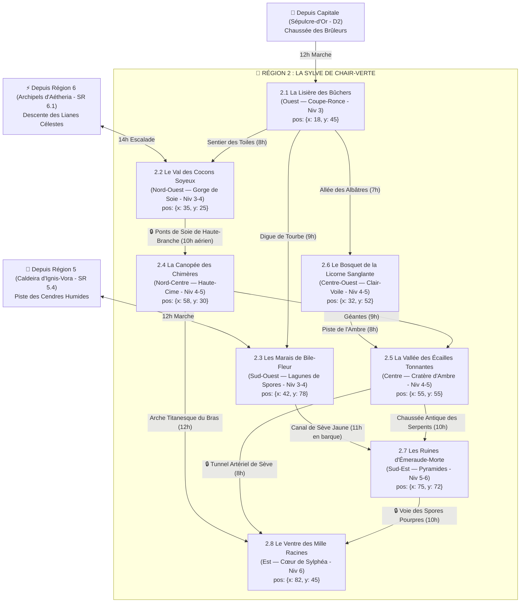

# 🌿 Région 2 : La Sylve de Chair-Verte (`sylve-de-chair-verte`)

> **Position sur le continent** : Est d'Ombresang (`position: { x: 80, y: 46 }`)
> **Paliers de niveau** : Niveaux 3 à 6 (`niveauMin: 3`, `niveauMax: 6`)
> **Origine divine (Bible §1.1 & §4)** : Le corps fécond et décomposé de **Sylphéa**, Déesse de la Vie, des Moissons et des Bêtes. Une jungle titanesque, carnivore et bioluminescente où plantes, bêtes et ossements fusionnent. Bordée à l'Ouest par la Capitale *Sépulcre-d'Or*, au Nord par les *Archipels Célestes d'Aétheria* (`Région 6`), et au Sud par la *Caldeira d'Ignis-Vora* (`Région 5`).

---

## 1. Hiérarchie des Boss (Monstres SRD 5.2.1)

| Échelon | Territoire | Boss / Monstre Chef (`id` SRD) | FP (CR) | Titre & Rôle Narratif |
| :--- | :--- | :--- | :---: | :--- |
| **BOSS DE RÉGION (1A)** | Le Ventre des Mille Racines (SR 2.8) | **`ver-pourpre`** & **`hydre`** | **FP 15 / 8** | **L'Avatar du Bourgeon Rouge & L'Hydre-Racine** — Monstruosités symbiotiques greffées sur le cœur végétal de Sylphéa. |
| **BOSS DE RÉGION (1B)** | Le Ventre des Mille Racines (SR 2.8) | **`archimage`** *(Profil d'Archidruidesse + `druide` FP 2 & `sylvanien` FP 9)* | **FP 12** | **L'Archidruidesse Ysolde des Spores** — Dirige la *Moisson Dévoreuse* pour engloutir les cités de pierre sous la jungle. |
| **Sous-Boss SR 2.1** | La Lisière des Bûchers | **`sylvanien`** *(Escorte : 3x `arbre-eveille` FP 2)* | **FP 9** | **Chêne-Sang l'Écorché** — Ancien gardien du bosquet sacré qui attaque les scieries de Coupe-Ronce chaque nuit. |
| **Sous-Boss SR 2.2** | Le Val des Cocons Soyeux | **`drider`** *(Escorte : `araignee-de-phase` FP 3 & `ettercap` FP 2)* | **FP 6** | **Arachnéa la Mère-Tisseuse** — Reine mutée par la sève d'Ichor qui règne sur le temple souterrain des gorges de soie. |
| **Sous-Boss SR 2.3** | Les Marais de Bile-Fleur | **`guenaude-nocturne`** *(+ 2x `guenaude-verte` FP 3 & `tertre-errant` FP 5)* | **FP 5** | **Le Couvent des Trois Chaudrons** — Sorcières distillant les rêves des villageois endormis par les spores. |
| **Sous-Boss SR 2.4** | La Canopée des Chimères | **`chimere`** *(Escorte : couple de `manticore` FP 3)* | **FP 6** | **Gueule-d'Orage** — Prédateur ailé muté par le pollen divin qui assiège le dirigeable du Consortium. |
| **Sous-Boss SR 2.5** | La Vallée des Écailles | **`tyrannosaure`** *(+ `allosaure` FP 2 & `ankylosaure` FP 3)* | **FP 8** | **Roi-Écaille Rex** — Saurien colossal dominant le Cratère Chaud et le camp des braconniers. |
| **Sous-Boss SR 2.6** | Le Bosquet de la Licorne | **`licorne`** *(Corrompue + **`ours-garou`** FP 5 & **`loup-garou`** FP 3)* | **FP 5** | **La Licorne d'Ichor Noir & Fenrir Ronce-Noire** — S'affrontent autour de la Fontaine de Sève Pure. |
| **Sous-Boss SR 2.7** | Les Ruines d'Émeraude | **`dragon-vert-adulte`** *(Face à `naga-gardien` FP 10 & `couatl` FP 4)* | **FP 15** | **Vermeil-le-Siffleur** — Dragon vert qui se fait adorer comme la réincarnation de Sylphéa au sommet de la pyramide. |
| **Sous-Boss SR 2.8** | Le Ventre des Racines | **`ver-pourpre`**, **`hydre`** & **`archimage`** *(+ `babelien` FP 2)* | **FP 15 / 12** | **La Trinité du Bourgeon Rouge**. |

---

## 2. Réseau Routier, Fleuves de Sève & Temps de Trajet



### Verrous Stratégiques de la Région 2
1. **La Tranchée de Naphte de Coupe-Ronce (`SR 2.1`)** : Filtre militaire et lance-flammes du Consortium à l'entrée Ouest.
2. **Double Réseau (Sol vs Canopée `SR 2.2 -> SR 2.4`)** : Les *Ponts de Soie* permettent d'éviter les marais et les dinosaures du sol en passant à 100 m de hauteur.
3. **Le Dôme du Ventre des Mille Racines (`SR 2.8`)** : Protégé par un mur végétal hermétique ; accessible uniquement par le *Tunnel Artériel* (`SR 2.5`), l'*Arche du Bras* (`SR 2.4`) ou le mot de passe druidique de la *Voie des Spores* (`SR 2.7`).

---

## 3. Charte Visuelle & Empreinte sur la Carte du Monde

### Vue Aérienne (Carte du Monde / Atlas)
- **Forme géographique** : Mer végétale dense à l'Est épousant les courbes de la déesse **Sylphéa** : à l'Ouest la cicatrice noire et enflammée de la Lisière (`SR 2.1`), au Nord-Ouest le canyon blanc de toiles d'araignée (`SR 2.2`), au Nord les branches géantes fossilisées émergeant de la canopée (`SR 2.4`), au Centre la caldeira circulaire bordée de falaises d'ambre jaune (`SR 2.5`) et la clairière d'argent (`SR 2.6`), au Sud les lagunes violettes (`SR 2.3`) et les pyramides vertes (`SR 2.7`), et à l'Est le dôme montagneux de racines rouges et émeraude (`SR 2.8`).
- **Palette chromatique** : Bois-chair acajou, ambre jaune (`#D97706`), soie blanche, vert émeraude profond (`#143D29`), vert bioluminescent (`#4ADE80`), pourpre orchidée (`#7E2253`), cyan fongique (`#22D3EE`).

### Vue au Sol (Exploration CRPG)
- **Atmosphère** : Brume chaude saturée de pollen doré et de spores bleues ; arbres dont l'écorce pulse comme de la chair et saigne une sève rouge-or ; fleurs carnivores géantes.

---

## 4. Description Détaillée des 8 Sous-Régions

---

### SR 2.1 — La Lisière des Bûchers (`la-lisiere-des-buchers`)
- **Position & Frontières** : Frontière occidentale de la Sylve (`position: { x: 18, y: 45 }`, `niveauMin: 3`, `niveauMax: 3`). Bande de 5 km de terre brûlée et de tranchées de naphte enflammé face à `SR 2.2` (Nord-Est), `SR 2.6` (Est) et `SR 2.3` (Sud-Est).
- **Routes & Accès** :
  - Depuis la Capitale (`D2`) : **Chaussée des Brûleurs** (12h).
  - Vers `SR 2.2` : **Sentier des Toiles** (8h).
  - Vers `SR 2.6` : **Allée des Albâtres** (7h).
  - Vers `SR 2.3` : **Digue de Tourbe** (9h).
- **Points d'Intérêt (POI)** :
  - 🏘️ **Les Scieries Calcinées** : Campement ouvrier autour de trois scieries mécaniques au bord de la forêt, attaquées la nuit par la révolte des arbres.
  - 🏰 **Bourg-Fortifié de Coupe-Ronce** : Bastion de bûcherons, de sapeurs-brûleurs du Consortium et de Garde-Lisières, ceint d'une douve d'huile ardente.
  - 🕳️ **La Grotte des Sèves Noires** : Cavité sous les racines d'un arbre abattu de 20 mètres de diamètre où suinte de l'Ichor végétal.
  - ⛩️ **Sanctuaire de la Graine Volée** : Autel sylvestre profané où le contremaître de la scierie a dérobé le *Cœur-Graine*.
  - 🗿 **L'Arbre-Pendu** : Chêne pétrifié géant à la lisière où une **`dryade` (FP 1)** blessée garde l'accès au sous-bois.
- **Boss de Sous-Région** : **Chêne-Sang l'Écorché (`sylvanien`, FP 9)** accompagné de trois **`arbre-eveille` (FP 2)**.

---

### SR 2.2 — Le Val des Cocons Soyeux (`le-val-des-cocons-soyeux`)
- **Position & Frontières** : Gorge forestière profonde du Nord-Ouest (`position: { x: 35, y: 25 }`, `niveauMin: 3`, `niveauMax: 4`), entre les contreforts d'Aétheria (`Région 6` au Nord), la Lisière (`SR 2.1` au Sud-Ouest) et la Canopée (`SR 2.4` à l'Est).
- **Routes & Accès** :
  - Depuis `SR 2.1` : **Sentier des Toiles** (8h).
  - Depuis `Région 6 (SR 6.1)` : **Descente des Lianes Célestes** (14h).
  - Vers `SR 2.4` : **Ponts de Soie de Haute-Branche** (10h, voie aérienne à 60 m du sol).
- **Points d'Intérêt (POI)** :
  - 🏘️ **Village suspendu de Tisse-Branche** : Habitations en cocons d'osier et de soie blanche suspendues aux branches hautes ; déplacements en nacelles à poulies.
  - 🏰 **La Tour des Poulies de Soie** : Bastion de bois gardant l'ancrage des grands câbles de soie menant à la haute canopée.
  - 🕳️ **Les Cavernes de Soie Blanche** : Réseau de grottes calcaires tapissées de toiles vibrantes où sont stockés les voyageurs entoilés.
  - ⛩️ **Le Temple de la Mère-Tisseuse** : Sanctuaire elfique ancien englouti sous un dôme de soie nacrée au fond de la gorge.
  - 🗿 **Le Grand Pont de Toile** : Arche de soie tressée longue de 300 mètres franchissant le précipice.
- **Boss de Sous-Région** : **Arachnéa la Mère-Tisseuse (`drider`, FP 6)** entourée d'**`araignee-de-phase` (FP 3)** et d'**`ettercap` (FP 2)**.

---

### SR 2.3 — Les Marais de Bile-Fleur (`les-marais-de-bile-fleur`)
- **Position & Frontières** : Delta marécageux du Sud-Ouest (`position: { x: 42, y: 78 }`, `niveauMin: 3`, `niveauMax: 4`), où les eaux chaudes descendant de la Caldeira (`Région 5` au Sud) se mêlent aux fleuves de sève. Voisin de `SR 2.1` (Nord-Ouest) et `SR 2.7` (Est).
- **Routes & Accès** :
  - Depuis `SR 2.1` : **Digue de Tourbe** (9h).
  - Depuis `Région 5 (SR 5.4)` : **Piste des Cendres Humides** (12h).
  - Vers `SR 2.7` : **Canal de Sève Jaune** (11h en barque à fond plat).
- **Points d'Intérêt (POI)** :
  - 🏘️ **Village sur pilotis de Tourbe-Douce** : Hameau d'herboristes dont la moitié des habitants est plongée dans un sommeil somnambulique.
  - 🏰 **Le Cercle des Chaudrons** : Trois carapaces géantes de tortues primordiales servant de bastion au couvent de guenaudes.
  - 🕳️ **La Grotte aux Fongus Bleus** : Caverne semi-inondée éclairée par des **`thallophyte-violette` (FP 1/4)** et des **`criard` (FP 0)**.
  - ⛩️ **L'Autel des Nénuphars Sanglants** : Cercle rituel flottant où les guenaudes offrent des larmes de rêveurs aux plantes carnivores.
  - 🗿 **L'Idole Engloutie** : Tête sculptée géante de Sylphéa à demi noyée dans la vase, dans la bouche de laquelle bouillonne l'élixir de cauchemar.
- **Boss de Sous-Région** : **Le Couvent de Bile-Fleur (`guenaude-nocturne` FP 5 + deux `guenaude-verte` FP 3)** et leur gardien **`tertre-errant` (FP 5)**.

---

### SR 2.4 — La Canopée des Chimères (`la-canopee-des-chimeres`)
- **Position & Frontières** : Niveau supérieur du Centre-Nord de la forêt (`position: { x: 58, y: 30 }`, `niveauMin: 4`, `niveauMax: 5`), formé par les bras levés et les branches maîtresses fossilisées de la déesse à 100 mètres au-dessus du sol.
- **Routes & Accès** :
  - Depuis `SR 2.2` : **Ponts de Soie de Haute-Branche** (10h).
  - Vers `SR 2.5` : **Échelle des Racines Géantes** (9h, descente dans un tronc creux).
  - Vers `SR 2.8` : **Arche Titanesque du Bras** (12h).
- **Points d'Intérêt (POI)** :
  - 🏘️ **Le Bivouac des Aérostiers Naufragés** : Campement de fortune établi par l'équipage survivant du dirigeable dans les fourches d'un arbre géant.
  - 🏰 **Poste d'observation de Haute-Cime** : Fortin de bois et de toile avec quai d'amarrage où le dirigeable endommagé du Consortium est retenu par les lianes.
  - 🕳️ **La Grotte Aérienne des Harpies** : Cavité creusée dans le bois géant d'un tronc suspendu, repaire de **`harpie` (FP 1)**.
  - ⛩️ **L'Autel des Plumes d'Or** : Sanctuaire à ciel ouvert dédié aux esprits ailés de Sylphéa.
  - 🗿 **Le Nid Céleste** : Entrelacs de branches pétrifiées au sommet de la canopée où le pollen doré divin fait muter les bêtes ailées.
- **Boss de Sous-Région** : **Gueule-d'Orage (`chimere`, FP 6)** accompagnée d'un couple de **`manticore` (FP 3)**.

---

### SR 2.5 — La Vallée des Écailles Tonnantes (`la-vallee-des-ecailles-tonnantes`)
- **Position & Frontières** : Centre géographique de la Sylve (`position: { x: 55, y: 55 }`, `niveauMin: 4`, `niveauMax: 5`), logé dans l'abdomen tiède de la déesse : une caldeira circulaire de 12 km entourée de falaises d'ambre jaune.
- **Routes & Accès** :
  - Depuis `SR 2.6` : **Piste de l'Ambre** (8h).
  - Depuis `SR 2.4` : **Échelle des Racines Géantes** (9h).
  - Vers `SR 2.7` : **Chaussée Antique des Serpents** (10h).
  - Vers `SR 2.8` : **Tunnel Artériel de Sève** (8h).
- **Points d'Intérêt (POI)** :
  - 🏘️ **Campement de Croc-Vert** : Village tribal fortifié de palissades d'os de dinosaures, perché sur un piton rocheux.
  - 🏰 **Le Camp des Braconniers Impériaux** : Fortin de cages de fer où sont retenus les jeunes sauriens capturés pour l'Arène de la Capitale.
  - 🕳️ **Les Grottes d'Ambre Fossile** : Mines naturelles dans la falaise jaune où des créatures anciennes sont figées dans la résine divine.
  - ⛩️ **Sanctuaire de l'Écaille-Mère** : Temple troglodyte où les chasseurs de Croc-Vert vénèrent l'esprit reptilien primordial.
  - 🗿 **Le Monolithe du Premier Sang** : Dent fossilisée géante au centre du cratère autour de laquelle nidifient les grands sauriens.
- **Boss de Sous-Région** : **Roi-Écaille Rex (`tyrannosaure`, FP 8)** et sa harde d'**`allosaure` (FP 2)** et **`ankylosaure` (FP 3)**.

---

### SR 2.6 — Le Bosquet de la Licorne Sanglante (`le-bosquet-de-la-licorne-sanglante`)
- **Position & Frontières** : Vallée sacrée du Centre-Ouest (`position: { x: 32, y: 52 }`, `niveauMin: 4`, `niveauMax: 5`), située entre la Lisière (`SR 2.1` à l'Ouest) et le Cratère d'Ambre (`SR 2.5` à l'Est).
- **Routes & Accès** :
  - Depuis `SR 2.1` : **Allée des Albâtres** (7h).
  - Vers `SR 2.5` : **Piste de l'Ambre** (8h).
- **Points d'Intérêt (POI)** :
  - 🏘️ **Village elfique de Clair-Voile** : Maisons de marbre blanc et de bois d'argent barricadées contre les assauts nocturnes des lycanthropes.
  - 🏰 **La Tour de Garde des Veilleurs d'Argent** : Beffroi elfique protégeant l'entrée de la clairière sacrée avec des balistes à carreaux d'argent.
  - 🕳️ **La Grotte des Racines Pleureuses** : Tanière souterraine de la meute de loups-garous et d'ours-garous.
  - ⛩️ **La Fontaine de Sève Pure** : Sanctuaire de cristal au centre de la clairière, dont le bassin est aujourd'hui corrompu par de l'Ichor Noir.
  - 🗿 **La Clairière de Cristal** : Cercle d'arbres pétrifiés en quartz blanc où se réfugie la Licorne blessée.
- **Boss de Sous-Région** : **La Licorne d'Ichor Noir (`licorne` corrompue, FP 5)** & **Fenrir Ronce-Noire (`ours-garou` FP 5 + meute de `loup-garou` FP 3)**.

---

### SR 2.7 — Les Ruines d'Émeraude-Morte (`les-ruines-d-emeraude-morte`)
- **Position & Frontières** : Bassin Sud-Est de la forêt (`position: { x: 75, y: 72 }`, `niveauMin: 5`, `niveauMax: 6`), entre les Marais (`SR 2.3` à l'Ouest), le Cratère (`SR 2.5` au Nord-Ouest) et le Ventre (`SR 2.8` au Nord-Est).
- **Routes & Accès** :
  - Depuis `SR 2.3` : **Canal de Sève Jaune** (11h).
  - Depuis `SR 2.5` : **Chaussée Antique des Serpents** (10h).
  - Vers `SR 2.8` : **Voie des Spores Pourpres** (10h).
- **Points d'Intérêt (POI)** :
  - 🏘️ **Camp des Archéologues et Druides** : Campement mixte au pied des pyramides où érudits et sectateurs du dragon se côtoient avec méfiance.
  - 🏰 **La Cité Engloutie sous les Lianes** : Bastion antique aux places pavées éventrées par les racines et baignées de brume de chlore.
  - 🕳️ **Les Cryptes Végétales** : Souterrains de la pyramide gardés par un **`naga-gardien` (FP 10)** et un **`couatl` (FP 4)** qui connaissent le mensonge du dragon.
  - ⛩️ **Le Parvis des Offrandes de Jade** : Autel où les druides trompés livrent leurs reliques au souffle empoisonné du dragon.
  - 🗿 **Le Temple du Serpent Ailé** : Grande pyramide à degrés en jade et pierre verte fendue par un figuier géant, antre de Vermeil-le-Siffleur.
- **Boss de Sous-Région** : **Vermeil-le-Siffleur (`dragon-vert-adulte`, FP 15)** au sommet de la pyramide.

---

### SR 2.8 — Le Ventre des Mille Racines (`le-ventre-des-mille-racines`)
- **Position & Frontières** : Extrémité orientale et cœur de la Région 2 (`position: { x: 82, y: 45 }`, `niveauMin: 6`, `niveauMax: 6`). Dôme colossal de racines géantes entrelacées de 800 mètres de haut.
- **Routes & Accès** :
  - Depuis `SR 2.4` : **Arche Titanesque du Bras** (12h).
  - Depuis `SR 2.5` : **Tunnel Artériel de Sève** (8h).
  - Depuis `SR 2.7` : **Voie des Spores Pourpres** (10h).
- **Points d'Intérêt (POI)** :
  - 🏘️ **Village Symbiotique de Sève-Chair** : Communauté de druides fanatiques ayant fusionné leur propre peau avec l'écorce et les spores de la déesse.
  - 🏰 **Le Rempart des Ronces Vivantes** : Muraille organique hérissée d'épines de trois mètres qui se referme derrière les intrus.
  - 🕳️ **L'Abîme des Spores** : Fosse digestive sous le bourgeon où sont jetés les prisonniers et où grouillent des **`babelien` (FP 2)**.
  - ⛩️ **Le Trône d'Écorce** : Sanctuaire-siège de l'Archidruidesse Ysolde surplombant le lac de sève primordiale.
  - 🗿 **Le Sanctuaire du Bourgeon Rouge** : Caverne-cathédrale vivante au centre du dôme où pend un bourgeon floral titanesque alimenté par des artères d'Ichor vert et or.
- **Boss Final de la Région** : **L'Archidruidesse Ysolde (`archimage` FP 12 / `druide` FP 2)**, **L'Hydre-Racine (`hydre`, FP 8)** & **Le Ver Symbiotique (`ver-pourpre`, FP 15)**.

---

## 5. Prompt Cartographique de Référence (Région 2)

```text
Dark fantasy digital painting, top-down regional map of 'La Sylve de Chair-Verte', a colossal mutated bioluminescent jungle grown from the decaying body of a fallen nature goddess, showing clear trails, sap-rivers and canopy bridges connecting 8 sub-regions.
Visible landmarks across the region:
- West border (SR 2.1): A scorched trench of black ash, burning oil moats and fortified sawmills holding back a wall of giant roots.
- North-West (SR 2.2): A deep gorge draped in massive white spiderweb canopies and silk suspension bridges leading to giant fossilized tree branches above the canopy in the North-Center (SR 2.4).
- Center-West (SR 2.6): A silver-white elven glade stained at its center with dark crimson corruption.
- Center (SR 2.5): A steaming prehistoric crater valley surrounded by golden amber cliffs.
- South-West (SR 2.3): A bioluminescent swamp of giant purple carnivore blossoms and mushroom domes linked by a yellow sap-canal to overgrown green-stone step pyramids in the South-East (SR 2.7).
- East Heart (SR 2.8): A mountain-sized spiral dome of pulsing red-and-emerald roots.
Palette: deep jungle emerald, glowing acid green, fleshy orchid purple, golden amber sap, cyan fungi. No text, no labels, no UI.
```
