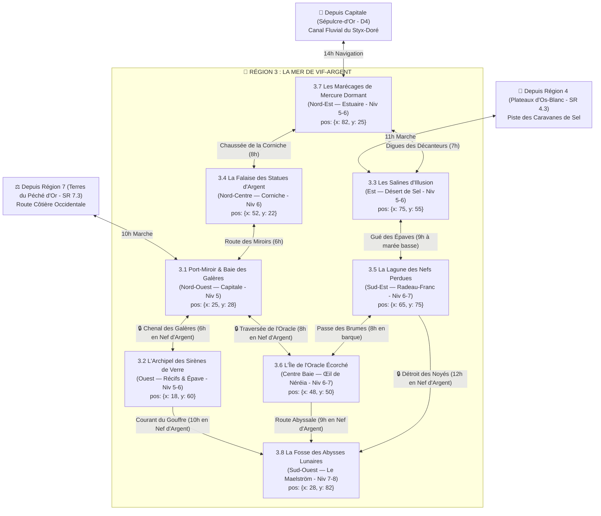

# 🌊 Région 3 : La Mer de Vif-Argent & Les Côtes Miroirs (`mer-de-vif-argent`)

> **Position sur le continent** : Sud-Ouest d'Ombresang (`position: { x: 24, y: 72 }`)
> **Paliers de niveau** : Niveaux 5 à 8 (`niveauMin: 5`, `niveauMax: 8`)
> **Origine divine (Bible §1.1 & §4)** : Le corps liquéfié de **Néréia**, Déesse des Eaux, des Reflets et de la Lune. Une mer intérieure de mercure vif et de brumes hallucinatoires où les reflets prennent vie. Bordée au Nord par les *Terres du Péché d'Or* (`Région 7`), au Nord-Est par la Capitale *Sépulcre-d'Or*, et à l'Est par les *Plateaux d'Os-Blanc* (`Région 4`).

---

## 1. Hiérarchie des Boss (Monstres SRD 5.2.1)

| Échelon | Territoire | Boss / Monstre Chef (`id` SRD) | FP (CR) | Titre & Rôle Narratif |
| :--- | :--- | :--- | :---: | :--- |
| **BOSS DE RÉGION (1A)** | La Fosse des Abysses Lunaires (SR 3.8) | **`aboleth`** *(+ Prince-Reflet Valério `archimage` FP 12)* | **FP 10 / 12** | **L'Architecte des Reflets Xal-Néréia** — Entité antédiluvienne qui façonne les doubles de mercure (`doppelganger`) pour remplacer les dirigeants de la côte. |
| **BOSS DE RÉGION (1B)** | La Fosse des Abysses Lunaires (SR 3.8) | **`kraken`** *(ou `dragon-tortue` FP 17)* | **FP 23** | **Le Léviathan de Mercure** — Titan tentaculaire gainé de vif-argent gardant le crâne englouti de Néréia. |
| **Sous-Boss SR 3.1** | Port-Miroir | **`doppelganger`** *(Alpha + **`assassin`** FP 8 & `espion` FP 1)* | **FP 3 / 8** | **Le Reflet-Maître de la Douane** — Dirige la Chambre de Moulage sous le Phare aux Cent Lentilles. |
| **Sous-Boss SR 3.2** | L'Archipel des Sirènes | **`dragon-tortue`** *(+ Reine-Chanteuse `harpie` FP 1 & `merrow` FP 2)* | **FP 17** | **Carapace-d'Argent** — Monstre marin vénéré par les harpies et les merrows autour de l'Épave du Titan-Doré. |
| **Sous-Boss SR 3.3** | Les Salines d'Illusion | **`rakshasa`** *(Escorte : `lamie` FP 4 & `traqueur-invisible` FP 6)* | **FP 13** | **Shahrazad aux Mains Inversées** — Tisse des caravanes illusoires dans le Désert des Glaces Sèches. |
| **Sous-Boss SR 3.4** | La Falaise des Statues | **`meduse`** *(+ **`golem-de-pierre`** d'argent FP 10 & `basilic` FP 3)* | **FP 6 / 10** | **Dame Séléné & ses Sœurs** — Collectionnent les victimes pétrifiées en argent massif au Palais Suspendu. |
| **Sous-Boss SR 3.5** | La Lagune des Nefs | **`ame-en-peine`** *(+ **`fantome`** FP 4, `spectre` FP 1 & `pieuvre-geante` FP 1)* | **FP 5** | **L'Amiral Noyé Vane-Mor** — Commande le cimetière des galions impériaux face à la cité pirate de Radeau-Franc. |
| **Sous-Boss SR 3.6** | L'Île de l'Oracle Écorché | **`naga-corrupteur`** *(Face au gardien **`sphinx-erudit`** FP 11)* | **FP 8** | **Sibilis l'Aveugleur** — Chef du commando des Cendres Blanches venu empoisonner le lac divin *L'Œil de Néréia*. |
| **Sous-Boss SR 3.7** | Les Marécages de Mercure | **`hydre`** *(Écailles de mercure + `cube-gelatineux` FP 2 & `vase-grise` FP 1/2)* | **FP 8** | **La Bête d'Alambic** — Prédateur à plusieurs têtes niché sous les arches brisées du Pont-Aqueduc. |
| **Sous-Boss SR 3.8** | La Fosse des Abysses | **`aboleth`**, **`archimage`** & **`kraken`** | **FP 10 / 23** | **La Cour du Miroir-Monde**. |

---

## 2. Réseau Routier Côtier, Lignes Maritimes & Temps de Trajet



### Verrous Stratégiques de la Région 3
1. **Les Nefs à Coque d'Argent (`SR 3.1 / SR 3.5`)** : Le mercure divin ronge le bois et le fer ordinaires ; impossible d'atteindre les îles (`SR 3.2`, `SR 3.6`, `SR 3.8`) sans affréter une galère doublée d'argent.
2. **Le Faisceau du Phare aux Cent Lentilles (`SR 3.1`)** : Dissipe les brumes d'illusion sur le Chenal des Galères vers `SR 3.2`.
3. **Le Détroit des Noyés (`SR 3.5 -> SR 3.8`)** : Barré par la flotte fantôme de l'Amiral Vane-Mor.

---

## 3. Charte Visuelle & Empreinte sur la Carte du Monde

### Vue Aérienne (Carte du Monde / Atlas)
- **Forme géographique** : Grande baie en croissant ouverte au Sud-Ouest dont la mer est **d'un argent métallique pur et miroitant comme du chrome liquide**. Au Centre brille l'anneau blanc de l'Île de l'Oracle (`SR 3.6`) ; au Nord-Ouest Port-Miroir (`SR 3.1`) ; au Nord la Falaise des Statues (`SR 3.4`) ; au Nord-Est le delta des Marécages (`SR 3.7`) ; à l'Est le damier blanc des Salines (`SR 3.3`) ; au Sud-Est la Lagune d'épaves (`SR 3.5`) ; et au Sud-Ouest le tourbillon noir et violet de la Fosse (`SR 3.8`).
- **Palette chromatique** : Vif-argent chromé (`#E2E8F0` / `#94A3B8`), blanc de sel et d'albâtre (`#F8FAFC`), bleu nuit lunaire (`#0F172A`), reflets d'opale violette (`#C084FC`) et cyan (`#67E8F9`).

### Vue au Sol (Exploration CRPG)
- **Atmosphère** : Mer sans écume aux vagues lourdes et silencieuses qui reflètent parfaitement les visages ; brouillard opalescent d'où sortent des silhouettes familières.

---

## 4. Description Détaillée des 8 Sous-Régions

---

### SR 3.1 — Port-Miroir & La Baie des Galères d'Argent (`port-miroir`)
- **Position & Frontières** : Capitale régionale dans l'anse Nord-Ouest (`position: { x: 25, y: 28 }`, `niveauMin: 5`, `niveauMax: 5`). Bordée au Nord par les Terres du Péché d'Or (`Région 7`), à l'Est par `SR 3.4` et au Sud par la mer de mercure (`SR 3.2`, `SR 3.6`).
- **Routes & Accès** :
  - Depuis `Région 7 (SR 7.3)` : **Route Côtière Occidentale** (10h).
  - Depuis `SR 3.4` : **Route des Miroirs** (6h).
  - Vers `SR 3.2` : **Chenal des Galères** (6h en Nef d'Argent).
  - Vers `SR 3.6` : **Traversée de l'Oracle** (8h en Nef d'Argent).
- **Points d'Intérêt (POI)** :
  - 🏘️ **Cité de Port-Miroir** : Ville vénitienne de 15 000 habitants parcourue de canaux de mercure liquide aux façades de marbre blanc ornées de miroirs.
  - 🏰 **Le Phare aux Cent Lentilles** : Tour-bastion au bout du môle maritime, équipée d'un système rotatif de cent miroirs paraboliques en argent poli.
  - 🕳️ **Les Grottes de Marée-Basse (Chambre de Moulage)** : Cavernes sous la ville où les `doppelganger` émergent des bassins de mercure pour remplacer les citoyens.
  - ⛩️ **Le Temple de la Lune Noyée** : Sanctuaire inondé à mi-corps où officie l'Oracle Aveugle Calypso.
  - 🗿 **L'Arche du Galion d'Argent** : Porte maritime colossale formée par deux côtes d'argent liquide figées au-dessus de l'entrée du port.
- **Boss de Sous-Région** : **Le Reflet-Maître de la Douane (`doppelganger` alpha, FP 3)** entouré d'**`assassin` (FP 8)** et d'**`espion` (FP 1)**.

---

### SR 3.2 — L'Archipel des Sirènes de Verre (`l-archipel-des-sirenes-de-verre`)
- **Position & Frontières** : Chapelet d'îles volcaniques vitrifiées à l'Ouest de la baie (`position: { x: 18, y: 60 }`, `niveauMin: 5`, `niveauMax: 6`), entre `SR 3.1` (Nord) et `SR 3.8` (Sud).
- **Routes & Accès** :
  - Depuis `SR 3.1` : **Chenal des Galères** (6h en Nef d'Argent).
  - Vers `SR 3.8` : **Courant du Gouffre** (10h en Nef d'Argent).
- **Points d'Intérêt (POI)** :
  - 🏘️ **Village d'Écume-Blanche** : Hameau de pêcheurs de perles de mercure et de pilotes de récifs, perché sur pilotis au-dessus des rochers de verre.
  - 🏰 **Le Fortin du Brisant Noir** : Tour de guet maritime abandonnée par l'Amirauté et transformée en aire fortifiée par les harpies.
  - 🕳️ **La Caverne des Échos Chantants** : Tunnel marin traversant une île de verre creux qui amplifie la voix des harpies à dix lieues à la ronde.
  - ⛩️ **L'Autel des Naufrageurs** : Récif englouti où les `merrow` entassent les coffres d'Ichor pour leur déesse-tortue.
  - 🗿 **L'Épave du Titan-Doré** : Carcasse d'un navire-citadelle impérial de 150 mètres de long empalé sur une aiguille de verre blanc.
- **Boss de Sous-Région** : **Carapace-d'Argent (`dragon-tortue`, FP 17)** & **La Reine-Chanteuse (`harpie` FP 1 + `merrow` FP 2 & `combattant-sahuagin` FP 1/2)**.

---

### SR 3.3 — Les Salines d'Illusion (`les-salines-d-illusion`)
- **Position & Frontières** : Grande plaine côtière orientale (`position: { x: 75, y: 55 }`, `niveauMin: 5`, `niveauMax: 6`), située au Sud des Marécages (`SR 3.7`), à l'Ouest des Plateaux d'Os-Blanc (`Région 4`) et au Nord de la Lagune (`SR 3.5`).
- **Routes & Accès** :
  - Depuis `SR 3.7` : **Digues des Décanteurs** (7h).
  - Depuis `Région 4 (SR 4.3)` : **Piste des Caravanes de Sel** (11h).
  - Vers `SR 3.5` : **Gué des Épaves** (9h à marée basse).
- **Points d'Intérêt (POI)** :
  - 🏘️ **Bourg de Sel-Miroir** : Ville de sauniers et de souffleurs de verre aux maisons taillées dans des blocs de sel gemme translucide.
  - 🏰 **Le Palais-Mirage de Shahrazad** : Citadelle illusoire au cœur du désert de sel dont les murs changent de place à chaque heure.
  - 🕳️ **Les Mines de Cristal Lunaire** : Galeries souterraines étincelantes sous la croûte de sel.
  - ⛩️ **Le Sanctuaire des Reflets Perdus** : Temple de cristal où les pèlerins viennent racheter leur ombre volée par les mirages.
  - 🗿 **Le Désert des Glaces Sèches** : Étendue plate de 20 km recouverte d'une fine pellicule de mercure où le ciel se reflète à 360°.
- **Boss de Sous-Région** : **Shahrazad aux Mains Inversées (`rakshasa`, FP 13)** servie par une **`lamie` (FP 4)** et un **`traqueur-invisible` (FP 6)**.

---

### SR 3.4 — La Falaise des Statues d'Argent (`la-falaise-des-statues-d-argent`)
- **Position & Frontières** : Hautes falaises de craie et de marbre blanc au Nord de la baie (`position: { x: 52, y: 22 }`, `niveauMin: 6`, `niveauMax: 6`), entre `SR 3.1` (Ouest) et `SR 3.7` (Est).
- **Routes & Accès** :
  - Depuis `SR 3.7` : **Chaussée de la Corniche** (8h).
  - Vers `SR 3.1` : **Route des Miroirs** (6h).
- **Points d'Intérêt (POI)** :
  - 🏘️ **Village de Haute-Vasque** : Bourg de sculpteurs et de miroitiers vivant dans la terreur des nuits de pleine lune.
  - 🏰 **Le Palais Suspendu de Dame Séléné** : Villa-forteresse à colonnades blanches accrochée en encorbellement à 200 m au-dessus de la mer.
  - 🕳️ **La Grotte aux Miroirs Brisés** : Antre souterrain sous le palais où nichent des **`basilic` (FP 3)** et **`cockatrice` (FP 1/2)**.
  - ⛩️ **L'Oratoire de la Beauté Figée** : Chapelle où les nobles viennent boire une goutte de mercure dilué pour figer leur visage dans une jeunesse éternelle.
  - 🗿 **Le Jardin des Pétrifiés** : Esplanade en terrasses où se dressent trois cents statues d'argent massif (les victimes pétrifiées des méduses).
- **Boss de Sous-Région** : **Dame Séléné (`meduse`, FP 6)** accompagnée d'un **`golem-de-pierre` d'argent massif (FP 10)**.

---

### SR 3.5 — La Lagune des Nefs Perdues (`la-lagune-des-nefs-perdues`)
- **Position & Frontières** : Hauts-fonds brumeux du Sud-Est (`position: { x: 65, y: 75 }`, `niveauMin: 6`, `niveauMax: 7`), entre `SR 3.3` (Nord), `SR 3.6` (Nord-Ouest) et `SR 3.8` (Sud-Ouest).
- **Routes & Accès** :
  - Depuis `SR 3.3` : **Gué des Épaves** (9h à marée basse).
  - Vers `SR 3.6` : **Passe des Brumes** (8h en barque).
  - Vers `SR 3.8` : **Détroit des Noyés** (12h en Nef d'Argent).
- **Points d'Intérêt (POI)** :
  - 🏘️ **Cité Flottante de Radeau-Franc** : Ville pirate construite en reliant quarante coques de galions échoués par des ponts de planches et des tentes de voiles.
  - 🏰 **Le Galion-Citadelle de l'Amiral Noyé** : Vaisseau de guerre à trois ponts figé dans le sel d'argent qui verrouille le Détroit des Noyés.
  - 🕳️ **La Grotte Sous-Marine du Corail Noir** : Cavité accessible à marée basse sous la quille du plus grand galion, repaire d'une **`pieuvre-geante` (FP 1)**.
  - ⛩️ **La Chapelle des Naufragés** : Église bâtie dans la coque retournée d'une nef amirale.
  - 🗿 **Le Cimetière des Cent Mâts** : Forêt surréaliste de mâts brisés émergeant du mercure brumeux sur cinq kilomètres.
- **Boss de Sous-Région** : **L'Amiral Noyé Vane-Mor (`ame-en-peine`, FP 5)** accompagné de **`fantome` (FP 4)**, **`spectre` (FP 1)** et **`bleme` (FP 2)**.

---

### SR 3.6 — L'Île de l'Oracle Écorché (`l-ile-de-l-oracle-ecorche`)
- **Position & Frontières** : Centre géométrique exact de la Mer de Vif-Argent (`position: { x: 48, y: 50 }`, `niveauMin: 6`, `niveauMax: 7`). Île volcanique blanche circulaire en forme d'atoll fermé.
- **Routes & Accès** :
  - Depuis `SR 3.1` : **Traversée de l'Oracle** (8h en Nef d'Argent).
  - Depuis `SR 3.5` : **Passe des Brumes** (8h en barque).
  - Vers `SR 3.8` : **Route Abyssale** (9h en Nef d'Argent).
- **Points d'Intérêt (POI)** :
  - 🏘️ **Hameau des Pèlerins Voilés** : Petit port d'accostage où tous les habitants portent un bandeau sur les yeux pour ne pas devenir fous en regardant le lac.
  - 🏰 **La Porte des Deux Colosses Aveugles** : Forteresse maritime gardant l'unique goulet d'entrée de l'atoll.
  - 🕳️ **La Grotte des Fumées Lunaires** : Tunnel sous-lacustre par où le commando des Cendres Blanches tente d'injecter du poison dans l'Œil.
  - ⛩️ **Le Monastère de Clair-Voyance** : Abbaye à coupoles de verre blanc bâtie sur la crête de l'anneau rocheux, défendue par un **`sphinx-erudit` (FP 11)**.
  - 🗿 **L'Œil de Néréia** : Lac intérieur circulaire de mercure pur d'un kilomètre de diamètre, immobile comme un miroir astronomique qui projette les images du passé.
- **Boss de Sous-Région** : **Sibilis l'Aveugleur (`naga-corrupteur`, FP 8)** entouré de **`fanatique-de-secte` (FP 2)** et d'un **`mage` (FP 6)**.

---

### SR 3.7 — Les Marécages de Mercure Dormant (`les-marecages-de-mercure-dormant`)
- **Position & Frontières** : Delta intérieur du Nord-Est (`position: { x: 82, y: 25 }`, `niveauMin: 5`, `niveauMax: 6`), là où le fleuve *Styx-Doré* arrivant de la Capitale se jette dans la Mer de Vif-Argent. Bordé à l'Ouest par `SR 3.4` et au Sud par `SR 3.3`.
- **Routes & Accès** :
  - Depuis la Capitale (`D4`) : **Canal Fluvial du Styx-Doré** (14h).
  - Vers `SR 3.4` : **Chaussée de la Corniche** (8h).
  - Vers `SR 3.3` : **Digues des Décanteurs** (7h).
- **Points d'Intérêt (POI)** :
  - 🏘️ **Village d'Alambic-Gris** : Bourg d'alchimistes et de distillateurs sur pilotis qui séparent l'or fluvial du mercure marin.
  - 🏰 **Les Bassins de Décantation Impériaux** : Écluses fortifiées contrôlant le débit du Styx-Doré.
  - 🕳️ **La Tanière de l'Hydre d'Argent** : Gouffre boueux sous les arches brisées du Pont-Aqueduc.
  - ⛩️ **L'Autel des Vapeurs Blanches** : Sanctuaire sur pilotis où les distillateurs prient pour échapper à la folie du mercure.
  - 🗿 **Les Ruines du Pont-Aqueduc** : Monumentale structure impériale à trois étages d'arches traversant le marais.
- **Boss de Sous-Région** : **La Bête d'Alambic (`hydre` aux écailles de mercure, FP 8)** entourée de **`cube-gelatineux` (FP 2)** et **`vase-grise` (FP 1/2)**.

---

### SR 3.8 — La Fosse des Abysses Lunaires (`la-fosse-des-abysses-lunaires`)
- **Position & Frontières** : Sud-Ouest de la baie, à la limite de la haute mer (`position: { x: 28, y: 82 }`, `niveauMin: 7`, `niveauMax: 8`). Gouffre marin circulaire de 5 km de large où le mercure liquide tourbillonne en entonnoir autour d'un piton rocheux central.
- **Routes & Accès** :
  - Depuis `SR 3.2` : **Courant du Gouffre** (10h en Nef d'Argent).
  - Depuis `SR 3.6` : **Route Abyssale** (9h en Nef d'Argent).
  - Depuis `SR 3.5` : **Détroit des Noyés** (12h en Nef d'Argent).
- **Points d'Intérêt (POI)** :
  - 🏘️ **Les Quais des Plongeurs d'Abîme** : Port inférieur accroché à la base du piton rocheux, où vivent les scaphandriers alchimiques et les équipages asservis.
  - 🏰 **Citadelle Insulaire d'Argent-Pur** : Forteresse-palais du Prince-Amiral Valério, perchée sur l'aiguille rocheuse au bord même du tourbillon.
  - 🕳️ **La Salle du Miroir-Monde** : Caverne sous-marine finale où l'Aboleth tisse ses illusions à l'échelle de la province.
  - ⛩️ **Le Temple Abyssal des Reflets** : Sanctuaire de nacre noire où les notables capturés sont maintenus en stase pendant que leurs doubles gouvernent à leur place.
  - 🗿 **Le Gouffre de la Couronne Engloutie** : Le crâne immergé de la déesse Néréia au fond de l'entonnoir de mercure.
- **Boss Final de la Région** : **Xal-Néréia (`aboleth`, FP 10)**, **Le Prince-Reflet Valério (`archimage`, FP 12)** & **Le Léviathan de Mercure (`kraken`, FP 23)**.

---

## 5. Prompt Cartographique de Référence (Région 3)

```text
Dark fantasy digital painting, top-down regional map of 'La Mer de Vif-Argent', an inland sea made of gleaming liquid mercury and polished chrome formed by a liquefied moon goddess, with coastal roads, aqueducts and sea-lanes connecting 8 sub-regions.
Visible landmarks across the region:
- The sea itself is gleaming liquid silver and chrome, NOT blue water.
- Center of the bay (SR 3.6): A perfect ring-shaped white island enclosing a circular mirror-lake ('The Eye of Néréia').
- North-West (SR 3.1): A crescent white-marble port city with a lighthouse made of giant parabolic mirrors, linked by a high white cliffside road (SR 3.4) to a ruined multi-arch stone aqueduct over silver marshes in the North-East (SR 3.7).
- West entrance (SR 3.2): Jagged volcanic glass reefs and a giant golden shipwreck.
- East coast (SR 3.3): Geometric hexagonal white salt-pans and mirror-flats.
- South-East (SR 3.5): A lagoon choked with forty stranded shipwrecks linked by wooden bridges into a floating town.
- South-West deep sea (SR 3.8): A colossal circular whirlpool maelstrom with a spire-fortress on its rim.
Palette: liquid silver chrome, blinding salt white, deep midnight blue, pale violet and cyan opal reflections. No text, no labels, no UI.
```
