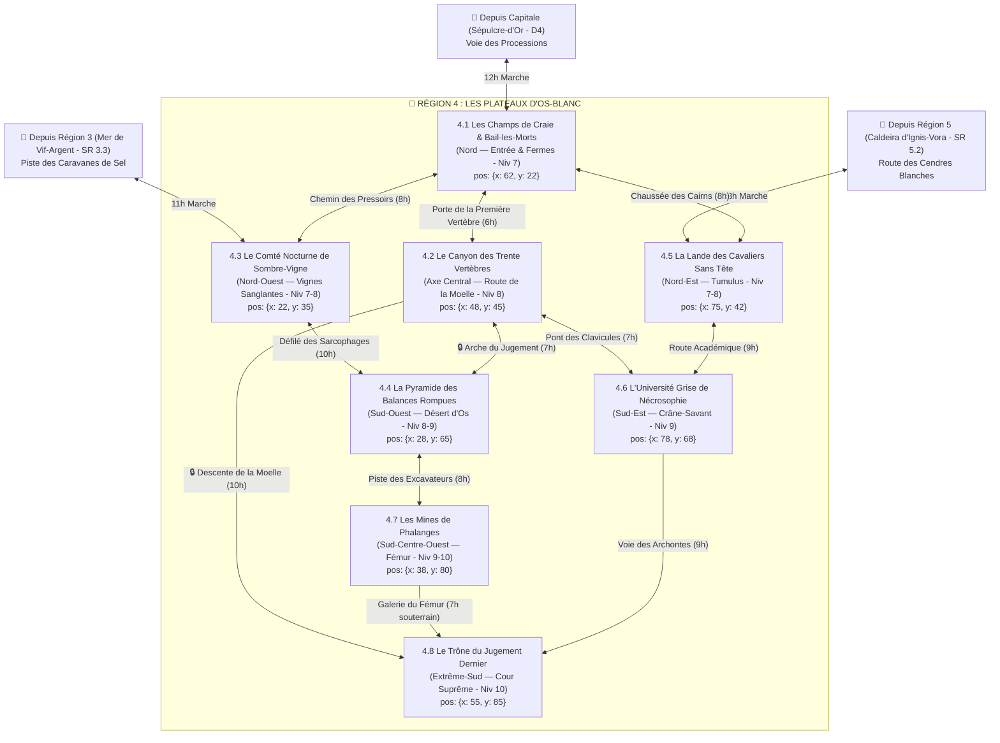

# 🦴 Région 4 : Les Plateaux d'Os-Blanc (`plateaux-d-os-blanc`)

> **Position sur le continent** : Sud d'Ombresang (`position: { x: 52, y: 78 }`)
> **Paliers de niveau** : Niveaux 7 à 10 (`niveauMin: 7`, `niveauMax: 10`)
> **Origine divine (Bible §1.1 & §4)** : Le squelette titanesque à demi enfoui de **Mor-Vath**, le Dieu des Morts, du Jugement et de la Mémoire. Une province aride, juridique et nécromantique où les travailleurs squelettes retrouvent la mémoire et se mettent en grève. Bordée au Nord par la Capitale *Sépulcre-d'Or*, à l'Ouest par la *Mer de Vif-Argent* (`Région 3`), et à l'Est par la *Caldeira d'Ignis-Vora* (`Région 5`).

---

## 1. Hiérarchie des Boss (Monstres SRD 5.2.1)

| Échelon | Territoire | Boss / Monstre Chef (`id` SRD) | FP (CR) | Titre & Rôle Narratif |
| :--- | :--- | :--- | :---: | :--- |
| **BOSS DE RÉGION (1A)** | Le Trône du Jugement (SR 4.8) | **`momie-auguste`** | **FP 15** | **L'Empereur des Ossements Ankhar le Souvenant** — Premier Roi-Momie qui a éveillé la mémoire des centaines de milliers de squelettes pour juger les vivants. |
| **BOSS DE RÉGION (1B)** | Le Trône du Jugement (SR 4.8) | **`dragon-noir-venerable`** | **FP 21** | **L'Ombre de Mor-Vath** — Dragon noir nécrotique niché dans le Puits des Larmes Noires qui cherche à détourner l'armée des morts au profit des Cendres Blanches. |
| **Sous-Boss SR 4.1** | Bail-les-Morts | **`minotaure-squelette`** *(+ `ogre-zombi` FP 2 vs Huissier `mage` FP 6)* | **FP 2 / 6** | **Brise-Chaîne le Syndic des Os** face à **L'Huissier-Nécromant Malcor**. |
| **Sous-Boss SR 4.2** | Le Canyon des Vertèbres | **`necronte`** *(Escorte : meute de `bleme` FP 2 & `goule` FP 1)* | **FP 9** | **Vorax le Dévoreur de Moelle** — Tient la 15e Vertèbre et dévore l'Ichor de mémoire des pèlerins. |
| **Sous-Boss SR 4.3** | Le Comté de Sombre-Vigne | **`vampire`** *(Escorte : `vampirien` FP 5 & `familier-de-vampire`)* | **FP 13** | **Comte Vladis de Vermeil** — Seigneur vampire qui cultive le *Vin de Cendre-Sang* et assiège les villages rebelles. |
| **Sous-Boss SR 4.4** | La Pyramide des Balances | **`sphinx-merveilleux`** *(ou `momie-auguste` FP 15 + `momie` FP 3)* | **FP 17** | **Le Gardien de la Pesée** — Juge la sincérité des voyageurs au sommet de la Grande Ziggourat de Mor-Vath. |
| **Sous-Boss SR 4.5** | La Lande des Cavaliers | **`ame-en-peine`** *(Montée sur `destrier-squelette` + `chien-du-trepas` FP 3)* | **FP 5** | **Le Maréchal Sans Tête** — Mène la charge spectrale nocturne à travers le plateau des tumulus. |
| **Sous-Boss SR 4.6** | L'Université Grise | **`liche`** *(ou `archimage` FP 12 + `horriflamme` FP 4 & `golem-de-chair` FP 5)* | **FP 21 / 12** | **Le Doyen Vaelor de Crâne-Savant** — Enfermé dans une boucle temporelle nécrotique sous le dôme violet. |
| **Sous-Boss SR 4.7** | Les Mines de Phalanges | **`ver-pourpre`** *(Escorte : `ankheg` FP 2 & `grick` FP 2)* | **FP 15** | **Le Fouisseur Sépulcral** — Ver titanesque rongeant de l'intérieur le Fémur Géant de Mor-Vath. |
| **Sous-Boss SR 4.8** | Le Trône du Jugement | **`momie-auguste`** & **`dragon-noir-venerable`** | **FP 15 / 21** | **La Cour Suprême des Âmes**. |

---

## 2. Réseau Routier, Canyons Osseux & Temps de Trajet



### Verrous Stratégiques de la Région 4
1. **Les Cordons de Squelettes en Grève (`SR 4.1`)** : Bloquent pacifiquement les routes autour de Bail-les-Morts ; négocier ou annuler leurs baux à l'étude notariale ouvre la province sans effusion de sang.
2. **La Route de la Moelle (`SR 4.2`)** : Traverse le canal rachidien des trente vertèbres géantes ; barrée à la 15e vertèbre par le Nécronte Vorax.
3. **La Galerie du Fémur (`SR 4.7 -> SR 4.8`)** : Passage souterrain alternatif à travers l'os creux de la cuisse du dieu pour atteindre le Trône du Jugement Dernier.

---

## 3. Charte Visuelle & Empreinte sur la Carte du Monde

### Vue Aérienne (Carte du Monde / Atlas)
- **Forme géographique** : Haut plateau de craie blanche au Sud traversé du Nord au Sud par **l'épine dorsale colossale de trente vertèbres d'ivoire** (`SR 4.2`) qui aboutit au **bassin osseux géant en forme de trône** (`SR 4.8`). À l'Ouest contrastent la tache rouge sang des vignobles de Sombre-Vigne (`SR 4.3`) et la grande pyramide noire flanquée des deux plateaux de balance en bronze (`SR 4.4`). À l'Est s'étendent la lande de cairns (`SR 4.5`) et l'Université sous son dôme violet (`SR 4.6`).
- **Palette chromatique** : Blanc de craie et d'os (`#F1F5F9`), basalte funéraire noir (`#111318`), violet nécrotique (`#6D28D9`), vert spectral (`#86EFAC`), bronze terni (`#A16207`), rouge vigne sanglant (`#7F1D1D`).

### Vue au Sol (Exploration CRPG)
- **Atmosphère** : Vent sec soulevant des tourbillons de poussière de craie et de farine d'os ; soleil pâle filtré par un ciel gris-perle ; claquement rythmique des ossements de milliers de travailleurs squelettes immobiles.

---

## 4. Description Détaillée des 8 Sous-Régions

---

### SR 4.1 — Les Champs de Craie & La Cité de Bail-les-Morts (`bail-les-morts`)
- **Position & Frontières** : Plaine septentrionale (`position: { x: 62, y: 22 }`, `niveauMin: 7`, `niveauMax: 7`), au débouché de la *Voie des Processions*. Bordée au Sud par `SR 4.2`, à l'Ouest par `SR 4.3` et à l'Est par `SR 4.5`.
- **Routes & Accès** :
  - Depuis la Capitale (`D4`) : **Voie des Processions** (12h).
  - Vers `SR 4.2` : **Porte de la Première Vertèbre** (6h).
  - Vers `SR 4.3` : **Chemin des Pressoirs** (8h).
  - Vers `SR 4.5` : **Chaussée des Cairns** (8h).
- **Points d'Intérêt (POI)** :
  - 🏘️ **Ville de Bail-les-Morts** : Cité notariale et agricole de 6 000 vivants et 10 000 morts sous contrat, aux maisons de craie blanche à toits de basalte noir.
  - 🏰 **Le Tribunal-Forteresse des Testaments** : Bastion judiciaire à colonnes d'os où les Archontes-Notaires gardent sous clé les contrats originaux de location des cadavres.
  - 🕳️ **La Grotte de l'Ossuaire Commun** : Ancienne carrière souterraine où se rassemblent les squelettes qui ont retrouvé la mémoire de leur famille.
  - ⛩️ **Chapelle du Repos Racheté** : Sanctuaire où les familles pauvres viennent racheter une phalange de leur ancêtre pour abréger son bail de servitude.
  - 🗿 **Les Fermes Silencieuses** : Immenses domaines céréaliers où dix mille `squelette` immobiles ont planté leurs faux en terre en attendant le verdict d'Ankhar.
- **Boss de Sous-Région** : **Brise-Chaîne (`minotaure-squelette`, FP 2 — variante géante FP 5)** leader des grévistes, ou **L'Huissier-Nécromant Malcor (`mage`, FP 6 + `ogre-zombi` FP 2)**.

---

### SR 4.2 — Le Canyon des Trente Vertèbres (`le-canyon-des-trente-vertebres`)
- **Position & Frontières** : Épine dorsale centrale de la région (`position: { x: 48, y: 45 }`, `niveauMin: 8`, `niveauMax: 8`). Canyon rectiligne de 50 km enjambé par les trente arcs osseux géants des vertèbres de Mor-Vath.
- **Routes & Accès** :
  - Depuis `SR 4.1` : **Porte de la Première Vertèbre** (6h).
  - Vers `SR 4.4` : **Arche du Jugement** (7h).
  - Vers `SR 4.6` : **Pont des Clavicules** (7h).
  - Vers `SR 4.8` : **Descente de la Moelle** (10h).
- **Points d'Intérêt (POI)** :
  - 🏘️ **Village troglodyte d'Épine-Blanche** : Maisons, auberges et ateliers d'embaumeurs taillés directement à l'intérieur des parois osseuses des 8e, 9e et 10e vertèbres.
  - 🏰 **Le Bastion de la Quinzième Vertèbre** : Poste de péage fortifié par le Nécronte Vorax qui bloque le canal rachidien.
  - 🕳️ **La Caverne des Goules Affamées** : Réseau de galeries creusées dans la moelle fossilisée du dieu.
  - ⛩️ **Le Reliquaire de la Moelle Grise** : Sanctuaire souterrain où suinte l'Ichor de mémoire qui rend leurs souvenirs aux morts.
  - 🗿 **L'Arche du Jugement** : Vertèbre monumentale de cent mètres de haut gravée des lois funéraires de Mor-Vath.
- **Boss de Sous-Région** : **Vorax le Dévoreur de Moelle (`necronte`, FP 9)** entouré d'une meute de **`bleme` (FP 2)** et de **`goule` (FP 1)**.

---

### SR 4.3 — Le Comté Nocturne de Sombre-Vigne (`le-comte-nocturne-de-sombre-vigne`)
- **Position & Frontières** : Vallée encaissée du Nord-Ouest (`position: { x: 22, y: 35 }`, `niveauMin: 7`, `niveauMax: 8`), entre la Mer de Vif-Argent (`Région 3` à l'Ouest), `SR 4.1` (Est) et `SR 4.4` (Sud).
- **Routes & Accès** :
  - Depuis `SR 4.1` : **Chemin des Pressoirs** (8h).
  - Depuis `Région 3 (SR 3.3)` : **Piste des Caravanes de Sel** (11h).
  - Vers `SR 4.4` : **Défilé des Sarcophages** (10h).
- **Points d'Intérêt (POI)** :
  - 🏘️ **Bourg viticole de Sang-Terre** : Village produisant le célèbre *Vin de Cendre-Sang*, dont les habitants ferment leurs volets de fer dès le crépuscule.
  - 🏰 **Le Château de Vermeil** : Forteresse gothique en basalte noir et marbre rouge perchée sur un piton calcaire, fief du Comte Vladis.
  - 🕳️ **Les Caves d'Affinage Souterraines** : Labyrinthe de foudres géants sous la colline où le Comte retient ses captifs et ses `vampirien`.
  - ⛩️ **La Chapelle Profanée de Saint-Calice** : Ancien temple de Mor-Vath transformé en salon de bal nocturne.
  - 🗿 **Le Pressoir des Géants** : Cuve de pierre cyclopéenne datant de l'âge divin où les grappes gorgées d'Ichor sont foulées par des zombies.
- **Boss de Sous-Région** : **Comte Vladis de Vermeil (`vampire`, FP 13)** entouré de ses **`vampirien` (FP 5)** et **`familier-de-vampire` (FP 3)**.

---

### SR 4.4 — La Pyramide des Balances Rompues (`la-pyramide-des-balances-rompues`)
- **Position & Frontières** : Désert de sable d'os blanc du Sud-Ouest (`position: { x: 28, y: 65 }`, `niveauMin: 8`, `niveauMax: 9`), entre `SR 4.3` (Nord), `SR 4.2` (Est) et `SR 4.7` (Sud).
- **Routes & Accès** :
  - Depuis `SR 4.3` : **Défilé des Sarcophages** (10h).
  - Depuis `SR 4.2` : **Arche du Jugement** (7h).
  - Vers `SR 4.7` : **Piste des Excavateurs** (8h).
- **Points d'Intérêt (POI)** :
  - 🏘️ **Oasis de Sable-Gris** : Campement de pèlerins, de juges itinérants et de pilleurs de tombes autour d'un puits artésien.
  - 🏰 **Le Fortin des Gardes-Sceaux** : Redoute en briques noires protégeant la rampe d'accès principale de la Ziggourat.
  - 🕳️ **Le Labyrinthe des Sarcophages** : Nécropole souterraine sous la pyramide où reposent les premiers rois-prêtres du continent.
  - ⛩️ **Le Parvis de la Pesée des Âmes** : Esplanade au sommet de la ziggourat où les mensonges prennent vie sous forme d'`ombre`.
  - 🗿 **La Grande Ziggourat de Mor-Vath & Les Balances Rompues** : Pyramide à sept degrés de basalte noir haute de 180 m, au pied de laquelle gisent deux plateaux de bronze géants de 100 m de diamètre.
- **Boss de Sous-Région** : **Le Gardien de la Pesée (`sphinx-merveilleux`, FP 17 — ou `momie-auguste` FP 15)** entouré de **`momie` (FP 3)** et d'**`ombre` (FP 1/2)**.

---

### SR 4.5 — La Lande des Cavaliers Sans Tête (`la-lande-des-cavaliers-sans-tete`)
- **Position & Frontières** : Haut plateau venteux du Nord-Est (`position: { x: 75, y: 42 }`, `niveauMin: 7`, `niveauMax: 8`), entre `SR 4.1` (Ouest), la Caldeira (`Région 5` à l'Est) et `SR 4.6` (Sud).
- **Routes & Accès** :
  - Depuis `SR 4.1` : **Chaussée des Cairns** (8h).
  - Depuis `Région 5 (SR 5.2)` : **Route des Cendres Blanches** (13h).
  - Vers `SR 4.6` : **Route Académique** (9h).
- **Points d'Intérêt (POI)** :
  - 🏘️ **Village fortifié de Halte-Cri** : Bourg-relais entouré d'un fossé hérissé de pieux d'argent et de lanternes bénies contre la charge spectrale nocturne.
  - 🏰 **La Tour des Veilleurs de Minuit** : Phare terrestre dont la cloche d'argent sonne dès que l'escadron maudit sort de son tertre.
  - 🕳️ **Le Tumulus du Roi-Chevalier** : Tertre funéraire souterrain géant sous une colline de craie, repaire du Maréchal Sans Tête.
  - ⛩️ **La Grotte-Sanctuaire des Corbeaux Blancs** : Oratoire troglodyte habité par un ermite qui connaît le nom véritable du Maréchal.
  - 🗿 **Le Champ de Bataille des Cent Bannières** : Plaine de craie jonchée de carcasses de chars, d'armures rouillées et de mille cairns funéraires.
- **Boss de Sous-Région** : **Le Maréchal Sans Tête (`ame-en-peine`, FP 5)** monté sur **`destrier-squelette` (FP 1/2)** avec une meute de **`chien-du-trepas` (FP 3)** et **`nuee-de-senestres` (FP 3)**.

---

### SR 4.6 — L'Université Grise de Nécrosophie (`l-universite-grise-de-necrosophie`)
- **Position & Frontières** : Plateau du Sud-Est (`position: { x: 78, y: 68 }`, `niveauMin: 9`, `niveauMax: 9`), entre `SR 4.5` (Nord), `SR 4.2` (Ouest) et `SR 4.8` (Sud-Ouest).
- **Routes & Accès** :
  - Depuis `SR 4.5` : **Route Académique** (9h).
  - Depuis `SR 4.2` : **Pont des Clavicules** (7h).
  - Vers `SR 4.8` : **Voie des Archontes** (9h).
- **Points d'Intérêt (POI)** :
  - 🏘️ **Cité Académique de Crâne-Savant** : Ville universitaire circulaire bâtie en marbre gris et os poli, dont la moitié nord est prisonnière d'un dôme violet figé dans le temps.
  - 🏰 **La Tour de l'Horloge d'Os** : Beffroi-citadelle central de 100 mètres dont les aiguilles d'ivoire reculent d'une heure chaque fois que le rituel du Doyen recommence.
  - 🕳️ **Les Catacombes d'Expérimentation** : Laboratoire souterrain sous la Tour où le Doyen cache son phylactère.
  - ⛩️ **L'Amphithéâtre Sacré d'Anatomie Divine** : Grande rotonde où les nécrosophes vénèrent et dissèquent les fragments de carcasses divines.
  - 🗿 **Le Dôme de Stase Violette** : Hémisphère d'énergie nécrotique crépitante de cinq cents mètres de large coupant des bâtiments en deux.
- **Boss de Sous-Région** : **Le Doyen Vaelor (`liche`, FP 21 — ou `archimage` FP 12)** entouré d'**`horriflamme` (FP 4)** et de **`golem-de-chair` (FP 5)**.

---

### SR 4.7 — Les Mines de Phalanges & Le Gouffre aux Vers (`les-mines-de-phalanges`)
- **Position & Frontières** : Bassin minier du Sud-Ouest (`position: { x: 38, y: 80 }`, `niveauMin: 9`, `niveauMax: 10`), creusé autour du fémur de Mor-Vath, entre `SR 4.4` (Nord) et `SR 4.8` (Sud-Est).
- **Routes & Accès** :
  - Depuis `SR 4.4` : **Piste des Excavateurs** (8h).
  - Vers `SR 4.8` : **Galerie du Fémur** (7h sous terre).
- **Points d'Intérêt (POI)** :
  - 🏘️ **Camp minier de Craie-Profonde** : Ville de baraquements suspendue au bord d'une carrière en entonnoir de 200 mètres de profondeur.
  - 🏰 **Le Bastion des Treuils d'Ivoire** : Fortin de la guilde minière contrôlant les monte-charges qui descendent dans le fémur.
  - 🕳️ **Les Galeries du Fémur Géant** : Tunnels miniers creusés directement dans l'os fossilisé de 30 mètres de diamètre.
  - ⛩️ **L'Oratoire des Mineurs Ensevelis** : Chapelle souterraine où survivent trente mineurs bloqués par un éboulement.
  - 🗿 **Le Nid du Ver Sépulcral** : Gouffre béant au fond de la carrière d'où jaillit le Ver Pourpre.
- **Boss de Sous-Région** : **Le Fouisseur Sépulcral (`ver-pourpre`, FP 15)** entouré d'**`ankheg` (FP 2)** et de **`grick` (FP 2)**.

---

### SR 4.8 — Le Trône du Jugement Dernier (`le-trone-du-jugement-dernier`)
- **Position & Frontières** : Extrémité méridionale et cœur de la Région 4 (`position: { x: 55, y: 85 }`, `niveauMin: 10`, `niveauMax: 10`), au bord des falaises crayeuses dominant l'Océan Austral.
- **Routes & Accès** :
  - Depuis `SR 4.2` : **Descente de la Moelle** (10h).
  - Depuis `SR 4.7` : **Galerie du Fémur** (7h).
  - Depuis `SR 4.6` : **Voie des Archontes** (9h).
- **Points d'Intérêt (POI)** :
  - 🏘️ **Le Campement des Cent Mille Réveillés** : Immense bivouac silencieux des légions de squelettes affranchis entourant le bassin osseux.
  - 🏰 **La Citadelle des Archontes** : Forteresse de basalte noir accrochée au flanc droit du Trône d'os, assiégée par l'armée d'Ankhar.
  - 🕳️ **Le Puits des Larmes Noires** : Gouffre d'Ichor nécrotique noir au centre de l'amphithéâtre pelvien, repaire du Dragon Noir Vénérable.
  - ⛩️ **La Chaire du Verdict** : Autel central où Ankhar le Souvenant détient le *Grand Registre des Vivants et des Morts*.
  - 🗿 **La Cour Suprême des Âmes** : L'os iliaque (le bassin) titanesque de Mor-Vath dressé verticalement à 400 mètres de haut comme un trône royal cyclopéen face à la mer.
- **Boss Final de la Région** : **Ankhar le Souvenant (`momie-auguste`, FP 15)** & **L'Ombre de Mor-Vath (`dragon-noir-venerable`, FP 21)**.

---

## 5. Prompt Cartographique de Référence (Région 4)

```text
Dark fantasy digital painting, top-down regional map of 'Les Plateaux d'Os-Blanc', an arid necropolis province of white chalk plateaus and bone canyons formed by the colossal skeleton of the fallen god of death, with clear roads and canyon passes connecting 8 sub-regions.
Visible landmarks across the region:
- North Entrance (SR 4.1): Geometric pale-grey farmlands surrounding a white-walled city.
- Running North to South through the exact center (SR 4.2): A colossal fossilized spine of thirty giant white vertebrae forming natural arches over a straight canyon road, with bridges branching West and East.
- North-West (SR 4.3): A sunken valley of blood-red vineyards surrounding a dark gothic vampire castle on a crag.
- South-West (SR 4.4): A massive black-basalt step pyramid (ziggurat) on white bone-sand, with two giant fallen bronze scale-pans beside it.
- North-East (SR 4.5): A windswept plateau of white stone cairns and a giant burial mound.
- South-East (SR 4.6): A circular necromantic university campus with a tall ivory clocktower half-enclosed in a purple arcane dome.
- South-Center-West (SR 4.7): Terraced white open-pit quarries around a giant broken femur bone pierced by giant worm-holes.
- Far South (SR 4.8): A titanic pelvic bone formation shaped like a 400-meter throne overlooking the southern sea cliffs.
Palette: bleached bone white, chalk grey, funerary basalt black, necrotic violet glow, blood-wine red, tarnished bronze. No text, no labels, no UI.
```
