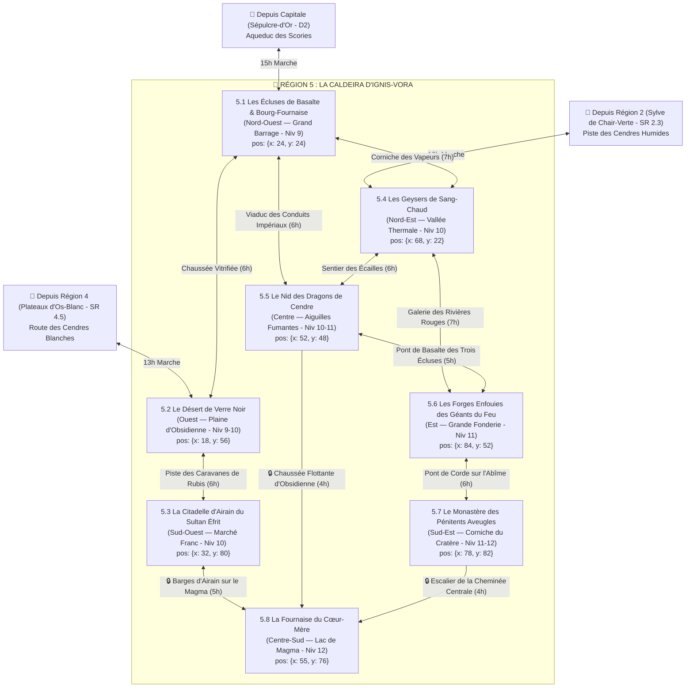

# 🌋 Région 5 : La Caldeira d'Ignis-Vora & Les Terres de Braise (`caldeira-d-ignis-vora`)

> **Position sur le continent** : Sud-Est d'Ombresang (`position: { x: 84, y: 78 }`)
> **Paliers de niveau** : Niveaux 9 à 12 (`niveauMin: 9`, `niveauMax: 12`)
> **Origine divine (Bible §1.1 & §4)** : Le corps incandescent d'**Ignis-Vora**, la Forge-Mère et Déesse des Volcans, dont le ventre éventré forme une mer de basalte noir parcourue d'artères de lave dorée (le *Sang-Flamme*). Bordée au Nord-Ouest par la Capitale *Sépulcre-d'Or*, au Nord par la *Sylve de Chair-Verte* (`Région 2`), et à l'Ouest par les *Plateaux d'Os-Blanc* (`Région 4`).

---

## 1. Hiérarchie des Boss (Monstres SRD 5.2.1)

| Échelon | Territoire | Boss / Monstre Chef (`id` SRD) | FP (CR) | Titre & Rôle Narratif |
| :--- | :--- | :--- | :---: | :--- |
| **BOSS DE RÉGION (1A)** | La Fournaise du Cœur-Mère (SR 5.8) | **`dragon-rouge-venerable`** | **FP 24** | **Pyraxis l'Ancien, Gardien du Cœur-Mère** — Titan draconique né de la première goutte de Sang-Flamme d'Ignis-Vora, qui exige la restitution des sept Cœurs de Rubis. |
| **BOSS DE RÉGION (1B)** | La Fournaise du Cœur-Mère (SR 5.8) | **`balor`** *(Éveillé du sang de la déesse + `horriflamme` FP 4)* | **FP 19** | **Khor-Vael, Le Fléau de Braise** — Démon primordial éveillé dans le cratère central qui lutte contre Pyraxis pour dévorer le Cœur-Mère. |
| **Sous-Boss SR 5.1** | Les Écluses de Basalte | **`salamandre`** *(+ `elementaire-du-feu` FP 5, `magmatique` FP 1/2 & `mephite-magmatique` FP 1/2)* | **FP 5** | **Commandant Pyros des Conduites** — Seigneur ophidien surgi des vannes sabotées du Grand Barrage de Lave face à la Gouverneure Héloïse Ardente (`mage` FP 6). |
| **Sous-Boss SR 5.2** | Le Désert de Verre Noir | **`bulette`** *(Cuirassée d'obsidienne + `scorpion-geant` FP 3 & `chef-de-bande` FP 2)* | **FP 5** | **La Cuirasse-de-Verre** — Monstruosité blindée d'obsidienne tranchante qui décime les convois de rubis divins. |
| **Sous-Boss SR 5.3** | La Citadelle d'Airain | **`efrit`** *(Escorte : `sentinelle-azer` FP 2, `salamandre` FP 5 & `golem-de-fer` FP 16)* | **FP 11** | **Le Sultan-Éfrit Malik al-Khar** — Souverain du Palais des Mille Braseros qui menace d'embraser la province si la *Lampe de Scellement* de sa fille n'est pas retrouvée. |
| **Sous-Boss SR 5.4** | Les Geysers de Sang-Chaud | **`glabrezu`** *(Escorte : `hezrou` FP 8, `molosse-infernal` FP 3 & `mephite-vaporeux` FP 1/4)* | **FP 9** | **Vorgath le Guérisseur-Maudit** — Démon caché sous la source thermale qui offre des guérisons miraculeuses contre des pactes de corruption. |
| **Sous-Boss SR 5.5** | Le Nid des Dragons de Cendre | **`dragon-rouge-adulte`** *(+ 3x `jeune-dragon-rouge` FP 10 & `combattant-kobold` FP 1/8)* | **FP 17** | **La Matriarche Ignia & ses Trois Héritiers** — Se disputent le tribut du village d'Écaille-Rousse au sommet des Aiguilles Fumantes. |
| **Sous-Boss SR 5.6** | Les Forges des Géants du Feu | **`geant-du-feu`** *(Roi-Forgeron + `golem-de-pierre` FP 10, `sentinelle-azer` FP 2 & `xorn` FP 5)* | **FP 9** | **Le Roi-Forgeron Surtr-Khar** — Reconstruit en secret l'épée brisée d'Ignis-Vora en réduisant en esclavage les nains de Martel-Profond. |
| **Sous-Boss SR 5.7** | Le Monastère des Pénitents | **`erinye`** *(+ Grand-Prieur Sévérin `pretre` FP 2 / `fanatique-de-secte` FP 2 & **`planetar`** FP 16 captif)* | **FP 12** | **Le Grand-Prieur Sévérin l'Aveugle & Dame Pyra** — S'apprêtent à jeter un Planétar de feu blessé dans la cheminée volcanique pour provoquer l'hiver volcanique. |
| **Sous-Boss SR 5.8** | La Fournaise du Cœur-Mère | **`dragon-rouge-venerable`** & **`balor`** | **FP 24 / 19** | **Le Choc du Dragon et du Démon au Cœur-Mère**. |

---

## 2. Réseau Routier, Canaux de Lave & Temps de Trajet



### Verrous Stratégiques de la Région 5
1. **Le Grand Barrage de Lave (`SR 5.1`)** : Ses vannes sabotées par les Pénitents du Silence menacent d'inonder Bourg-Fournaise et bloquent le *Viaduc des Conduits Impériaux* tant qu'elles ne sont pas stabilisées.
2. **Les Barges d'Airain (`SR 5.3 -> SR 5.8`)** : Permettent de naviguer sur le lac de lave central jusqu'à l'Île d'Obsidienne Flottante avec l'accord du Sultan Malik al-Khar.
3. **Le Pont de Corde sur l'Abîme (`SR 5.6 -> SR 5.7 -> SR 5.8`)** : Seul accès terrestre vers la forteresse troglodyte du Grand-Prieur Sévérin et la cheminée surplombant le Cœur-Mère.

---

## 3. Charte Visuelle & Empreinte sur la Carte du Monde

### Vue Aérienne (Carte du Monde / Atlas)
- **Forme géographique** : Au Sud-Est du continent, une gigantesque **caldeira volcanique circulaire** formée par le ventre éventré d'**Ignis-Vora**, bordée d'une muraille annulaire de basalte noir et parcourue d'artères de lave dorée (*Sang-Flamme*).
- **Palette chromatique** : Noir d'obsidienne vitrifiée (`#110C0D`), or-orange de Sang-Flamme incandescent (`#FF521B`), jaune soufre (`#E5C128`), airain poli (`#C7922E`) et rouge rubis divin (`#991B1B`).

### Vue au Sol (Exploration CRPG)
- **Atmosphère** : Pluie perpétuelle de cendres tièdes et d'escarbilles dorées ; distorsion thermique de l'air ; grondement sourd du Cœur-Mère qui fait bouillonner les lacs de lave.

---

## 4. Description Détaillée des 8 Sous-Régions

---

### SR 5.1 — Les Écluses de Basalte & Bourg-Fournaise (`les-ecluses-de-basalte`)
- **Position & Frontières** : Entrée Nord-Ouest de la caldeira (`position: { x: 24, y: 24 }`, `niveauMin: 9`, `niveauMax: 9`). Reliée au Nord-Ouest à la Capitale, au Sud-Ouest au Désert de Verre Noir (`SR 5.2`), à l'Est aux Geysers (`SR 5.4`) et au Sud-Est au Nid des Dragons (`SR 5.5`).
- **Routes & Accès** :
  - Depuis la Capitale (`D2`) : **Aqueduc des Scories** (15h).
  - Vers `SR 5.2` : **Chaussée Vitrifiée** (6h).
  - Vers `SR 5.4` : **Corniche des Vapeurs** (7h).
  - Vers `SR 5.5` : **Viaduc des Conduits Impériaux** (6h).
- **Points d'Intérêt (POI)** :
  - 🏘️ **Ville industrielle de Bourg-Fournaise** : Cité ouvrière d'extracteurs de Sang-Flamme dirigée par la Gouverneure-Ingénieure Héloïse Ardente.
  - 🏰 **Le Grand Barrage de Lave** : Muraille cyclopéenne de basalte et de laiton retenant un lac de magma à cent mètres au-dessus de la ville ; ses vannes viennent d'être sabotées.
  - 🕳️ **Les Grottes de Soufre** : Conduites naturelles fissurées sous le barrage d'où jaillissent des `magmatique`, des `mephite-magmatique` et des `salamandre`.
  - ⛩️ **Le Temple de la Flamme Domptée** : Sanctuaire corporatiste des ingénieurs du Consortium où brûle un creuset de Sang-Flamme stabilisé.
  - 🗿 **Les Vannes Géantes d'Ignis-Vora** : Trois têtes de lionnes en airain de trente mètres de haut crachant des cascades de lave contrôlée dans l'Aqueduc des Scories.
- **Boss de Sous-Région** : **Commandant Pyros (`salamandre`, FP 5)** accompagné d'**`elementaire-du-feu` (FP 5)**, de **`magmatique` (FP 1/2)**, de **`mephite-magmatique` (FP 1/2)** et de saboteurs **`fanatique-de-secte` (FP 2)**.

---

### SR 5.2 — Le Désert de Verre Noir (`le-desert-de-verre-noir`)
- **Position & Frontières** : Flanc Ouest de la province (`position: { x: 18, y: 56 }`, `niveauMin: 9`, `niveauMax: 10`), aussi appelé *Le Val des Cendres Impérial*. Bordé à l'Ouest par les Plateaux d'Os-Blanc (`Région 4`), au Nord par `SR 5.1` et au Sud par `SR 5.3`.
- **Routes & Accès** :
  - Depuis `SR 5.1` : **Chaussée Vitrifiée** (6h).
  - Depuis `Région 4 (SR 4.5)` : **Route des Cendres Blanches** (13h).
  - Vers `SR 5.3` : **Piste des Caravanes de Rubis** (6h).
- **Points d'Intérêt (POI)** :
  - 🏘️ **Village caravane de Halte-Vitre** : Relais fortifié entouré de murs de verre volcanique où font halte les convois de rubis divins.
  - 🏰 **Le Fortin des Escortes d'Obsidienne** : Bastion de la Légion protégeant les puits d'eau filtrée le long de la route impériale.
  - 🕳️ **La Caverne des Scorpions d'Airain** : Gouffre vitrifié sous les dunes noires où grouille une colonie de `scorpion-geant` et de `bulette`.
  - ⛩️ **L'Autel du Souffle Vitrifié** : Chapelle taillée dans une bulle de verre volcanique translucide.
  - 🗿 **La Plaine d'Obsidienne Tranchante & L'Obélisque Vitrifié** : Mer de lames de verre noir figées par le dernier souffle d'Ignis-Vora autour d'un monolithe de cent mètres.
- **Boss de Sous-Région** : **La Cuirasse-de-Verre (`bulette` cuirassée d'obsidienne, FP 5)** alliée à des **`scorpion-geant` (FP 3)** et aux pillards d'un **`chef-de-bande` (FP 2)**.

---

### SR 5.3 — La Citadelle d'Airain du Sultan Éfrit (`la-citadelle-d-airain-du-sultan-efrit`)
- **Position & Frontières** : Rive Sud-Ouest du lac de lave (`position: { x: 32, y: 80 }`, `niveauMin: 10`, `niveauMax: 10`). Bordée au Nord par `SR 5.2` et à l'Est par la Fournaise du Cœur-Mère (`SR 5.8`).
- **Routes & Accès** :
  - Depuis `SR 5.2` : **Piste des Caravanes de Rubis** (6h).
  - Vers `SR 5.8` : **Barges d'Airain sur le Magma** (5h de navigation sur la lave).
- **Points d'Intérêt (POI)** :
  - 🏘️ **Oasis Thermale de Fumée-d'Or & Le Bazar des Génies** : Marché franc exotique où humains, `salamandre`, `sentinelle-azer` et marchands d'Ichor négocient sous des tentes de soie ignifugée.
  - 🏰 **Le Palais des Mille Braseros** : Citadelle d'airain et de cuivre rouge surgie de la lave, résidence du Sultan Malik al-Khar.
  - 🕳️ **Les Mines de Gemmes de Feu** : Galeries ardentes sous la citadelle où des **`xorn` (FP 5)** dévorent les filons de rubis divins.
  - ⛩️ **Le Sanctuaire de la Lampe Dérobée** : Pavillon sacré de la princesse Éfrit où a eu lieu le vol de la *Lampe de Scellement* par un **`assassin` (FP 8)**.
  - 🗿 **Le Colosse de Bronze du Port-Magma** : Statue géante d'un génie tenant un fanal de feu solaire au-dessus des quais de basalte.
- **Boss de Sous-Région** : **Le Sultan-Éfrit Malik al-Khar (`efrit`, FP 11)** entouré de sa garde de **`sentinelle-azer` (FP 2)**, de **`salamandre` (FP 5)** et d'un **`golem-de-fer` (FP 16)**.

---

### SR 5.4 — Les Geysers de Sang-Chaud (`les-geysers-de-sang-chaud`)
- **Position & Frontières** : Quadrant Nord-Est de la caldeira (`position: { x: 68, y: 22 }`, `niveauMin: 10`, `niveauMax: 10`). Bordé au Nord par la Sylve de Chair-Verte (`Région 2`), à l'Ouest par `SR 5.1`, au Sud-Ouest par `SR 5.5` et au Sud-Est par `SR 5.6`.
- **Routes & Accès** :
  - Depuis `SR 5.1` : **Corniche des Vapeurs** (7h).
  - Depuis `Région 2 (SR 2.3)` : **Piste des Cendres Humides** (12h).
  - Vers `SR 5.5` : **Sentier des Écailles** (6h).
  - Vers `SR 5.6` : **Galerie des Rivières Rouges** (7h).
- **Points d'Intérêt (POI)** :
  - 🏘️ **Village de Bains-des-Stigmates** : Ville d'eaux thermales où les malades viennent de tout l'Empire se baigner pour guérir leurs blessures.
  - 🏰 **L'Hospice Fortifié des Hospitaliers de Braise** : Bastion médical contrôlant l'accès aux bassins les plus purs.
  - 🕳️ **La Grotte des Vapeurs Hallucinogènes** : Caverne profonde sous la source principale où se cache le Glabrezu Vorgath.
  - ⛩️ **Le Sanctuaire de la Guérison Brûlante** : Temple thermal dont les prêtres corrompus font signer des pactes démoniaques aux mourants.
  - 🗿 **La Vallée des Cent Geysers** : Champ de colonnes d'eau bouillante rouge-or qui jaillissent à cinquante mètres de haut en cadence avec le Cœur-Mère.
- **Boss de Sous-Région** : **Vorgath le Guérisseur-Maudit (`glabrezu`, FP 9)** soutenu par un **`hezrou` (FP 8)**, des **`molosse-infernal` (FP 3)** et des **`mephite-vaporeux` (FP 1/4)**.

---

### SR 5.5 — Le Nid des Dragons de Cendre (`le-nid-des-dragons-de-cendre`)
- **Position & Frontières** : Centre de la caldeira (`position: { x: 52, y: 48 }`, `niveauMin: 10`, `niveauMax: 11`). Massif de pitons volcaniques fumants entouré par `SR 5.1` (Nord-Ouest), `SR 5.4` (Nord-Est), `SR 5.6` (Est) et `SR 5.8` (Sud).
- **Routes & Accès** :
  - Depuis `SR 5.1` : **Viaduc des Conduits Impériaux** (6h).
  - Depuis `SR 5.4` : **Sentier des Écailles** (6h).
  - Vers `SR 5.6` : **Pont de Basalte des Trois Écluses** (5h).
  - Vers `SR 5.8` : **Chaussée Flottante d'Obsidienne** (4h).
- **Points d'Intérêt (POI)** :
  - 🏘️ **Village fortifié d'Écaille-Rousse** : Bourg minier contraint de payer un triple tribut contradictoire aux trois jeunes dragons rouges et à leurs clans de **`combattant-kobold` (FP 1/8)**.
  - 🏰 **Le Donjon des Dîmes de Feu** : Tour de basalte où les émissaires **`demi-dragon` (FP 5)** pèsent l'or et le bétail livrés par les villageois.
  - 🕳️ **La Grotte au Trésor Fondu** : Caverne volcanique centrale où dort la mère dragon sur un lit d'armures et de pièces soudées par la chaleur.
  - ⛩️ **L'Autel du Pacte Draconique** : Sanctuaire antique où les premiers rois d'Ombresang juraient fidélité aux enfants d'Ignis-Vora.
  - 🗿 **Les Aiguilles Fumantes** : Trois pitons de basalte verticaux de quatre cents mètres de haut coiffés chacun du nid d'un jeune dragon rouge.
- **Boss de Sous-Région** : **La Matriarche Ignia (`dragon-rouge-adulte`, FP 17)** et ses trois fils rivaux (**`jeune-dragon-rouge`, FP 10**).

---

### SR 5.6 — Les Forges Enfouies des Géants du Feu (`les-forges-enfouies-des-geants-du-feu`)
- **Position & Frontières** : Paroi Est de la caldeira (`position: { x: 84, y: 52 }`, `niveauMin: 11`, `niveauMax: 11`). Bordée au Nord-Ouest par `SR 5.4`, à l'Ouest par `SR 5.5` et au Sud par `SR 5.7`.
- **Routes & Accès** :
  - Depuis `SR 5.4` : **Galerie des Rivières Rouges** (7h).
  - Depuis `SR 5.5` : **Pont de Basalte des Trois Écluses** (5h).
  - Vers `SR 5.7` : **Pont de Corde sur l'Abîme** (6h).
- **Points d'Intérêt (POI)** :
  - 🏘️ **Avant-poste nain de Martel-Profond** : Enclave de mineurs nains et d'artisans résistant à l'asservissement par le clan des Géants du Feu.
  - 🏰 **La Grande Fonderie Cyclopéenne** : Forteresse industrielle souterraine aux cent soufflets où le Roi-Forgeron bat le métal divin.
  - 🕳️ **Le Tunnel des Rivières Rouges** : Réseau de canaux souterrains de lave liquide gardés par des **`molosse-infernal` (FP 3)** et des **`troll` (FP 5)**.
  - ⛩️ **Le Temple du Marteau Tombé** : Sanctuaire clanique abritant l'enclume sacrée d'Ignis-Vora.
  - 🗿 **L'Épée Brisée de la Forge-Mère** : Lame de métal stellaire de cent mètres de long couchée dans un moule de pierre que les Géants du Feu resoudent en secret.
- **Boss de Sous-Région** : **Le Roi-Forgeron Surtr-Khar (`geant-du-feu`, FP 9)** accompagné d'un **`golem-de-pierre` (FP 10)**, de **`sentinelle-azer` (FP 2)** et de **`xorn` (FP 5)**.

---

### SR 5.7 — Le Monastère des Pénitents Aveugles (`le-monastere-des-penitents-aveugles`)
- **Position & Frontières** : Corniche Sud-Est escarpée surplombant le cratère central (`position: { x: 78, y: 82 }`, `niveauMin: 11`, `niveauMax: 12`). Reliée au Nord à `SR 5.6` et en contrebas à `SR 5.8`.
- **Routes & Accès** :
  - Depuis `SR 5.6` : **Pont de Corde sur l'Abîme** (6h).
  - Vers `SR 5.8` : **Escalier de la Cheminée Centrale** (4h).
- **Points d'Intérêt (POI)** :
  - 🏘️ **Hameau de Cendre-Grise** : Campement austère de pèlerins fanatiques venus se brûler rituellement les paupières pour rejoindre l'Ordre du Silence.
  - 🏰 **La Forteresse Troglodyte du Silence** : Quartier général du Grand-Prieur Sévérin l'Aveugle, taillé dans la falaise de pierre ponce noire.
  - 🕳️ **La Grotte des Flagellants** : Cachots volcaniques où le **`planetar` (FP 16)** de feu blessé est maintenu enchaîné au-dessus du vide.
  - ⛩️ **La Nef de l'Hiver Volcanique** : Autel suspendu au-dessus de la cheminée principale où Sévérin prépare le sacrifice du Planétar pour éteindre le soleil.
  - 🗿 **Le Pont de Corde sur l'Abîme** : Passerelle vertigineuse de chaînes et de câbles d'amiante tressée longue de quatre cents mètres au-dessus d'un gouffre de lave.
- **Boss de Sous-Région** : **Grand-Prieur Sévérin l'Aveugle (`pretre` FP 2 / `fanatique-de-secte` FP 2)** allié à **Dame Pyra (`erinye`, FP 12)** et à des **`diable-barbele` (FP 5)** autour du **`planetar` (FP 16)** captif.

---

### SR 5.8 — La Fournaise du Cœur-Mère (`la-fournaise-du-coeur-mere`)
- **Position & Frontières** : Cœur de la Région 5 au Centre-Sud du cratère (`position: { x: 55, y: 76 }`, `niveauMin: 12`, `niveauMax: 12`). Immense lac de magma bouillonnant où flotte une île d'obsidienne noire.
- **Routes & Accès** :
  - Depuis `SR 5.3` : **Barges d'Airain sur le Magma** (5h).
  - Depuis `SR 5.5` : **Chaussée Flottante d'Obsidienne** (4h).
  - Depuis `SR 5.7` : **Escalier de la Cheminée Centrale** (4h).
- **Points d'Intérêt (POI)** :
  - 🏘️ **La Station des Pompes Impériales** : Dernier avant-poste fortifié des ingénieurs du Consortium sur la rive nord du lac de lave.
  - 🏰 **Les Conduits Impériaux** : Ouvrage cyclopéen de siphons d'airain qui pompent le Sang-Flamme directement dans les artères de la déesse.
  - 🕳️ **Le Cratère Central d'Ignis-Vora** : Le gouffre de magma pur où le Dragon Rouge Vénérable et le Balor s'affrontent pour les sept Cœurs de Rubis.
  - ⛩️ **Le Temple du Premier Feu** : Sanctuaire primordial au centre de l'île flottante où bat le Cœur-Mère d'Ignis-Vora.
  - 🗿 **L'Île d'Obsidienne Flottante** : Masse rocheuse de deux kilomètres de large qui dérive lentement à la surface de la mer de lave dorée.
- **Boss Final de la Région** : **Pyraxis l'Ancien (`dragon-rouge-venerable`, FP 24)** & **Khor-Vael le Fléau de Braise (`balor`, FP 19)** entourés d'**`horriflamme` (FP 4)** et d'**`elementaire-du-feu` (FP 5)**.

---

## 5. Prompt Cartographique de Référence (Région 5)

```text
Dark fantasy digital painting, top-down regional map of "La Caldeira d'Ignis-Vora", a massive circular volcanic caldera in the southeast of a dark fantasy continent formed by the disemboweled body of a fallen volcano goddess.
Key geographic landmarks required:
- Northwest entrance (SR 5.1): A colossal basalt lava dam and industrial foundry town feeding a glowing slag aqueduct.
- West (SR 5.2): A razor-sharp black obsidian glass desert around a 100-meter vitrified obelisk.
- Southwest lava shore (SR 5.3): A gleaming brass and copper Efreeti citadel-palace and genie bazaar with brass barges.
- Northeast (SR 5.4): A steaming valley of a hundred golden-red blood-lava geysers and thermal baths.
- Center (SR 5.5): Three tall smoking volcanic spires crowned with red dragon nests above a fortified mining village.
- East crater wall (SR 5.6): A subterranean Fire Giant foundry carved into the cliff alongside a 100-meter broken divine sword.
- Southeast cliff (SR 5.7): A troglodyte monastery linked by a long rope-and-chain bridge over a volcanic abyss.
- Center-South heart (SR 5.8): A floating black obsidian island in the middle of a golden-orange magma lake with giant brass siphon conduits.
Palette: obsidian black, glowing golden-orange magma, sulfur yellow, polished brass, ruby red. No text, no labels, no UI.
```
