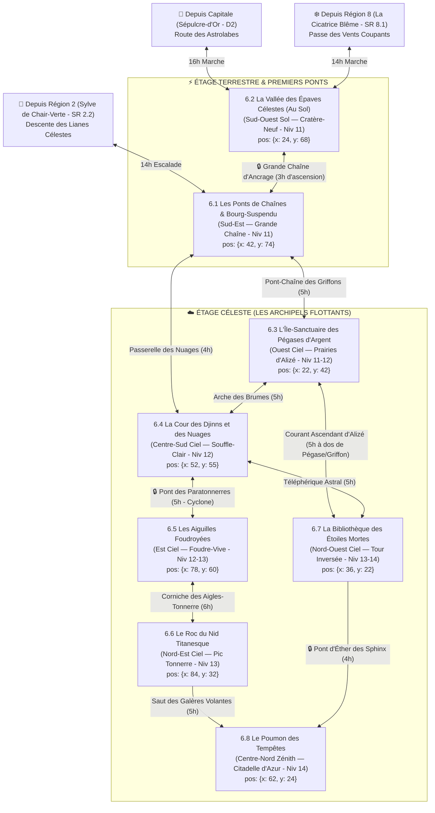

# ⚡ Région 6 : Les Archipels Célestes d'Aétheria (`archipels-d-aetheria`)

> **Position sur le continent** : Nord-Est d'Ombresang (`position: { x: 82, y: 24 }`)
> **Paliers de niveau** : Niveaux 11 à 14 (`niveauMin: 11`, `niveauMax: 14`)
> **Origine divine (Bible §1.1 & §4)** : Le corps dispersé d'**Aétheria**, Déesse des Vents, de la Foudre et des Étoiles. En mourant, son souffle (*l'Éther-Souffle*) a arraché des montagnes entières à la gravité : des dizaines d'îles rocheuses flottent au-dessus de hauts plateaux foudroyés, mais retombent une à une à cause du siphonage arcanique du **Conclave des Astrologues d'Azur**. Bordée au Nord-Ouest par *La Cicatrice Blême* (`Région 8`), au Sud-Ouest par la Capitale *Sépulcre-d'Or*, et au Sud par la *Sylve de Chair-Verte* (`Région 2`).

---

## 1. Hiérarchie des Boss (Monstres SRD 5.2.1)

| Échelon | Territoire | Boss / Monstre Chef (`id` SRD) | FP (CR) | Titre & Rôle Narratif |
| :--- | :--- | :--- | :---: | :--- |
| **BOSS DE RÉGION (1A)** | Le Poumon des Tempêtes (SR 6.8) | **`dragon-bleu-venerable`** | **FP 23** | **Aétherion l'Empereur-Foudre** — Souverain draconique de l'Œil du Cyclone Éternel. |
| **BOSS DE RÉGION (1B)** | Le Poumon des Tempêtes (SR 6.8) | **`geant-des-tempetes`** & **`archimage`** *(+ `dragon-d-argent-adulte` FP 16)* | **FP 13 / 12** | **Le Roi-Prophète Zéphyrion** (qui défend le cœur d'Aétheria) face à **L'Archimage Céleste Orion Vael** (qui active les Grands Siphons d'Éther avec ses `golem-de-fer` FP 16). |
| **Sous-Boss SR 6.1** | Les Ponts de Chaînes | **`gargouille`** *(Meute alpha + saboteurs `chef-de-bande` FP 2 & `harpie` FP 1)* | **FP 2 (5)** | **L'Escouade Brise-Maillon** — Saboteurs envoyés scier les maillons géants de la Grande Chaîne d'Ancrage de Bourg-Suspendu. |
| **Sous-Boss SR 6.2** | La Vallée des Épaves | **`golem-de-pierre`** *(Détraqué + `elementaire-de-l-air` FP 5 & `bulette` FP 5)* | **FP 10** | **Le Colosse de l'Île Tombée** — Gardien runique devenu fou au milieu des décombres de l'île sacrée écrasée au sol. |
| **Sous-Boss SR 6.3** | L'Île des Pégases d'Argent | **`jeune-dragon-bleu`** *(+ chasseurs impériaux `veteran` FP 3)* | **FP 9** | **Écaille-d'Orage** — Jeune dragon bleu qui électrocute les troupeaux de `pegase` (FP 2) et d'`aigle-geant` (FP 1). |
| **Sous-Boss SR 6.4** | La Cour des Djinns | **`djinn`** *(Alliance : clan de **`geant-des-nuages`** FP 9 & `traqueur-invisible` FP 6)* | **FP 11 / 9** | **Le Vizir Zephyros & Comte Néphélion** — Ont enveloppé trois îles dans un cyclone permanent pour réclamer le tribut impérial. |
| **Sous-Boss SR 6.5** | Les Aiguilles Foudroyées | **`dragon-bleu-adulte`** *(+ couvée de **`behir`** FP 11 & `armure-animee` FP 1)* | **FP 16 / 11** | **Fulgo-Vael & La Couvée d'Ambre** — Se nourrissent de la foudre concentrée par la Forêt de Paratonnerres. |
| **Sous-Boss SR 6.6** | Le Roc du Nid Titanesque | **`rukh`** *(Escorte : `chimere` FP 6, `vouivre` FP 6 & `harpie` FP 1)* | **FP 11** | **L'Oiseau-Tonnerre d'Aétheria** — Oiseau roc colossal né des plumes de la déesse, protégeant son unique œuf d'or. |
| **Sous-Boss SR 6.7** | La Bibliothèque des Étoiles | **`nalfeshnie`** *(+ `vrock` FP 6 & `assassin` FP 8 face aux gardiens **`sphinx-valeureux`** FP 17 & **`sphinx-erudit`** FP 11)* | **FP 13 / 17** | **Khor-Vasz le Dévoreur d'Astres** — Assiège les deux Sphinx dans la Tour Inversée pour s'emparer des tablettes sur la *Lance Sans Nom*. |
| **Sous-Boss SR 6.8** | Le Poumon des Tempêtes | **`dragon-bleu-venerable`**, **`geant-des-tempetes`** & **`archimage`** | **FP 23 / 13** | **La Bataille de l'Œil du Cyclone Éternel**. |

---

## 2. Réseau Bi-Étagé (Sol & Îles Flottantes), Ponts de Chaînes & Temps de Trajet



### Verrous Stratégiques de la Région 6
1. **La Grande Chaîne d'Ancrage (`SR 6.2 -> SR 6.1`)** : Relie la Vallée des Épaves (au sol) à Bourg-Suspendu (dans les airs). Menacée de rupture par les saboteurs.
2. **Le Cyclone du Tribut (`SR 6.4`)** : Le Djinn Zephyros bloque les courants aériens vers l'Est (`SR 6.5`) tant que son différend avec le Conclave d'Azur n'est pas résolu.
3. **La Tour Inversée des Sphinx (`SR 6.7 -> SR 6.8`)** : Garde le code d'accès des Grands Siphons d'Éther menant à la Citadelle d'Azur (`SR 6.8`).

---

## 3. Charte Visuelle & Empreinte sur la Carte du Monde

### Vue Aérienne (Carte du Monde / Atlas)
- **Forme géographique** : Au Nord-Est, une **grappe d'îles rocheuses flottantes** reliées par de titanesques chaînes d'orichalque et de fer, projetant des ombres noires nettes sur la *Vallée des Épaves Célestes* en contrebas (`SR 6.2`).
- **Palette chromatique** : Bleu électrique d'ozone (`#38BDF8`), blanc nacré de nuage et de marbre (`#F8FAFC`), or d'astrolabe (`#EAB308`), violet d'orage (`#4C1D95`) et gris ardoise magnétique (`#334155`).

### Vue au Sol et au Ciel (Exploration CRPG)
- **Atmosphère** : Gravité allégée au bord des falaises célestes d'où des cascades tombent dans le vide ; crépitement d'électricité statique ; grondement des siphons d'Éther-Souffle.

---

## 4. Description Détaillée des 8 Sous-Régions

---

### SR 6.1 — Les Ponts de Chaînes & Bourg-Suspendu (`les-ponts-de-chaines`)
- **Position & Frontières** : Seuil aérien Sud-Est (`position: { x: 42, y: 74 }`, `niveauMin: 11`, `niveauMax: 11`). Ville accrochée directement aux maillons géants entre deux îles flottantes, au-dessus de `SR 6.2` et de la lisière nord de la Sylve (`Région 2`).
- **Routes & Accès** :
  - Depuis `SR 6.2 (Au Sol)` : **Grande Chaîne d'Ancrage** (3h d'ascension par monte-charge).
  - Depuis `Région 2 (SR 2.2)` : **Descente des Lianes Célestes** (14h).
  - Vers `SR 6.3` : **Pont-Chaîne des Griffons** (5h).
  - Vers `SR 6.4` : **Passerelle des Nuages** (4h).
- **Points d'Intérêt (POI)** :
  - 🏘️ **Ville de Bourg-Suspendu** : Cité vertigineuse de maisons à colombages et de cabestans bâtie *à l'intérieur* et autour des maillons de dix mètres de large.
  - 🏰 **Le Phare des Nuages** : Tour-bastion de la Capitaine Lyra Vent-d'Orage (`chevalier` sur `griffon`), guidant les navires volants dans le brouillard.
  - 🕳️ **La Grotte des Courants d'Air** : Cavité venteuse sous la roche d'ancrage où se cachent les saboteurs et les `gargouille`.
  - ⛩️ **Chapelle du Dernier Maillon** : Oratoire suspendu dans le vide où les aérostiers prient Aétheria avant chaque traversée.
  - 🗿 **La Grande Chaîne d'Ancrage** : Chaîne cyclopéenne de deux kilomètres de long retenant l'archipel au sol, dont un maillon est à moitié scié.
- **Boss de Sous-Région** : **L'Escouade Brise-Maillon (Meute de `gargouille` FP 2 + saboteurs `chef-de-bande` FP 2 & `harpie` FP 1)**.

---

### SR 6.2 — La Vallée des Épaves Célestes (Au Sol) (`la-vallee-des-epaves-celestes`)
- **Position & Frontières** : Étage Terrestre Sud-Ouest (`position: { x: 24, y: 68 }`, `niveauMin: 11`, `niveauMax: 11`), au sol sous l'ombre des îles flottantes. Point d'arrivée des routes terrestres depuis la Capitale et la `Région 8`.
- **Routes & Accès** :
  - Depuis la Capitale (`D2`) : **Route des Astrolabes** (16h).
  - Depuis `Région 8 (SR 8.1)` : **Passe des Vents Coupants** (14h).
  - Vers `SR 6.1 (Ciel)` : **Grande Chaîne d'Ancrage** (3h).
- **Points d'Intérêt (POI)** :
  - 🏘️ **Village de Cratère-Neuf** : Campement de survivants, de ferrailleurs et de chercheurs d'artefacts fouillant les décombres d'une île tombée le mois dernier.
  - 🏰 **La Redoute des Treuils Terrestres** : Fortin impérial gardant le socle d'ancrage inférieur de la Grande Chaîne.
  - 🕳️ **Les Cavernes d'Impact** : Failles sismiques ouvertes par la chute de l'île, d'où surgissent des **`bulette` (FP 5)** et des **`ankheg` (FP 2)**.
  - ⛩️ **Le Temple Écrasé** : Basilique céleste tombée du ciel et plantée à l'envers dans la boue, hantée par des **`elementaire-de-l-air` (FP 5)** furieux.
  - 🗿 **Le Champ des Îles Tombées** : Paysage apocalyptique de montagnes retournées, de palais brisés et de siphons d'Éther fumants.
- **Boss de Sous-Région** : **Le Colosse de l'Île Tombée (`golem-de-pierre`, FP 10)** accompagné d'**`elementaire-de-l-air` (FP 5)** et d'une meute de **`bulette` (FP 5)**.

---

### SR 6.3 — L'Île-Sanctuaire des Pégases d'Argent (`l-ile-sanctuaire-des-pegases-d-argent`)
- **Position & Frontières** : Île flottante occidentale (`position: { x: 22, y: 42 }`, `niveauMin: 11`, `niveauMax: 12`). Haut plateau herbeux aux cascades tombant dans le vide.
- **Routes & Accès** :
  - Depuis `SR 6.1` : **Pont-Chaîne des Griffons** (5h).
  - Vers `SR 6.4` : **Arche des Brumes** (5h).
  - Vers `SR 6.7` : **Courant Ascendant d'Alizé** (5h).
- **Points d'Intérêt (POI)** :
  - 🏘️ **Hameau pastoral d'Alizé** : Village de dresseurs de griffons et de bergers des nuages vivant en harmonie avec les troupeaux ailés.
  - 🏰 **Le Pavillon des Chasseurs Impériaux** : Camp fortifié de braconniers nobles (`veteran` FP 3) venus capturer des pégases pour la Capitale.
  - 🕳️ **La Grotte des Plumes Blanches** : Caverne à flanc de falaise céleste où nichent les **`pegase` (FP 2)** et les **`aigle-geant` (FP 1)**.
  - ⛩️ **L'Autel du Zéphyr** : Cercle de colonnes de marbre blanc où le souffle pur d'Aétheria accorde le don de vol temporaire.
  - 🗿 **Les Prairies Flottantes** : Tapis d'herbe argentée suspendu à 2 000 mètres d'altitude au-dessus des nuages.
- **Boss de Sous-Région** : **Écaille-d'Orage (`jeune-dragon-bleu`, FP 9)** accompagné de **`dragonnet-bleu` (FP 3)**.

---

### SR 6.4 — La Cour des Djinns et des Nuages (`la-cour-des-djinns-et-des-nuages`)
- **Position & Frontières** : Archipel flottant du Centre-Sud (`position: { x: 52, y: 55 }`, `niveauMin: 12`, `niveauMax: 12`).
- **Routes & Accès** :
  - Depuis `SR 6.1` : **Passerelle des Nuages** (4h).
  - Depuis `SR 6.3` : **Arche des Brumes** (5h).
  - Vers `SR 6.5` : **Pont des Paratonnerres** (5h).
  - Vers `SR 6.7` : **Téléphérique Astral** (5h).
- **Points d'Intérêt (POI)** :
  - 🏘️ **Village aérien de Souffle-Clair** : Bourg de verriers et de musiciens éoliens enveloppé dans la tempête invoquée par les Djinns.
  - 🏰 **Le Palais de Vapeur Sculptée** : Citadelle de nuages solidifiés et de marbre doré où siègent le Djinn Zephyros et le clan des Géants des Nuages.
  - 🕳️ **La Caverne des Orages Embouteillés** : Cellier souterrain sous l'île où sont stockées des amphores contenant des ouragans captifs.
  - ⛩️ **L'Observatoire du Vent** : Temple acoustique où sont conservés les traités d'alliance signés jadis avec le Premier Empereur.
  - 🗿 **L'Escalier de Cumulus** : Cinquante marches géantes de nuage blanc pétrifié montant vers le trône des Géants.
- **Boss de Sous-Région** : **Le Vizir Zephyros (`djinn`, FP 11)** & **Comte Néphélion (`geant-des-nuages`, FP 9)** entourés de **`traqueur-invisible` (FP 6)**.

---

### SR 6.5 — Les Aiguilles Foudroyées (`les-aiguilles-foudroyees`)
- **Position & Frontières** : Archipel oriental de pitons magnétiques (`position: { x: 78, y: 60 }`, `niveauMin: 12`, `niveauMax: 13`), entre `SR 6.4` (Ouest) et `SR 6.6` (Nord).
- **Routes & Accès** :
  - Depuis `SR 6.4` : **Pont des Paratonnerres** (5h).
  - Vers `SR 6.6` : **Corniche des Aigles-Tonnerre** (6h).
- **Points d'Intérêt (POI)** :
  - 🏘️ **Poste de collecte de Foudre-Vive** : Station d'artificiers du Consortium qui mettent la foudre en bouteille dans des condensateurs d'ambre.
  - 🏰 **La Tour du Condensateur Majeur** : Bastion blindé de cuivre défendu par des **`garde-anime` (FP 4)** et **`armure-animee` (FP 1)**.
  - 🕳️ **L'Antre du Behir Céleste** : Réseau de grottes vitrifiées par la foudre au cœur du piton central.
  - ⛩️ **Chapelle de l'Étincelle Divine** : Sanctuaire où les mages d'Azur vénèrent le système nerveux électrique d'Aétheria.
  - 🗿 **La Forêt de Paratonnerres & Le Monolithe d'Ambre Électrique** : Cent flèches de cuivre de soixante mètres reliées par des arcs électriques bleus permanents.
- **Boss de Sous-Région** : **Fulgo-Vael (`dragon-bleu-adulte`, FP 16)** et sa couvée de **`behir` (FP 11)**.

---

### SR 6.6 — Le Roc du Nid Titanesque (`le-roc-du-nid-titanesque`)
- **Position & Frontières** : Piton flottant isolé au Nord-Est (`position: { x: 84, y: 32 }`, `niveauMin: 13`, `niveauMax: 13`).
- **Routes & Accès** :
  - Depuis `SR 6.5` : **Corniche des Aigles-Tonnerre** (6h).
  - Vers `SR 6.8` : **Saut des Galères Volantes** (5h).
- **Points d'Intérêt (POI)** :
  - 🏘️ **Campement des Fauconniers** : Bivouac de chasseurs célestes et d'éclaireurs de Lyra Vent-d'Orage cherchant à protéger l'œuf du Rukh contre le Concile.
  - 🏰 **L'Épave de la Galère Volante** : Cuirassé aérien impérial encastré dans la falaise, transformé en fortin par les survivants.
  - 🕳️ **Les Grottes à Guano d'Or** : Cavernes sous le nid géant riches en salpêtre alchimique, infestées de **`chimere` (FP 6)** et **`vouivre` (FP 6)**.
  - ⛩️ **L'Autel de la Première Plume** : Rocher sacré où les fauconniers prêtent serment aux grands rapaces.
  - 🗿 **Le Pic de l'Oiseau-Tonnerre** : Nid de cinquante mètres de diamètre fait de mâts de navires brisés au sommet duquel brille l'unique œuf d'or du Rukh.
- **Boss de Sous-Région** : **L'Oiseau-Tonnerre (`rukh`, FP 11)** entouré de **`harpie` (FP 1)** et d'**`aigle-geant` (FP 1)**.

---

### SR 6.7 — La Bibliothèque des Étoiles Mortes (`la-bibliotheque-des-etoiles-mortes`)
- **Position & Frontières** : Île-monastère du Nord-Ouest céleste (`position: { x: 36, y: 22 }`, `niveauMin: 13`, `niveauMax: 14`).
- **Routes & Accès** :
  - Depuis `SR 6.3` : **Courant Ascendant d'Alizé** (5h).
  - Depuis `SR 6.4` : **Téléphérique Astral** (5h).
  - Vers `SR 6.8` : **Pont d'Éther des Sphinx** (4h).
- **Points d'Intérêt (POI)** :
  - 🏘️ **Île-Monastère d'Astrolabe** : Communauté de moines-astronomes et de scribes gardant la surface de l'île contre l'incursion démoniaque.
  - 🏰 **Le Bastion du Planétarium Divin** : Coupole de bronze armillaire reproduisant la chute de la *Lance Sans Nom* lors de la Nuit des Sept Lances.
  - 🕳️ **Les Archives du Vide** : Salles fortes souterraines où les tablettes stellaires sont défendues par des **`epee-volante` (FP 1/4)** et des **`tapis-etrangleur` (FP 2)**.
  - ⛩️ **Le Tribunal des Deux Sphinx** : Sanctuaire où siègent le **`sphinx-valeureux` (FP 17)** et le **`sphinx-erudit` (FP 11)**.
  - 🗿 **La Tour Inversée** : Flèche de marbre noir de trois cents mètres qui **pend la tête en bas sous l'île rocheuse**, directement au-dessus de deux mille mètres de vide !
- **Boss de Sous-Région** : **Khor-Vasz (`nalfeshnie`, FP 13)** accompagné de **`vrock` (FP 6)** et d'**`assassin` (FP 8)** des Cendres Blanches, face aux deux Sphinx.

---

### SR 6.8 — Le Poumon des Tempêtes (`le-poumon-des-tempetes`)
- **Position & Frontières** : Cœur et zénith de la Région 6 au Centre-Nord (`position: { x: 62, y: 24 }`, `niveauMin: 14`, `niveauMax: 14`, altitude 3 200 m).
- **Routes & Accès** :
  - Depuis `SR 6.6` : **Saut des Galères Volantes** (5h).
  - Depuis `SR 6.7` : **Pont d'Éther des Sphinx** (4h).
- **Points d'Intérêt (POI)** :
  - 🏘️ **Les Quartiers Flottants du Conclave d'Azur** : Villas suspendues des mages aristocrates qui refusent d'évacuer les îles basses.
  - 🏰 **La Citadelle d'Azur** : Capitale régionale flottante et tour de commandement de l'Archimage Céleste Orion Vael.
  - 🕳️ **Les Grands Siphons d'Éther** : Tuyauteries cyclopéennes plongeant dans l'Œil du Cyclone pour pomper le souffle divin d'Aétheria.
  - ⛩️ **Le Sanctuaire des Souffles Primordiaux** : Temple intérieur où le Roi-Prophète Zéphyrion (`geant-des-tempetes`) et un **`dragon-d-argent-adulte` (FP 16)** tentent d'arrêter le siphonage.
  - 🗿 **L'Œil du Cyclone Éternel** : Gouffre de nuages noirs et d'éclairs bleus au centre duquel flotte le cœur pulmonaire lumineux de la déesse Aétheria.
- **Boss Final de la Région** : **Aétherion (`dragon-bleu-venerable`, FP 23)**, **L'Archimage Orion Vael (`archimage`, FP 12 + `golem-de-fer` FP 16)** & **Le Roi Zéphyrion (`geant-des-tempetes`, FP 13)**.

---

## 5. Prompt Cartographique de Référence (Région 6)

```text
Dark fantasy digital painting, top-down regional map of "Les Archipels Célestes d'Aétheria", a cluster of floating sky-islands above a cratered valley in the northeast of a dark fantasy continent.
Key geographic landmarks required:
- Ground layer below (Southwest SR 6.2): A scarred valley littered with the shattered ruins of fallen sky-islands, linked upward by a colossal anchor chain to a town suspended between two cliffs (SR 6.1 Bourg-Suspendu).
- Sky layer above: floating islands casting sharp dark shadows on the ground below, connected by giant chain-bridges:
  - West sky-island (SR 6.3): Silver-grass floating prairies with Pegasus flocks and waterfalls pouring into the void.
  - South-Center sky-island (SR 6.4): Sculpted cloud palaces of Djinns and Cloud Giants wrapped in a cyclone.
  - East sky-island (SR 6.5): Jagged rock spires bristling with a forest of copper lightning rods and blue electrical arcs.
  - Northeast sky-island (SR 6.6): A colossal Roc nest built from airship masts atop a thunder peak.
  - Northwest sky-island (SR 6.7): A monastery island with a 300-meter black marble Inverted Tower hanging upside-down beneath the rock base.
  - North-Center zenith (SR 6.8): The Eye of the Eternal Cyclone with the floating Azure Citadel and giant brass ether-siphons.
Palette: electric ozone blue, cloud pearl white, astrolabe gold, storm violet, slate grey. No text, no labels, no UI.
```
