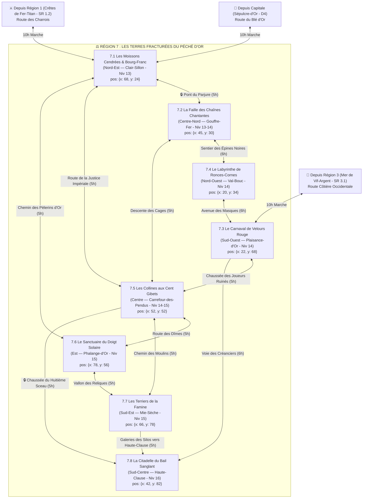

# ⚖️ Région 7 : Les Terres Fracturées du Péché d'Or (`terres-du-peche-d-or`)

> **Position sur le continent** : Centre-Ouest d'Ombresang (`position: { x: 24, y: 50 }`)
> **Paliers de niveau** : Niveaux 13 à 16 (`niveauMin: 13`, `niveauMax: 16`)
> **Origine divine (Bible §1.1 & §4)** : Ici est tombée la main droite coupée de **Sol-Invictus** tenant encore le fragment de la *Balance des Serments*, ainsi que le sang mêlé des sept dieux. C'est l'ancien grenier à blé de l'Empire, une terre de collines dorées balafrées par des failles abyssales d'où montent les huissiers des Neuf Enfers venus saisir la province à l'expiration du bail séculaire des **Sept Barons Parjures**. Bordée au Nord par les *Crêtes de Fer-Titan* (`Région 1`), à l'Est par la Capitale *Sépulcre-d'Or*, et au Sud par la *Mer de Vif-Argent* (`Région 3`).

---

## 1. Hiérarchie des Boss (Monstres SRD 5.2.1)

| Échelon | Territoire | Boss / Monstre Chef (`id` SRD) | FP (CR) | Titre & Rôle Narratif |
| :--- | :--- | :--- | :---: | :--- |
| **BOSS DE RÉGION (1A)** | La Citadelle du Bail Sanglant (SR 7.8) | **`diantrefosse`** | **FP 20** | **Son Éminence Baal-Zéphon, Grand-Juge du Huitième Sceau** — Seigneur Diantrefosse qui préside l'audience finale de saisie des Sept Baronnies. |
| **BOSS DE RÉGION (1B)** | La Citadelle du Bail Sanglant (SR 7.8) | **`diable-cornu`** & **`rakshasa`** *(Escorte : `diable-osseux` FP 9)* | **FP 11 / 13** | **Le Légat Infernal Malphas de la Huitième Clause** — Diplomate d'une politesse glaciale qui exécute légalement la saisie des terres et des âmes. |
| **Sous-Boss SR 7.1** | Les Moissons Cendrées | **`diable-barbu`** *(+ meute de `molosse-infernal` FP 3, `diablotin` FP 1 & mercenaires `veteran` FP 3)* | **FP 3 / 5** | **Le Percepteur Fer-Rouge** — Assiège le bourg de Clair-Sillon défendu par la baronne rebelle Dame Jeanne (`chevalier` FP 3). |
| **Sous-Boss SR 7.2** | La Faille des Chaînes | **`diable-des-chaines`** *(+ `diable-osseux` FP 9 & `diable-barbele` FP 5)* | **FP 8 / 9** | **Maître-Geôlier Kaelis** — Retient les âmes des villageois parjures dans des cages suspendues autour de l'*Obélisque des Contrats*. |
| **Sous-Boss SR 7.3** | Le Carnaval de Velours | **`rakshasa`** *(+ cabaret de `succube` FP 4, `incube` FP 4 & `doppelganger` FP 3)* | **FP 13** | **Le Marquis Mahavira** — Dirige la Grande Foire Nocturne de Plaisance-d'Or et rachète les années de vie des nobles ruinés. |
| **Sous-Boss SR 7.4** | Le Labyrinthe de Ronces | **`glabrezu`** *(+ meute de `minotaure-de-baphomet` FP 3, `hezrou` FP 8 & `combattant-gnoll` FP 1/2)* | **FP 9** | **Khor-Bapho le Démon du Parjure** — Invoqué par le Baron de Val-Bouc pour tromper les Diables, il a transformé la baronnie en labyrinthe sauvage. |
| **Sous-Boss SR 7.5** | Les Collines aux Cent Gibets | **`necronte`** *(+ `ame-en-peine` FP 5, `fantome` FP 4 & `capitaine-de-la-garde` FP 4)* | **FP 9** | **Le Grand-Juge Pendu** — Cadavre immortel qui pend coupables et innocents à l'*Arbre des Juges* pour remplir le quota d'âmes. |
| **Sous-Boss SR 7.6** | Le Sanctuaire du Doigt | **`marilith`** *(En lutte contre **`erinye`** FP 12 face aux gardiens **`naga-gardien`** FP 10, **`deva`** FP 10 & **`couatl`** FP 4)* | **FP 16 / 12** | **Dame Ashmedaï & La Commandante Némésia** — Deux armées (abyssale et infernale) qui convergent pour souiller la Source d'Or Liquide. |
| **Sous-Boss SR 7.7** | Les Terriers de la Famine | **`rat-garou`** *(Maître Meunier + **`otyugh`** FP 5, **`pouding-noir`** FP 4 & `mimique` FP 2)* | **FP 2 / 5** | **Le Meunier-Roi Grippesou** — Accapare toutes les réserves de blé dans les Silos Souterrains pendant que la province meurt de faim. |
| **Sous-Boss SR 7.8** | La Citadelle du Bail | **`diantrefosse`**, **`diable-cornu`** & **`rakshasa`** | **FP 20 / 13** | **Le Tribunal Suprême de Haute-Clause**. |

---

## 2. Réseau Routier Féodal, Ponts de Failles & Temps de Trajet



### Verrous Stratégiques de la Région 7
1. **Le Siège de Clair-Sillon (`SR 7.1`)** : Les collecteurs infernaux bloquent le *Pont du Parjure* vers l'Ouest ; secourir Dame Jeanne ouvre les routes de la province.
2. **L'Obélisque des Contrats (`SR 7.2`)** : Grave chaque mensonge prononcé dans la région ; détruire ou modifier les clauses gravées sur l'obélisque affaiblit le pouvoir légal du Légat Malphas en `SR 7.8`.
3. **Le Fragment de la Balance des Serments (`SR 7.6 -> SR 7.8`)** : Conservé au Sanctuaire du Doigt Solaire (`SR 7.6`), ce fragment divin est la seule preuve juridique capable d'annuler le Bail Sanglant devant le tribunal de Haute-Clause (`SR 7.8`).

---

## 3. Charte Visuelle & Empreinte sur la Carte du Monde

### Vue Aérienne (Carte du Monde / Atlas)
- **Forme géographique** : Au Centre-Ouest du continent, une province de collines agricoles dorées **balafrée par un réseau de crevasses abyssales noires et rouges** d'où jaillit une lueur de soufre et d'or fondu. À l'Est se dresse **l'index pétrifié géant de la main droite de Sol-Invictus** (`SR 7.6`).
- **Palette chromatique** : Or des blés et d'Ichor solaire (`#FACC15`), noir de basalte et de cendre (`#09090B`), rouge carmin infernal (`#B91C1C`), velours pourpre (`#581C87`) et airain terni (`#78350F`).

### Vue au Sol (Exploration CRPG)
- **Atmosphère** : Champs de blé d'or calcinés par des pluies de cendres rouges ; odeur d'encens juridique et de soufre ; tintement incessant des chaînes et des balances des huissiers infernaux sur les routes.

---

## 4. Description Détaillée des 8 Sous-Régions

---

### SR 7.1 — Les Moissons Cendrées & Bourg-Franc (`les-moissons-cendrees`)
- **Position & Frontières** : Entrée Nord-Est de la région (`position: { x: 68, y: 24 }`, `niveauMin: 13`, `niveauMax: 13`). Bordée au Nord par la `Région 1`, à l'Est par la Capitale, à l'Ouest par `SR 7.2` et au Sud par `SR 7.5` et `SR 7.6`.
- **Routes & Accès** :
  - Depuis la Capitale (`D4`) : **Route du Blé d'Or** (10h).
  - Depuis `Région 1 (SR 1.2)` : **Route des Charrois** (10h).
  - Vers `SR 7.2` : **Pont du Parjure** (5h).
  - Vers `SR 7.5` : **Route de la Justice Impériale** (5h).
  - Vers `SR 7.6` : **Chemin des Pèlerins d'Or** (5h).
- **Points d'Intérêt (POI)** :
  - 🏘️ **Bourg fortifié de Clair-Sillon** : Dernier refuge libre de la province où s'entassent les réfugiés sous la protection de la baronne paladine Dame Jeanne.
  - 🏰 **Le Donjon de Franc-Aleu** : Citadelle de pierre blanche de Dame Jeanne assiégée par les huissiers infernaux et les mercenaires des barons voisins.
  - 🕳️ **La Grotte des Réfractaires** : Cache souterraine sous les collines où se dissimulent les paysans dont l'âme est réclamée par les Enfers.
  - ⛩️ **La Chapelle du Serment Tenu** : Petit sanctuaire solaire dont la cloche repousse les `lemure` et les `diablotin`.
  - 🗿 **Les Moulins Brûlés** : Alignement de douze grands moulins à vent calcinés dont les ailes enflammées tournent encore dans le vent de soufre.
- **Boss de Sous-Région** : **Le Percepteur Fer-Rouge (`diable-barbu`, FP 3)** entouré de **`molosse-infernal` (FP 3)**, de **`diablotin` (FP 1)** et de mercenaires **`veteran` (FP 3)**.

---

### SR 7.2 — La Faille des Chaînes Chantantes (`la-faille-des-chaines-chantantes`)
- **Position & Frontières** : Canyon géologique du Centre-Nord (`position: { x: 45, y: 30 }`, `niveauMin: 13`, `niveauMax: 14`), entre `SR 7.1` (Est), `SR 7.4` (Ouest) et `SR 7.5` (Sud).
- **Routes & Accès** :
  - Depuis `SR 7.1` : **Pont du Parjure** (5h).
  - Vers `SR 7.4` : **Sentier des Épines Noires** (6h).
  - Vers `SR 7.5` : **Descente des Cages** (5h).
- **Points d'Intérêt (POI)** :
  - 🏘️ **Village minier de Gouffre-Fer** : Hameau accroché aux parois de la faille dont les habitants forgent les chaînes destinées à leur propre captivité.
  - 🏰 **Le Pont-Bastion du Parjure** : Arche fortifiée enjambant la crevasse d'où pendent des centaines de cages de fer.
  - 🕳️ **Les Cavernes de Torture Légale** : Salles d'interrogatoire souterraines tenues par des **`diable-osseux` (FP 9)** et des **`diable-barbele` (FP 5)**.
  - ⛩️ **Le Greffe des Mensonges** : Temple-tribunal où des **`fanatique-de-secte` (FP 2)** archivent les parjures des sept baronnies.
  - 🗿 **L'Obélisque des Contrats** : Aiguille de basalte noir de cent mètres au fond de la faille qui grave automatiquement en lettres de feu chaque mensonge prononcé dans la province.
- **Boss de Sous-Région** : **Maître-Geôlier Kaelis (`diable-des-chaines`, FP 8)** assisté d'un **`diable-osseux` (FP 9)**.

---

### SR 7.3 — Le Carnaval de Velours Rouge (`le-carnaval-de-velours-rouge`)
- **Position & Frontières** : Vallée thermale du Sud-Ouest (`position: { x: 22, y: 68 }`, `niveauMin: 14`, `niveauMax: 14`), ouverte au Sud sur la route côtière de la Mer de Vif-Argent (`Région 3`).
- **Routes & Accès** :
  - Depuis `Région 3 (SR 3.1)` : **Route Côtière Occidentale** (10h).
  - Depuis `SR 7.4` : **Avenue des Masques** (6h).
  - Vers `SR 7.5` : **Chaussée des Joueurs Ruinés** (5h).
  - Vers `SR 7.8` : **Voie des Créanciers** (6h).
- **Points d'Intérêt (POI)** :
  - 🏘️ **Ville thermale et décadente de Plaisance-d'Or** : Cité de casinos, de bains parfumés et de bals masqués où la noblesse dilapide ses derniers jours avant la saisie infernale.
  - 🏰 **Le Théâtre-Palais des Masques** : Citadelle baroque de velours rouge et d'or, fief du Marquis Rakshasa et de son cabaret de **`succube` (FP 4)** et **`incube` (FP 4)**.
  - 🕳️ **Les Catacombes des Soupirs** : Souterrains sous les casinos où les joueurs ayant perdu leurs années de vie sont transformés en vieillards exsangues.
  - ⛩️ **L'Autel de la Chance Truquée** : Salon secret où l'on mise ses souvenirs et ses compétences contre des faveurs diaboliques.
  - 🗿 **La Grande Foire Nocturne & La Roue des Âmes** : Champ de chapiteaux de soie pourpre dominé par une grande roue dorée illuminée de feux follets.
- **Boss de Sous-Région** : **Le Marquis Mahavira (`rakshasa`, FP 13)** entouré de **`succube` (FP 4)**, d'**`incube` (FP 4)**, de **`doppelganger` (FP 3)** et d'**`assassin` (FP 8)**.

---

### SR 7.4 — Le Labyrinthe de Ronces-Cornes (`le-labyrinthe-de-ronces-cornes`)
- **Position & Frontières** : Baronnie dévastée du Nord-Ouest (`position: { x: 20, y: 34 }`, `niveauMin: 14`, `niveauMax: 14`), entre `SR 7.2` (Est) et `SR 7.3` (Sud).
- **Routes & Accès** :
  - Depuis `SR 7.2` : **Sentier des Épines Noires** (6h).
  - Vers `SR 7.3` : **Avenue des Masques** (6h).
- **Points d'Intérêt (POI)** :
  - 🏘️ **Hameau abandonné de Val-Bouc** : Village envahi par les ronces géantes où quelques chasseurs survivent sur les toits.
  - 🏰 **Le Manoir Cornu du Baron Déchu** : Château féodal éventré par l'invocation abyssale qui devait chasser les Diables mais a livré le domaine aux démons.
  - 🕳️ **L'Antre du Minotaure** : Dédale souterrain sous le manoir où chassent des **`minotaure-de-baphomet` (FP 3)** et des **`combattant-gnoll` (FP 1/2)**.
  - ⛩️ **Le Temple Profané de la Moisson** : Église rurale souillée de sang où trône le démon Glabrezu.
  - 🗿 **La Haie Titanesque d'Épines Noires** : Muraille végétale et osseuse de trente mètres de haut formant un labyrinthe de dix kilomètres de large.
- **Boss de Sous-Région** : **Khor-Bapho (`glabrezu`, FP 9)** accompagné d'un **`hezrou` (FP 8)** et d'une harde de **`minotaure-de-baphomet` (FP 3)**.

---

### SR 7.5 — Les Collines aux Cent Gibets (`les-collines-aux-cent-gibets`)
- **Position & Frontières** : Carrefour central de la Région 7 (`position: { x: 52, y: 52 }`, `niveauMin: 14`, `niveauMax: 15`).
- **Routes & Accès** :
  - Depuis `SR 7.1` : **Route de la Justice Impériale** (5h).
  - Depuis `SR 7.2` : **Descente des Cages** (5h).
  - Depuis `SR 7.3` : **Chaussée des Joueurs Ruinés** (5h).
  - Vers `SR 7.6` : **Route des Dîmes** (5h).
  - Vers `SR 7.7` : **Chemin des Moulins** (5h).
  - Vers `SR 7.8` : **Chaussée du Huitième Sceau** (5h).
- **Points d'Intérêt (POI)** :
  - 🏘️ **Village de Carrefour-des-Pendus** : Bourg terrorisé autour du relais de poste central où les patrouilles arrêtent les voyageurs au moindre prétexte pour remplir le quota d'âmes.
  - 🏰 **Le Tribunal Routier des Quatre Vents** : Fortin de pierre noire où siège la garnison corrompue (`capitaine-de-la-garde` FP 4 & `chef-gros-bras` FP 3).
  - 🕳️ **La Grotte des Brigands** : Repaire souterrain d'anciens condamnés évadés qui attaquent les fourgons cellulaires.
  - ⛩️ **L'Oratoire des Sans-Sépulture** : Chapelle où les veuves viennent prier pour apaiser les `fantome` et `ame-en-peine` des pendus.
  - 🗿 **L'Arbre des Juges & La Route de la Justice Impériale** : Chêne mort géant pétrifié aux cent branches chargées de cages et de gibets.
- **Boss de Sous-Région** : **Le Grand-Juge Pendu (`necronte`, FP 9)** entouré d'**`ame-en-peine` (FP 5)**, de **`fantome` (FP 4)** et de **`goule` (FP 1)**.

---

### SR 7.6 — Le Sanctuaire du Doigt Solaire (`le-sanctuaire-du-doigt-solaire`)
- **Position & Frontières** : Collines sacrées de l'Est (`position: { x: 78, y: 56 }`, `niveauMin: 15`, `niveauMax: 15`), entre `SR 7.1` (Nord), `SR 7.5` (Ouest) et `SR 7.7` (Sud).
- **Routes & Accès** :
  - Depuis `SR 7.1` : **Chemin des Pèlerins d'Or** (5h).
  - Depuis `SR 7.5` : **Route des Dîmes** (5h).
  - Vers `SR 7.7` : **Vallon des Reliques** (5h).
- **Points d'Intérêt (POI)** :
  - 🏘️ **Le Cloître des Hospitaliers Solaires** : Campement des derniers défenseurs fidèles à Sol-Invictus menés par un **`deva` (FP 10)**.
  - 🏰 **Monastère fortifié de Phalange-d'Or** : Citadelle sainte bâtie autour de la base de l'index divin, assiégée simultanément par les Diables et les Démons.
  - 🕳️ **La Crypte des Reliques** : Chambre forte souterraine gardée par un **`couatl` (FP 4)** et un **`naga-gardien` (FP 10)** où repose le fragment de la *Balance des Serments*.
  - ⛩️ **La Source d'Or Liquide** : Fontaine miraculeuse d'Ichor pur jaillissant de la paume coupée de Sol-Invictus.
  - 🗿 **Le Doigt de Pierre** : L'index dressé en marbre et or fossilisé du Dieu-Roi, haut de deux cent cinquante mètres, pointé vers le ciel.
- **Boss de Sous-Région** : **Dame Ashmedaï (`marilith`, FP 16)** et sa rivale **La Commandante Némésia (`erinye`, FP 12)** qui s'affrontent aux portes du monastère.

---

### SR 7.7 — Les Terriers de la Famine (`les-terriers-de-la-famine`)
- **Position & Frontières** : Plaine agricole ravagée du Sud-Est (`position: { x: 66, y: 78 }`, `niveauMin: 15`, `niveauMax: 15`).
- **Routes & Accès** :
  - Depuis `SR 7.5` : **Chemin des Moulins** (5h).
  - Depuis `SR 7.6` : **Vallon des Reliques** (5h).
  - Vers `SR 7.8` : **Galeries des Silos vers Haute-Clause** (5h).
- **Points d'Intérêt (POI)** :
  - 🏘️ **Village affamé de Mie-Sèche** : Bourg paysan réduit à la famine alors que le meunier enrichi vend le blé en secret aux armées infernales.
  - 🏰 **Le Moulin Hanté (La Tour-Meulière)** : Grand moulin-forteresse de pierre noire gardé par des **`mimique` (FP 2)** et des mercenaires.
  - 🕳️ **Les Silos Souterrains & Les Galeries des Nuées** : Immenses caves regorgeant de blé d'or sous la garde d'un culte de **`rat-garou` (FP 2)**, d'**`otyugh` (FP 5)** et de **`pouding-noir` (FP 4)**.
  - ⛩️ **L'Autel du Rat d'Or** : Sanctuaire souterrain immonde où les accapareurs adorent la famine.
  - 🗿 **La Balance du Pain et du Sang** : Monument de bronze sur la place de Mie-Sèche où une miche de pain coûte littéralement son poids en sang.
- **Boss de Sous-Région** : **Le Meunier-Roi Grippesou (`rat-garou` alpha, FP 2/5)** entouré d'un **`otyugh` (FP 5)**, de **`pouding-noir` (FP 4)** et de **`gelee-ocre` (FP 2)**.

---

### SR 7.8 — La Citadelle du Bail Sanglant (`la-citadelle-du-bail-sanglant`)
- **Position & Frontières** : Cœur de la Région 7 au Sud-Centre (`position: { x: 42, y: 82 }`, `niveauMin: 16`, `niveauMax: 16`), bâtie à cheval sur la plus large faille infernale de la province.
- **Routes & Accès** :
  - Depuis `SR 7.3` : **Voie des Créanciers** (6h).
  - Depuis `SR 7.5` : **Chaussée du Huitième Sceau** (5h).
  - Depuis `SR 7.7` : **Galeries des Silos** (5h).
- **Points d'Intérêt (POI)** :
  - 🏘️ **Le Parvis des Sept Barons Parjures** : Campement d'apparat où les sept seigneurs féodaux de la province attendent tremblants l'heure de l'audience finale.
  - 🏰 **Château-Tribunal de Haute-Clause** : Forteresse gothique d'airain noir et de marbre rouge où siège le Légat Malphas.
  - 🕳️ **Les Oubliettes du Huitième Sceau** : Prisons souterraines plongeant directement au-dessus des flammes du Phlégéthon.
  - ⛩️ **La Salle du Grand Parchemin** : Prétoire monumental où est déroulé le contrat centenaire long de cent mètres ; on peut y plaider la faille juridique de la *Balance des Serments* ou affronter la Cour.
  - 🗿 **La Porte d'Airain vers les Neuf Enfers** : Arche titanesque de cent mètres de haut scellée de huit verrous ardents au fond du gouffre.
- **Boss Final de la Région** : **Son Éminence Baal-Zéphon (`diantrefosse`, FP 20)** & **Le Légat Infernal Malphas (`diable-cornu` FP 11 / `rakshasa` FP 13)**.

---

## 5. Prompt Cartographique de Référence (Région 7)

```text
Dark fantasy digital painting, top-down regional map of "Les Terres Fracturées du Péché d'Or", a devastated golden wheat province in the central-west of a dark fantasy continent, scarred by glowing red hell-chasms.
Key geographic landmarks required:
- Northeast (SR 7.1): Golden wheat fields burned by ash around the white walled town of Clair-Sillon and twelve burning windmills.
- North-Center (SR 7.2): A deep geological chasm spanned by iron chains suspending cages around a 100-meter black basalt contract obelisk.
- Northwest (SR 7.4): A 10km labyrinth of giant black thorn hedges surrounding a ruined manor.
- Southwest (SR 7.3): A decadent red-velvet carnival city and casino resort with a giant glowing Ferris wheel.
- Center (SR 7.5): Crossroads hills crowned with a giant petrified dead oak tree hung with a hundred cages and gibbets.
- East (SR 7.6): A colossal 250-meter petrified golden index finger of a fallen sun god pointing skyward inside a fortified monastery.
- Southeast (SR 7.7): Parched farmlands around a giant black stone windmill-fortress and underground grain silos.
- South-Center heart (SR 7.8): A monumental black-brass gothic Castle-Tribunal straddling the widest hell-rift in front of a titanic Brass Gate to the Nine Hells.
Palette: golden wheat, hellfire crimson, basalt black, red velvet purple, tarnished brass. No text, no labels, no UI.
```
