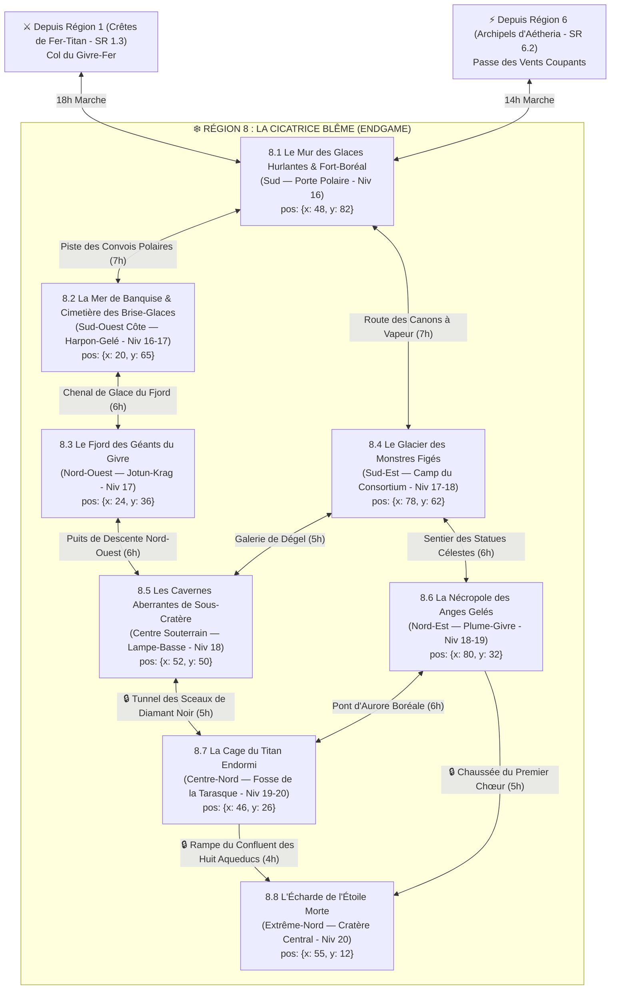

# ❄️ Région 8 : La Cicatrice Blême & Le Cratère de l'Étoile Morte (`cicatrice-bleme`)

> **Position sur le continent** : Grand Nord Glacé d'Ombresang (`position: { x: 55, y: 10 }`)
> **Paliers de niveau** : Niveaux 16 à 20 (`niveauMin: 16`, `niveauMax: 20` — Zone de Fin de Jeu / Endgame)
> **Origine divine (Bible §1.1 & §4)** : Ici ne repose aucun dieu connu, mais le cratère d'impact gelé de **La Lance Sans Nom** — le projectile cosmique venu d'au-delà des étoiles qui a frappé le firmament et déclenché la folie meurtrière de la *Nuit des Sept Lances*. Sous l'effet des forages d'Ichor du **Concile des Cendres Blanches** dirigé par **L'Apôtre Voilé (Malakor l'Écorché)**, le glacier central fond, réveillant les aberrations stellaires et la **Tarasque** endormie depuis l'aube du monde. Bordée au Sud-Ouest par les *Crêtes de Fer-Titan* (`Région 1`) et au Sud-Est par les *Archipels d'Aétheria* (`Région 6`).

---

## 1. Hiérarchie des Boss (Monstres SRD 5.2.1)

| Échelon | Territoire | Boss / Monstre Chef (`id` SRD) | FP (CR) | Titre & Rôle Narratif |
| :--- | :--- | :--- | :---: | :--- |
| **BOSS ULTIME DU MONDE (1A)** | L'Écharde de l'Étoile Morte (SR 8.8) | **`liche`** *(+ `archimage` FP 12, `balor` FP 19 & `diantrefosse` FP 20)* | **FP 21** | **L'Apôtre Voilé (Malakor l'Écorché)** — Ancien Premier Astrologue impérial et maître du Concile des Cendres Blanches, qui converge les Huit Aqueducs d'Ichor pour accomplir sa Seconde Apothéose. |
| **BOSS ULTIME DU MONDE (1B)** | La Cage du Titan Endormi (SR 8.7) | **`tarasque`** *(Gardée par **`dragon-blanc-venerable`** FP 20)* | **FP 30 / 20** | **La Bête de l'Aube du Monde** — Cataclysme vivant enchaîné sous le glacier, que les fanatiques injectent d'Ichor bouillant pour la lancer sur la Capitale. |
| **Sous-Boss SR 8.1** | Le Mur des Glaces Hurlantes | **`diable-gele`** *(+ horde de `zombi` FP 1/4, `squelette` FP 1/4 & `mammouth` FP 6)* | **FP 14** | **Le Légat Gelidius du Blizzard** — Commande l'assaut contre Fort-Boréal et les réfugiés nordiques du Jarl Astrid Brise-Glace (`berserker` FP 2). |
| **Sous-Boss SR 8.2** | La Mer de Banquise | **`dragon-blanc-adulte`** *(+ meute de **`remorhaz`** FP 11 & `jeune-dragon-blanc` FP 6)* | **FP 13 / 11** | **Kryos-le-Harponneur** — Attaque par en dessous les brise-glaces impériaux bloqués dans la banquise pour piller leurs cargaisons d'Ichor chaud. |
| **Sous-Boss SR 8.3** | Le Fjord des Géants du Givre | **`geant-du-givre`** *(Roi Jarl empoisonné + assassin **`oni`** FP 7, `troll` FP 5 & `ettin` FP 4)* | **FP 8 / 7** | **Le Roi-Jarl Ymir & L'Émissaire Masqué (`oni`)** — L'assassin Oni des Cendres Blanches a empoisonné le Roi pour déclencher une guerre entre Géants et Barbares. |
| **Sous-Boss SR 8.4** | Le Glacier des Monstres Figés | **`ver-pourpre`** *(Dégelé + `hydre` FP 8, `chimere` FP 6 & `babelien` FP 2)* | **FP 15** | **Le Foreur Antédiluvien** — Monstre préhistorique libéré de la glace par les canons à vapeur d'Ichor du Consortium. |
| **Sous-Boss SR 8.5** | Les Cavernes de Sous-Cratère | **`aboleth`** *(Stellaire + garde de **`chtuul`** FP 4, `enlaceur` FP 5 & `manteleur` FP 8)* | **FP 10** | **Xul-N'gha, La Pensée de la Lance** — Aberration née des radiations de la Lance Sans Nom dans le Lac Souterrain Sans Étoile. |
| **Sous-Boss SR 8.6** | La Nécropole des Anges Gelés | **`solar`** *(Aveugle et blessé, traqué par une **`liche`** FP 21 et un **`necronte`** FP 9 du Concile)* | **FP 21** | **L'Archange Aveugle Aurélien** — Dernier survivant du Premier Chœur foudroyé il y a 312 ans, qui détient la vérité sur la Nuit des Sept Lances. |
| **Sous-Boss SR 8.7** | La Cage du Titan Endormi | **`dragon-blanc-venerable`** *(+ `golem-de-fer` FP 16 autour de la **`tarasque`** FP 30)* | **FP 20 / 30** | **Glaurung-Blanc, Le Gardien des Sceaux Polaires**. |
| **Sous-Boss SR 8.8** | L'Écharde de l'Étoile Morte | **`liche`** *(Malakor l'Écorché)* | **FP 21** | **Le Climax Mondial au Confluent des Huit Aqueducs**. |

---

## 2. Réseau des Pistes Polaires, Fjords & Temps de Trajet



### Verrous Stratégiques de la Région 8
1. **Le Blocus de Fort-Boréal (`SR 8.1`)** : Point d'entrée unique depuis le Sud (`Région 1` et `Région 6`), assiégé par la horde du Diable Gelé.
2. **Les Tunnels de Sous-Cratère (`SR 8.5 -> SR 8.7`)** : Pour atteindre la Cage de la Tarasque (`SR 8.7`), il faut traverser le réseau souterrain aberrant ou obtenir la bénédiction de l'Archange Aveugle en `SR 8.6`.
3. **Le Confluent des Huit Aqueducs (`SR 8.8`)** : Protégé par les sceaux finaux du Concile des Cendres Blanches au cœur du cratère de la Lance Sans Nom.

---

## 3. Charte Visuelle & Empreinte sur la Carte du Monde

### Vue Aérienne (Carte du Monde / Atlas)
- **Forme géographique** : À l'extrême Nord d'Ombresang, une immense calotte glaciaire déchirée en son centre par **une cicatrice rectiligne violette et noire** (le cratère d'impact de la *Lance Sans Nom*). Au centre-nord s'élève la flèche cristalline noire et violette de l'Écharde (`SR 8.8`) vers laquelle convergent huit conduites dorées d'Ichor.
- **Palette chromatique** : Blanc spectral de neige (`#F8FAFC`), bleu glacier translucide (`#67E8F9`), violet cosmique de la Lance (`#A855F7`), noir de diamant stellaire (`#020617`) et or d'Ichor bouillant (`#FDE047`).

### Vue au Sol (Exploration CRPG)
- **Atmosphère** : Nuit polaire illuminée par des aurores boréales violettes ; parois de glace transparente laissant voir des monstres préhistoriques et des anges figés ; murmures télépathiques venus du sous-sol.

---

## 4. Description Détaillée des 8 Sous-Régions

---

### SR 8.1 — Le Mur des Glaces Hurlantes & Fort-Boréal (`le-mur-des-glaces-hurlantes`)
- **Position & Frontières** : Frontière Sud de la Cicatrice Blême (`position: { x: 48, y: 82 }`, `niveauMin: 16`, `niveauMax: 16`). Falaise de glace bleue barrant l'accès depuis les Crêtes de Fer-Titan (`Région 1` au Sud-Ouest) et Aétheria (`Région 6` au Sud-Est).
- **Routes & Accès** :
  - Depuis `Région 1 (SR 1.3)` : **Col du Givre-Fer** (18h).
  - Depuis `Région 6 (SR 6.2)` : **Passe des Vents Coupants** (14h).
  - Vers `SR 8.2` : **Piste des Convois Polaires** (7h).
  - Vers `SR 8.4` : **Route des Canons à Vapeur** (7h).
- **Points d'Intérêt (POI)** :
  - 🏘️ **Village trappeur de Fourrure-Grise** : Campement de réfugiés nordiques, de chasseurs et de troupeaux de **`mammouth` (FP 6)** massés devant les portes fermées du fort.
  - 🏰 **Forteresse frontalière de Fort-Boréal** : Bastion impérial encastré dans la muraille de glace, assiégé par les morts-vivants gelés.
  - 🕳️ **La Grotte de l'Ours Blanc** : Tanière sous-glaciaire servant de passage secret sous la muraille, habitée par des **`ours-polaire` (FP 2)** et **`tigre-a-dents-de-sabre` (FP 2)**.
  - ⛩️ **Brasero de la Veille Polaire** : Sanctuaire militaire chauffé à l'Ichor où les soldats jurent de ne rien laisser sortir du Nord.
  - 🗿 **La Passe des Vents Coupants** : Faille vertigineuse dans la falaise de glace dont les courants d'air hurlent comme des milliers de voix.
- **Boss de Sous-Région** : **Le Légat Gelidius (`diable-gele`, FP 14)** menant une horde de **`zombi` (FP 1/4)**, **`squelette` (FP 1/4)** et **`loup-arctique` (FP 3)**.

---

### SR 8.2 — La Mer de Banquise & Le Cimetière des Brise-Glaces (`la-mer-de-banquise`)
- **Position & Frontières** : Côte Sud-Ouest gelée (`position: { x: 20, y: 65 }`, `niveauMin: 16`, `niveauMax: 17`), entre `SR 8.1` (Sud-Est) et `SR 8.3` (Nord).
- **Routes & Accès** :
  - Depuis `SR 8.1` : **Piste des Convois Polaires** (7h).
  - Vers `SR 8.3` : **Chenal de Glace du Fjord** (6h).
- **Points d'Intérêt (POI)** :
  - 🏘️ **Port baleinier de Harpon-Gelé** : Dernier port habité du Nord où marins et éclaireurs survivent en brûlant de l'huile de baleine.
  - 🏰 **Le Cuirassé-Amiral "Brise-Aurore"** : Navire de ravitaillement impérial blindé pris dans la banquise, transformé en forteresse par son équipage.
  - 🕳️ **La Caverne Sous-Glaciaire** : Réseau de tunnels de glace fondue sous la banquise d'où attaquent les **`remorhaz` (FP 11)** et le dragon blanc.
  - ⛩️ **Le Sanctuaire de l'Orque Blanc** : Autel chamanique côtier dédié aux esprits marins (**`epaulard`, FP 3**).
  - 🗿 **Les Navires Pris dans les Glaces** : Vingt grands navires d'expédition figés debout dans la banquise crépitante.
- **Boss de Sous-Région** : **Kryos-le-Harponneur (`dragon-blanc-adulte`, FP 13)** accompagné de **`jeune-dragon-blanc` (FP 6)**, de **`remorhaz` (FP 11)** et de **`mephite-gele` (FP 1/2)**.

---

### SR 8.3 — Le Fjord des Géants du Givre (`le-fjord-des-geants-du-givre`)
- **Position & Frontières** : Côte Nord-Ouest escarpée (`position: { x: 24, y: 36 }`, `niveauMin: 17`, `niveauMax: 17`), entre `SR 8.2` (Sud) et `SR 8.5` (Est).
- **Routes & Accès** :
  - Depuis `SR 8.2` : **Chenal de Glace du Fjord** (6h).
  - Vers `SR 8.5` : **Puits de Descente Nord-Ouest** (6h).
- **Points d'Intérêt (POI)** :
  - 🏘️ **Village barbare de Sang-Chaud** : Fief du **Jarl Astrid Brise-Glace (`berserker`, FP 2)** bâti autour de sources géothermiques fumantes.
  - 🏰 **Citadelle de Glace de Jotun-Krag** : Forteresse cyclopéenne des **`geant-du-givre` (FP 8)** au sommet de la falaise du fjord.
  - 🕳️ **La Grotte des Stalactites Géantes** : Repaire où l'émissaire **`oni` (FP 7)** des Cendres Blanches a caché les fioles de poison utilisées contre le Roi des Géants.
  - ⛩️ **La Halle des Serments Nordiques** : Temple de bois sculpté où Géants et Humains négociaient jadis leurs trêves.
  - 🗿 **La Pierre des Sagas** : Monolithe runique de quarante mètres racontant la chute de la *Lance Sans Nom* vue par les premiers hommes.
- **Boss de Sous-Région** : **L'Émissaire Masqué (`oni`, FP 7)** & le clan enragé de **`geant-du-givre` (FP 8)**, **`troll` (FP 5)** et **`ettin` (FP 4)**.

---

### SR 8.4 — Le Glacier des Monstres Figés (`le-glacier-des-monstres-figes`)
- **Position & Frontières** : Plateau glaciaire du Sud-Est (`position: { x: 78, y: 62 }`, `niveauMin: 17`, `niveauMax: 18`), entre `SR 8.1` (Sud-Ouest), `SR 8.5` (Ouest) et `SR 8.6` (Nord).
- **Routes & Accès** :
  - Depuis `SR 8.1` : **Route des Canons à Vapeur** (7h).
  - Vers `SR 8.5` : **Galerie de Dégel** (5h).
  - Vers `SR 8.6` : **Sentier des Statues Célestes** (6h).
- **Points d'Intérêt (POI)** :
  - 🏘️ **Camp scientifique du Consortium** : Base d'excavation entourée de générateurs thermiques où mages et ingénieurs découpent la glace millénaire.
  - 🏰 **La Redoute des Canons à Vapeur** : Batterie d'artillerie à vapeur d'Ichor qui fait fondre le front du glacier, défendue par des **`golem-de-chair` (FP 5)** et **`mage` (FP 6)**.
  - 🕳️ **Les Puits de Vapeur** : Crevasses fumantes par où s'échappent les monstres dégelés par accident.
  - ⛩️ **L'Autel Préhistorique** : Sanctuaire cyclopéen antérieur aux dieux mêmes, mis à nu par la fonte des glaces.
  - 🗿 **La Galerie de Glace Translucide** : Paroi de cristal bleu de deux kilomètres où l'on voit encore des dizaines de chimères, d'hydres et de vers géants pris dans la glace.
- **Boss de Sous-Région** : **Le Foreur Antédiluvien (`ver-pourpre`, FP 15)** libéré avec une **`hydre` (FP 8)**, une **`chimere` (FP 6)** et des **`babelien` (FP 2)**.

---

### SR 8.5 — Les Cavernes Aberrantes de Sous-Cratère (`les-cavernes-aberrantes-de-sous-cratere`)
- **Position & Frontières** : Monde souterrain au Centre de la région (`position: { x: 52, y: 50 }`, `niveauMin: 18`, `niveauMax: 18`), directement sous la banquise centrale.
- **Routes & Accès** :
  - Depuis `SR 8.3` : **Puits de Descente Nord-Ouest** (6h).
  - Depuis `SR 8.4` : **Galerie de Dégel** (5h).
  - Vers `SR 8.7` : **Tunnel des Sceaux de Diamant Noir** (5h).
- **Points d'Intérêt (POI)** :
  - 🏘️ **Avant-poste souterrain de Lampe-Basse** : Dernier bivouac fortifié d'explorateurs qui portent des casques de plomb pour bloquer les murmures télépathiques.
  - 🏰 **Le Bastion de l'Écluse Souterraine** : Ouvrage ancien barrant les rivières de mucus noir qui montent du lac abyssal.
  - 🕳️ **Les Tunnels de Chair Violette & Le Lac Souterrain Sans Étoile** : Réseau de cavernes mutées par les radiations de la Lance Sans Nom, peuplé d'**`enlaceur` (FP 5)**, de **`manteleur` (FP 8)** et de **`grick` (FP 2)**.
  - ⛩️ **Le Sanctuaire des Murmures Stellaires** : Temple aberrant où des expéditions asservies adorent l'Aboleth.
  - 🗿 **Le Pilier Télépathique** : Éclat secondaire de la Lance Sans Nom fiché au milieu du lac souterrain, pulsant d'une lumière violette.
- **Boss de Sous-Région** : **Xul-N'gha (`aboleth` stellaire, FP 10)** entouré de sa garde de **`chtuul` (FP 4)**, de **`pouding-noir` (FP 4)** et de **`cube-gelatineux` (FP 2)**.

---

### SR 8.6 — La Nécropole des Anges Gelés (`la-necropole-des-anges-geles`)
- **Position & Frontières** : Vallée de cristal au Nord-Est (`position: { x: 80, y: 32 }`, `niveauMin: 18`, `niveauMax: 19`), entre `SR 8.4` (Sud), `SR 8.7` (Ouest) et `SR 8.8` (Nord-Ouest).
- **Routes & Accès** :
  - Depuis `SR 8.4` : **Sentier des Statues Célestes** (6h).
  - Vers `SR 8.7` : **Pont d'Aurore Boréale** (6h).
  - Vers `SR 8.8` : **Chaussée du Premier Chœur** (5h).
- **Points d'Intérêt (POI)** :
  - 🏘️ **Sanctuaire-Refuge de Plume-Givre** : Abri sacré tenu par un **`deva` (FP 10)** et un **`planetar` (FP 16)** survivants qui protègent l'Archange Aveugle contre les Liches du Concile.
  - 🏰 **La Citadelle du Premier Chœur** : Forteresse céleste foudroyée il y a 312 ans lorsqu'elle vint inspecter l'impact de la Lance Sans Nom.
  - 🕳️ **La Crypte du Premier Chœur** : Catacombes de glace où rôdent les **`necronte` (FP 9)**, **`spectre` (FP 1)** et **`ame-en-peine` (FP 5)** envoyés par Malakor.
  - ⛩️ **L'Autel de la Vérité Première** : Chœur où l'Archange Aveugle Aurélien (`solar`) révèle aux héros la véritable nature de la *Nuit des Sept Lances*.
  - 🗿 **Le Champ des Statues Célestes & Le Miroir d'Aurore** : Des centaines d'anges figés en plein vol dans le givre éternel autour d'un miroir de glace reflétant le passé du cosmos.
- **Boss de Sous-Région** : **L'Archange Aveugle Aurélien (`solar`, FP 21)** traqué par le **Légat-Liche des Cendres Blanches (`liche` FP 21 + `necronte` FP 9)**.

---

### SR 8.7 — La Cage du Titan Endormi (`la-cage-du-titan-endormi`)
- **Position & Frontières** : Fosse polaire du Centre-Nord (`position: { x: 46, y: 26 }`, `niveauMin: 19`, `niveauMax: 20`), juste au Sud du Cratère Central (`SR 8.8`).
- **Routes & Accès** :
  - Depuis `SR 8.5` : **Tunnel des Sceaux de Diamant Noir** (5h).
  - Depuis `SR 8.6` : **Pont d'Aurore Boréale** (6h).
  - Vers `SR 8.8` : **Rampe du Confluent des Huit Aqueducs** (4h).
- **Points d'Intérêt (POI)** :
  - 🏘️ **Poste de garde des Sceaux** : Garnison des anciens Veilleurs du Nord aujourd'hui infiltrée et assiégée par les **`assassin` (FP 8)** et **`fanatique-de-secte` (FP 2)** des Cendres Blanches.
  - 🏰 **Le Bastion des Injecteurs d'Ichor** : Usine thermique érigée par le Concile pour injecter de l'Ichor bouillant dans les veines du monstre endormi.
  - 🕳️ **La Caverne de la Carapace** : Gouffre souterrain aussi grand qu'une ville où dort la **`tarasque` (FP 30)** sous le souffle cryogénique du Dragon Blanc Vénérable.
  - ⛩️ **Le Temple des Veilleurs du Nord** : Sanctuaire contenant le mécanisme de verrouillage cryogénique des anciens dieux.
  - 🗿 **Les Chaînes de Diamant Noir** : Douze chaînes divines cyclopéennes ancrées dans la carapace hérissée de cornes de la Tarasque à travers la glace translucide.
- **Boss de Sous-Région & Boss Titanesque** : **Glaurung-Blanc (`dragon-blanc-venerable`, FP 20)** flanqué de **`golem-de-fer` (FP 16)**, et **La Bête de l'Aube du Monde (`tarasque`, FP 30)**.

---

### SR 8.8 — L'Écharde de l'Étoile Morte (`l-echarde-de-l-etoile-morte`)
- **Position & Frontières** : Cœur de la Région 8 et Climax Mondial à l'Extrême-Nord (`position: { x: 55, y: 12 }`, `niveauMin: 20`, `niveauMax: 20`).
- **Routes & Accès** :
  - Depuis `SR 8.6` : **Chaussée du Premier Chœur** (5h).
  - Depuis `SR 8.7` : **Rampe du Confluent des Huit Aqueducs** (4h).
- **Points d'Intérêt (POI)** :
  - 🏘️ **Le Campement de la Garde Finale des Cendres Blanches** : Esplanade intérieure où stationnent les archimages et les généraux fiélons de l'Apôtre Voilé.
  - 🏰 **La Cathédrale des Cendres Blanches** : Citadelle occulte bâtie tout autour de la pointe émergente de la Lance Sans Nom.
  - 🕳️ **Le Cratère Central de la Lance Sans Nom** : Abîme cosmique où pulse le dard cristallin noir et violet venu d'au-delà des étoiles.
  - ⛩️ **L'Autel de la Seconde Apothéose** : Le trône rituel où **L'Apôtre Voilé (Malakor l'Écorché)** fusionne l'essence des sept dieux morts pour devenir le Dieu Unique d'Ombresang.
  - 🗿 **Le Confluent des Huit Aqueducs d'Ichor** : Huit canaux titanesques d'or liquide bouillant arrivant des huit provinces et se déversant en cascades incandescentes sur la Lance Sans Nom.
- **Boss Final de la Région & de la Campagne** : **L'Apôtre Voilé / Malakor l'Écorché (`liche`, FP 21)** entouré de ses champions (**`balor` FP 19**, **`diantrefosse` FP 20**, **`solar` corrompu FP 21** et **`golem-de-fer` FP 16**).

---

## 5. Prompt Cartographique de Référence (Région 8)

```text
Dark fantasy digital painting, top-down regional map of "La Cicatrice Blême & Le Cratère de l'Étoile Morte", the endgame polar region in the far north of a dark fantasy continent.
Key geographic landmarks required:
- South border (SR 8.1): A towering vertical blue ice wall with Fort-Boréal at the mountain pass entrance.
- Southwest coast (SR 8.2): Frozen pack-ice sea with twenty icebreaker ships trapped in the ice around a whaling port.
- Northwest coast (SR 8.3): A deep icy fjord with a Frost Giant ice citadel on the cliff and a barbarian geothermal village below.
- Southeast (SR 8.4): A translucent blue glacier wall revealing giant prehistoric monsters frozen inside, with steam-cannon excavation camps.
- Center underground opening (SR 8.5): A chasm descending into purple bioluminescent aberrant caverns and a starless subterranean lake.
- Northeast (SR 8.6): A frozen necropolis of hundreds of celestial angel statues frozen mid-flight around an aurora mirror.
- North-Center (SR 8.7): A massive translucent ice cavern-pit bound by twelve black diamond chains, with the horned silhouette of the sleeping Tarrasque visible beneath the ice.
- Far North apex (SR 8.8): The colossal impact crater of the Nameless Spear — a towering jagged shard of black-and-violet cosmic crystal at the confluence of eight glowing golden Ichor aqueducts.
Palette: blinding snow white, translucent glacier cyan, cosmic void purple, black diamond, glowing golden Ichor. No text, no labels, no UI.
```
