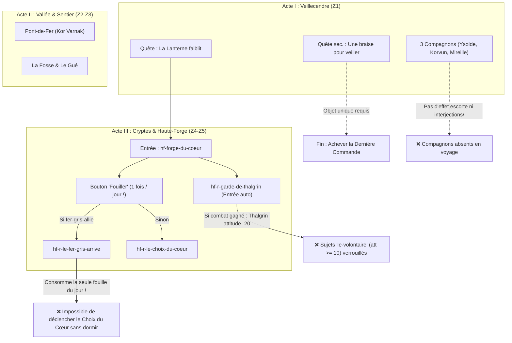

# Audit de Narrative Design & Plan d'Amélioration — *Le Val des Cendres* (D&D 5e)

En tant que **Narrative Designer et concepteur de scénarios D&D 5e**, ce document rassemble l'audit complet du module [val-des-cendres](file:///c:/Users/sebas/Documents/GitHub/D&D/crpg-llm/packages/mondes/val-des-cendres/monde.json) croisé avec le moteur d'exécution ([exploration.ts](file:///c:/Users/sebas/Documents/GitHub/D&D/crpg-llm/packages/regles/src/monde/exploration.ts), [parcours.ts](file:///c:/Users/sebas/Documents/GitHub/D&D/crpg-llm/packages/regles/src/verification/parcours.ts)) et les campagnes récentes de l'écosystème ([citadelle-des-marees](file:///c:/Users/sebas/Documents/GitHub/D&D/crpg-llm/packages/mondes/citadelle-des-marees/monde.json), [port-sillage](file:///c:/Users/sebas/Documents/GitHub/D&D/crpg-llm/packages/mondes/port-sillage/monde.json)).

---

## 1. Bilan Exécutif : Ce qui fait déjà du *Val des Cendres* une grande campagne

Sur le plan de l'écriture et de l'architecture JDR, *Le Val des Cendres* (151 lieux, 63 PNJ, 23 quêtes, 62 rencontres, 177 faits) possède des qualités rares :

1. **Un thème central fort et non-manichéen (*La survie face au deuil et à l'épuisement*)** : Aucune des 6 factions ([z6-factions.json](file:///c:/Users/sebas/Documents/GitHub/D&D/crpg-llm/packages/mondes/val-des-cendres/factions/z6-factions.json)) n'est « maléfique par nature ». Hesta Cendrebrune dissimule le sacrifice humain annuel qui nourrit la Lanterne ; le bailli Aurèle paie un tribut secret pour éviter un siège ; Kor Varnak cherche un foyer pour ses vétérans atteints de la *toux de fer* ; Gaspard le Borgne pille parce que ses réfugiés meurent de faim ; Frère Ocre offre l'euthanasie mystique d'un ancien Gardien brisé ; et le Roi-Spectre Thalgrin ne retient la montagne dans la non-mort que par refus d'accepter le décès de sa fille Brunhild (8 ans).
2. **Un *Dungeon Design* « Jaquaysé » exemplaire** : L'accès au donjon final (Z5 — La Haute-Forge) ne repose pas sur un goulot d'étranglement unique. Le groupe peut :
   - Ouvrir la Porte du Sceau via la **Clé du Sceau** obtenue dans les Cryptes d'Ormgard (par le combat, le serment du capitaine Brand, ou la relève).
   - Contourner les Cryptes par le **Conduit de la Fosse** (Z3 → Z5, `gro-fosse-conduit` vers `hf-galerie-effondree`), découvert auprès des mineurs ou de Dagna.
   - Négocier un passage ou une alliance avec la **Compagnie du Fer-Gris** ou les **Pèlerins gris**.
3. **Les Trois Piliers D&D 5e (Combat, Exploration, Interaction)** : Presque chaque rencontre majeure offre au moins trois résolutions (combat tactique, approche sociale à jet de compétence, ou utilisation d'un indice/objet issu de l'exploration comme la *comptine du sonneur* ou la *promesse du héraut*).

> [!IMPORTANT]
> **Pourquoi le Val des Cendres a besoin d'une passe de *Narrative Design* maintenant :**
> Bien qu'il soit le monde-phare du projet, *Le Val des Cendres* a été conçu **avant** plusieurs évolutions majeures du moteur (`interjections/`, `savoirs/`, `canon.json`, cartes illustrées avec brouillard, simulateur de parcours). Surtout, l'audit par simulation (`pnpm monde parcours val-des-cendres`) et l'inspection des scripts révèlent **des frictions dramatiques critiques dans le Climax (Z5)** qui empêchent le joueur (et le solveur automatique) d'accéder naturellement à 3 des 5 fins de la campagne.

---

## 2. Diagnostic Technique & Narratif : Les 5 Points de Friction Majeurs

### Diagnostic A — Le Climax de la Haute-Forge (`hf-forge-du-coeur`) est piégé par la mécanique de « Fouille » et par trois *softlocks*
Dans [z5-haute-forge.json (lieux)](file:///c:/Users/sebas/Documents/GitHub/D&D/crpg-llm/packages/mondes/val-des-cendres/lieux/z5-haute-forge.json#L1213-L1235) et [z5-haute-forge.json (rencontres)](file:///c:/Users/sebas/Documents/GitHub/D&D/crpg-llm/packages/mondes/val-des-cendres/rencontres/z5-haute-forge.json#L1035-L1275) :
1. **Le Climax caché derrière le bouton « Fouiller »** : Les rencontres décisives `hf-r-le-choix-du-coeur` (dans `hf-forge-du-coeur`), `hf-r-le-fer-gris-arrive` (dans `hf-forge-du-coeur`) et `hf-r-ecluse-noire` (dans `hf-ecluse-noire`) utilisent `"declencheur": "exploration"`. Or, dans le moteur ([exploration.ts](file:///c:/Users/sebas/Documents/GitHub/D&D/crpg-llm/packages/regles/src/monde/exploration.ts#L462)), ce déclencheur ne s'active que lorsque le joueur clique sur **« Fouiller »** (chercher des pièges/cachettes), action **limitée à une seule fois par lieu et par jour** !
   - *Conséquence 1* : Un joueur qui entre dans la Forge du Cœur voit Thalgrin et le Cœur-de-Braise, parle au roi, mais n'a **aucune proposition d'action** pour agir sur le Cœur s'il ne pense pas à « Fouiller la pièce » !
   - *Conséquence 2 (Collision avec le Fer-Gris)* : Si le groupe est allié à Kor Varnak (`fer-gris-allie`), cliquer sur « Fouiller » déclenche `hf-r-le-fer-gris-arrive`. Si le joueur refuse au dernier moment de livrer la Forge à Varnak (ce que la rencontre permet explicitement !), **sa fouille quotidienne est consommée** : `hf-r-le-choix-du-coeur` ne peut plus être déclenché sans remonter deux étages de donjon pour dormir au refuge de Dagna !
2. **Le *softlock* de la fin « Rallumer » (`fin-rallumer`) après le combat de la garde** :
   - Dès l'entrée dans `hf-forge-du-coeur`, `hf-r-garde-de-thalgrin` se déclenche. Si le groupe choisit de combattre la garde (`effetsVictoire` dans [z5-haute-forge.json](file:///c:/Users/sebas/Documents/GitHub/D&D/crpg-llm/packages/mondes/val-des-cendres/rencontres/z5-haute-forge.json#L1049)), l'attitude de Thalgrin baisse de `-20` (passant à `-20`).
   - Or, dans [z5-haute-forge.json (pnj)](file:///c:/Users/sebas/Documents/GitHub/D&D/crpg-llm/packages/mondes/val-des-cendres/pnj/z5-haute-forge.json#L207-L249), les sujets de Thalgrin permettant d'apprendre `f-rallumer-par-volontaire` (`le-volontaire`, `attitudeMin: 20`) ou de se sacrifier (`le-volontaire-s-offre`, `attitudeMin: 10`) deviennent inaccessibles ! Et si le joueur est arrivé au Cœur sans avoir validé dans l'ordre exact l'étape `coeur` de la quête principale, `f-rallumer-par-volontaire` n'est jamais acquis, rendant l'approche `rallumer` de `hf-r-le-choix-du-coeur` invisible.
3. **Le goulot d'étranglement de la fin « Achever la Dernière Commande » (`fin-achever`)** :
   - L'approche `achever` de `hf-r-le-choix-du-coeur` exige l'objet `braise-de-veille`, uniquement obtenu au terme de la quête secondaire `q-vei-la-braise-de-veille` à Veillecendre ([z1-veillecendre.json](file:///c:/Users/sebas/Documents/GitHub/D&D/crpg-llm/packages/mondes/val-des-cendres/quetes/z1-veillecendre.json#L235-L276)).
   - Pourtant, le texte canonique de la fin [z6-fins.json](file:///c:/Users/sebas/Documents/GitHub/D&D/crpg-llm/packages/mondes/val-des-cendres/fins/z6-fins.json#L61) écrit : *« la braise de veille, **ou la chaleur de celui qui la portait**, passe à la Fille de fer »*, et le sujet `offrir-la-braise` de Brunhild/Thalgrin existe aussi. Si le joueur n'a pas forgé le boîtier chez Fennick en Z1 mais découvre toute la tragédie de Brunhild en Z5 (`f-derniere-commande` + `f-fille-de-fer-inachevee`), il devrait pouvoir soit utiliser la `braise-de-veille` (sans sacrifice mortel), soit offrir directement le souffle vital d'un héros ou la braise du sanctuaire d'Ormgard (`cry-t-relique-du-veilleur` / `braise-de-veille`) !

### Diagnostic B — Les 3 Compagnons sont « muets » en voyage (Absence d'`escorte`, d'`interjections/` et de `savoirs/`)
Dans [z1-compagnons.json](file:///c:/Users/sebas/Documents/GitHub/D&D/crpg-llm/packages/mondes/val-des-cendres/pnj/z1-compagnons.json) :
- Ysolde Rouage, Korvun Tête-Rase et Mireille Vanhaut possèdent un champ `"compagnon"` (lignes 208, 444, 686) contenant des `repliques` et `opinions`.
- Comme documenté lors de l'audit du moteur ([JOURNAL.md](file:///c:/Users/sebas/Documents/GitHub/D&D/crpg-llm/docs/JOURNAL.md#L867)), **le moteur ignore totalement le bloc `"compagnon"` des fiches PNJ** ! Un compagnon ne suit le groupe que si un effet `{"escorte": {"pnj": "<id>", "actif": true}}` est déclenché, et ne réagit aux lieux/choix que via le dossier `interjections/` ([interjections.ts](file:///c:/Users/sebas/Documents/GitHub/D&D/crpg-llm/packages/regles/src/modules/interjections.ts)).
- De même, *Le Val des Cendres* ne possède **aucun dossier `savoirs/`** ([savoirs.ts](file:///c:/Users/sebas/Documents/GitHub/D&D/crpg-llm/packages/regles/src/modules/savoirs.ts)), ce qui désactive la parole libre des PNJ (`repondreEnPersonnage`) sur toute la campagne !

### Diagnostic C — Les 6 Avertissements d'Énigmes (`pnpm monde enigmes val-des-cendres`)
Le vérificateur d'énigmes signale 6 défauts concrets de Game Design :
1. **`[enonce-ordre]` sur 3 énigmes** (`pdf-enigme-lanternes-des-sentinelles`, `gro-e-aiguillages-de-la-fosse`, `cry-e-les-trois-runes`) : L'énoncé cite les éléments dans l'ordre exact de la solution (`rouge, blanc, ambre, bleu` ; `minerai, roche, vide` ; `Braise, Marteau, Trempe`), tuant la déduction.
2. **`[recompense-lue]` sur 2 énigmes** (`vei-e-cadran-de-la-lanterne` → `vei-cadran-regle` ; `pdf-enigme-lanternes-des-sentinelles` → `pdf-signal-connu`) : Les drapeaux posés en récompense ne sont lus par **aucune** condition du monde (récompense narrative « fantôme »).
3. **`[echec-defini]` sur `hf-enigme-onzieme-socle`** : Aucun effet d'échec n'est défini sur l'énigme royale de la Grande Galerie, autorisant le *brute-force* sans risque.

### Diagnostic D — Rythme Dramatique (Acte II/III), Horloge de Cendre et Topologie des Cryptes
1. **Concentration des Dilemmes en Acte I** : Les 3 seuls dilemmes formels ([z7-dilemmes.json](file:///c:/Users/sebas/Documents/GitHub/D&D/crpg-llm/packages/mondes/val-des-cendres/dilemmes/z7-dilemmes.json)) se trouvent à Veillecendre et au Gué (`dil-tribut-du-bailli`, `dil-le-pelerin-du-soir`, `dil-la-part-du-gue`). Les zones Z3 (La Fosse/Champ de cendre), Z4 (Cryptes d'Ormgard) et Z5 (Haute-Forge) n'ont **aucun dilemme formel** avec échos différés et regards des compagnons !
2. **Paliers de la Jauge de Cendre peu réactifs** : Les événements des paliers 2, 3 et 4 de la jauge `cendre` ([z6-globaux.json](file:///c:/Users/sebas/Documents/GitHub/D&D/crpg-llm/packages/mondes/val-des-cendres/evenements/z6-globaux.json)) posent les drapeaux `z6-cendre-rodeurs`, `z6-couvre-feu` et `z6-village-se-vide`, mais presque aucun PNJ ni lieu de Veillecendre ne change ses salutations ou ses accès en lisant ces drapeaux.
3. **Cul-de-sac involontaire dans les Cryptes (`cry-refectoire` → `cry-puits-de-cendre`)** : Relevé dans le journal de l'Atelier ([JOURNAL.md](file:///c:/Users/sebas/Documents/GitHub/D&D/crpg-llm/docs/JOURNAL.md#L751)), le passage de `cry-refectoire` vers `cry-puits-de-cendre` est à sens unique sans justification narrative (contrairement à une chute), obligeant à un long détour.

---

## 3. Plan d'Action Proposé (Découpé en 5 Axes Modulaires)

Voici les modifications précises découpées en 5 chantiers :

### Axe 1 — Refonte Dramatique & Mécanique du Climax (Z5) et des 5 Fins
*Objectif : Garantir qu'un joueur humain (comme le simulateur `pnpm monde parcours`) comprenne immédiatement comment agir au Cœur-de-Braise, sans collision de « Fouille » ni blocage involontaire, et puisse atteindre les **5 fins**.*

- **[MODIFY] [z5-haute-forge.json (lieux)](file:///c:/Users/sebas/Documents/GitHub/D&D/crpg-llm/packages/mondes/val-des-cendres/lieux/z5-haute-forge.json)** & **[z5-haute-forge.json (rencontres)](file:///c:/Users/sebas/Documents/GitHub/D&D/crpg-llm/packages/mondes/val-des-cendres/rencontres/z5-haute-forge.json)** :
  1. **Rendre le Choix du Cœur et l'Écluse Noire accessibles dès l'entrée / après la garde** :
     - Dans `hf-ecluse-noire`, passer `hf-r-ecluse-noire` de `"declencheur": "exploration"` à `"declencheur": "entree"` : quand le groupe descend dans la salle de la Grande Vanne, le mécanisme d'inondation se présente immédiatement à lui comme scène d'interaction majeure (avec l'option de reculer s'il hésite).
     - Dans `hf-forge-du-coeur`, remplacer le déclenchement caché derrière « Fouiller » (`"declencheur": "exploration"`) de `hf-r-le-choix-du-coeur` et `hf-r-le-fer-gris-arrive` par un déclenchement fluide :
       - Intégrer l'intervention de Kor Varnak (`fer-gris-allie`) directement comme une branche/approche dédiée au sein du climax ou via un sujet/rencontre d'entrée conditionnel après `hf-r-garde-de-thalgrin`, afin que **refuser Kor Varnak ne consomme jamais l'opportunité d'agir sur le Cœur**.
       - Ajouter sur Thalgrin (`thalgrin-coeur-d-enclume`) et/ou en entrée (une fois la garde résolue) l'ouverture directe de `hf-r-le-choix-du-coeur`, pour que le joueur n'ait jamais à deviner qu'il faut cliquer sur « Fouiller » devant le boss final.
  2. **Débloquer la voie « Rallumer » (`fin-rallumer`) même si la garde a été combattue** :
     - Dans [z5-haute-forge.json (pnj)](file:///c:/Users/sebas/Documents/GitHub/D&D/crpg-llm/packages/mondes/val-des-cendres/pnj/z5-haute-forge.json), abaisser le seuil `attitudeMin` des sujets `le-volontaire` et `le-volontaire-s-offre` de Thalgrin (ou les conditionner à `{ "ou": [{ "attitude": ... }, { "flag": "garde-thalgrin-vaincue" }] }`) : même vaincu par les armes, le Roi-Spectre écoute celui qui lui propose un sacrifice volontaire pour sauver le foyer nain.
     - Permettre aussi d'apprendre `f-rallumer-par-volontaire` en examinant les inscriptions du Cœur-de-Braise ou en interrogeant Thalgrin sur le fonctionnement du foyer (`le-coeur-de-braise`), au cas où l'étape `coeur` de la quête principale n'aurait pas été déclenchée dans l'ordre strict.
  3. **Ouvrir une double voie dramatique pour « Achever la Dernière Commande » (`fin-achever`)** :
     - Dans `hf-r-le-choix-du-coeur` ([z5-haute-forge.json (rencontres)](file:///c:/Users/sebas/Documents/GitHub/D&D/crpg-llm/packages/mondes/val-des-cendres/rencontres/z5-haute-forge.json#L1217)), permettre l'approche `achever` si le groupe possède `braise-de-veille` **OU** s'il a percé le secret de l'automate (`{ "et": [{ "fait": "f-derniere-commande" }, { "fait": "f-fille-de-fer-inachevee" }] }`), fidèle au texte de [z6-fins.json](file:///c:/Users/sebas/Documents/GitHub/D&D/crpg-llm/packages/mondes/val-des-cendres/fins/z6-fins.json#L61) (*« la braise de veille, ou la chaleur de celui qui la portait, passe à la Fille de fer »*). Avoir accompli la quête secondaire de Fennick (`braise-de-veille`) récompense alors le joueur en évitant qu'un membre du groupe ne doive donner sa propre chaleur vitale !

---

### Axe 2 — Donner vie aux Compagnons (`escorte` + `interjections/`) et au Roleplay Libre (`savoirs/` + `canon.json`)
*Objectif : Aligner Le Val des Cendres sur l'excellence narrative de La Citadelle des Marées et de Port-Sillage.*

- **[MODIFY] [z1-compagnons.json](file:///c:/Users/sebas/Documents/GitHub/D&D/crpg-llm/packages/mondes/val-des-cendres/pnj/z1-compagnons.json)** & **[z1-veillecendre.json (pnj)](file:///c:/Users/sebas/Documents/GitHub/D&D/crpg-llm/packages/mondes/val-des-cendres/pnj/z1-veillecendre.json)** :
  - Ajouter l'effet moteur `{"escorte": {"pnj": "<id>", "actif": true}}` dans les sujets `"rejoindre"` d'**Ysolde Rouage**, **Korvun Tête-Rase** et **Mireille Vanhaut** (ainsi qu'un sujet `"se-separer"` avec `"actif": false` pour permettre au joueur de changer de compagnon d'escorte ou de les faire voyager ensemble).
- **[NEW] `packages/mondes/val-des-cendres/interjections/z8-compagnons.json`** :
  - Convertir et enrichir les blocs `"compagnon"` (actuellement ignorés par le moteur) d'Ysolde, Korvun et Mireille en **36 à 45 interjections vivantes** (`entree-lieu`, `apercu-pnj`, `etape-quete`, `palier-jauge`, `choix-dilemme`) avec variantes de ton (`amical`, `neutre`, `mefiant`) et deltas d'attitude :
    - *Ysolde* réagit à la Lanterne, au Pont-de-Fer, à la Fosse, à la Galerie des Rois, à l'atelier de Brunhild et au Cœur-de-Braise.
    - *Korvun* réagit à la porte Nord, au camp hobgobelin de Kor Varnak, au cairn goliath, aux tombes de sa patrouille dans les Cryptes et devant Thalgrin.
    - *Mireille* réagit au quartier des réfugiés, au moulin noyé de Gaspard, à l'Allée des Couchés de Frère Ocre, au glas fendu d'Ormgard et devant Brunhild.
- **[NEW] `packages/mondes/val-des-cendres/savoirs/z8-savoirs.json` & `canon.json`** :
  - Créer les fiches de `savoirs` (voix, attitude, savoirs publics vs conditionnels, sujets `evasif` et mots `tabou`) pour les **12 PNJ piliers du Val** : Hesta Cendrebrune, Aurèle Montclar, Bertille, Fennick, Oswin le Veilleur, Kor Varnak, Gaspard le Borgne, Frère Ocre, le Capitaine Brand, le Roi Thalgrin, ainsi que les 3 compagnons (Ysolde, Korvun, Mireille).
  - Créer `canon.json` à la racine du monde pour déclarer les secrets majeurs et leurs mots tabous dans l'Atelier d'auteur.

---

### Axe 3 — Correction des 6 Défauts d'Énigmes (`pnpm monde enigmes`)
*Objectif : Atteindre **0 erreur et 0 avertissement** sur `pnpm monde enigmes val-des-cendres` et `pnpm monde valider`.*

1. **[MODIFY] [z1-veillecendre.json (enigmes)](file:///c:/Users/sebas/Documents/GitHub/D&D/crpg-llm/packages/mondes/val-des-cendres/enigmes/z1-veillecendre.json)** (`vei-e-cadran-de-la-lanterne`) :
   - **Problème** : Le drapeau `vei-cadran-regle` n'est jamais lu.
   - **Amélioration** : Lire `vei-cadran-regle` dans un dialogue d'Hesta / Fennick (gain d'attitude +5 / réputation Gardiens +5, reconnaissant que le groupe a recalé les miroirs de la Lanterne) et accorder un bonus ou déverrouiller un compartiment secret d'entretien dans la salle de la Lanterne.
2. **[MODIFY] [z2-pont-de-fer-et-gue.json (enigmes)](file:///c:/Users/sebas/Documents/GitHub/D&D/crpg-llm/packages/mondes/val-des-cendres/enigmes/z2-pont-de-fer-et-gue.json)** (`pdf-enigme-lanternes-des-sentinelles`) :
   - **Problème 1 (`[enonce-ordre]`)** : L'énoncé liste `(rouge, blanc, ambre, bleu)` dans l'ordre exact de la réponse. → Réécrire la liste des volets en ordre alphabétique ou mélangé `(ambre, blanc, bleu, rouge)` pour que le joueur doive réellement croiser les 4 couplets de la strophe militaire.
   - **Problème 2 (`[recompense-lue]`)** : Le drapeau `pdf-signal-connu` n'est jamais lu. → Lire `pdf-signal-connu` dans la rencontre du barrage hobgobelin (`pdf-r-barrage-du-pont` dans [z2-pont-de-fer-et-gue.json (rencontres)](file:///c:/Users/sebas/Documents/GitHub/D&D/crpg-llm/packages/mondes/val-des-cendres/rencontres/z2-pont-de-fer-et-gue.json)) pour offrir une approche sans jet (ou à DD réduit / automatique) permettant de donner le signal de relève aux sentinelles du pont !
3. **[MODIFY] [z3-sentier-grottes.json (enigmes)](file:///c:/Users/sebas/Documents/GitHub/D&D/crpg-llm/packages/mondes/val-des-cendres/enigmes/z3-sentier-grottes.json)** (`gro-e-aiguillages-de-la-fosse`) :
   - **Problème (`[enonce-ordre]`)** : L'énoncé décrit les trois wagonnets dans l'ordre exact `minerai, roche, vide`. → Présenter les trois voies dans l'ordre inverse ou neutre (`vide, roche, minerai`) tout en conservant l'indice logique de la plaque de cuivre (*« Le lourd ouvre la voie, le moyen suit, le léger ferme la marche »*).
4. **[MODIFY] [z4-cryptes.json (enigmes)](file:///c:/Users/sebas/Documents/GitHub/D&D/crpg-llm/packages/mondes/val-des-cendres/enigmes/z4-cryptes.json)** (`cry-e-les-trois-runes`) :
   - **Problème (`[enonce-ordre]`)** : L'énoncé nomme `Braise, Marteau, Trempe` dans l'ordre exact de la solution. → Nommer les trois piliers de gauche à droite dans un ordre différent (ex. *Marteau, Trempe et Braise*) afin que le joueur déduise la chronologie du forgeron (*chauffer à la Braise → battre au Marteau → plonger dans la Trempe*).
5. **[MODIFY] [z5-haute-forge.json (enigmes)](file:///c:/Users/sebas/Documents/GitHub/D&D/crpg-llm/packages/mondes/val-des-cendres/enigmes/z5-haute-forge.json)** (`hf-enigme-onzieme-socle`) :
   - **Problème (`[echec-defini]`)** : Aucun `echec` défini. → Ajouter un bloc `echec` cohérent avec le lieu (un grondement sourd résonne dans la Grande Galerie et une bouffée de cendre brûlante s'échappe du onzième socle, ou rattaché à un piège runique léger / baisse d'attitude de `morts-de-la-forge` de `-5` pour profanation).

---

### Axe 4 — Tension de la Jauge de Cendre, Dilemmes d'Acte II/III & Topologie des Cryptes
*Objectif : Maintenir la pression dramatique et les choix moraux jusqu'au fond de la Haute-Forge.*

1. **Deux nouveaux Dilemmes majeurs en Acte II/III ([z7-dilemmes.json](file:///c:/Users/sebas/Documents/GitHub/D&D/crpg-llm/packages/mondes/val-des-cendres/dilemmes/z7-dilemmes.json))** :
   - **`dil-la-toux-de-fer` (Z2/Z3 — Pont-de-Fer / La Fosse)** : Un convoi médical / un baril d'onguent et de charbon purifié peut soit sauver les jeunes recrues hobgobelines de Mère Grise qui étouffent à Pont-de-Fer, soit être envoyé aux mineurs et réfugiés de Veillecendre. Met en tension directe Korvun (qui découvre la souffrance de ses anciens ennemis) et Mireille.
   - **`dil-le-serment-d-ormgard` (Z4 — Cryptes d'Ormgard)** : Devant les urnes et le registre des serments de la garde d'Ormgard (`cry-salle-des-urnes` / `cry-salle-du-chapitre`), comment traiter les âmes liées au décret royal de Thalgrin ? Briser le sceau par la force pour piller les reliques de guerre (puissance immédiate pour le groupe, mais profanation), ou accomplir le rite funéraire de relève (apaise les morts d'Ormgard, mais alerte Thalgrin que la garde a été relevée).
2. **Réactivité concrète des paliers de la Jauge de Cendre (`cendre` 2, 3, 4)** :
   - Ajouter des `salutationsVariables` sur Hesta, Rolf, Bertille et Aurèle qui lisent `z6-cendre-rodeurs`, `z6-couvre-feu` et `z6-village-se-vide` pour que le joueur *sente* le village paniquer au fil des jours.
3. **Correction du passage à sens unique dans les Cryptes ([z4-cryptes.json (lieux)](file:///c:/Users/sebas/Documents/GitHub/D&D/crpg-llm/packages/mondes/val-des-cendres/lieux/z4-cryptes.json))** :
   - Ajouter le lien de retour de `cry-puits-de-cendre` vers `cry-refectoire` (escalier de service latéral), éliminant la seule anomalie topologique signalée par l'Atelier.

---

### Axe 5 — Enrichissement des Examens (`regards` des compagnons) & Préparation des Cartes
*Objectif : Connecter l'exploration environnementale aux compagnons.*

- **[MODIFY] [z9-val.json (examens)](file:///c:/Users/sebas/Documents/GitHub/D&D/crpg-llm/packages/mondes/val-des-cendres/examens/z9-val.json)** :
  - Actuellement, les 14 examens du Val ont tous `"regards": []` (tableau vide !).
  - Ajouter les **regards des compagnons** (`ysolde-rouage`, `korvun-tete-rase`, `mireille-vanhaut`) sur les 14 points d'examen (ex. le regard d'Ysolde sur *L'atelier de Brunhild* et *Les nervures du pont* ; le regard de Korvun sur *Le puits de cendre* de Pont-de-Fer et *Le cairn des goliaths* ; le regard de Mireille sur *L'allée des couchés* et *La cloche fendue*).

> [!NOTE]
> **Note sur l'économie d'or (`≈ 42 317 po` affiché par `pnpm monde valider`)** :
> L'inspection du journal ([JOURNAL.md](file:///c:/Users/sebas/Documents/GitHub/D&D/crpg-llm/docs/JOURNAL.md#L1025)) montre que ce montant élevé provient de la mise à jour récente de la table des prix SRD 5.2.1 dans le moteur (où un seul objet magique *Très rare* est valorisé à `40 000 po` par le validateur, contre `100 po` / `400 po` pour les objets *Communs* / *Peu communs*). En pièces d'or liquides (`pieces`), le Val reste sobre.

---

## 4. Protocole de Vérification Automatisée

Après chaque intervention, la conformité est validée par les 4 commandes du moteur :
1. `pnpm monde valider` → **0 erreur, 0 avertissement** sur `val-des-cendres`.
2. `pnpm monde enigmes val-des-cendres` → **0 erreur, 0 avertissement** (résolution des 6 défauts).
3. `pnpm monde parcours val-des-cendres` → Vérification de l'atteinte des **5 fins sur 5** (`fin-rallumer`, `fin-eteindre`, `fin-achever`, `fin-fer-gris`, `fin-la-cendre-submerge`).
4. `pnpm test` → Régression globale (1 632+ tests verts).
